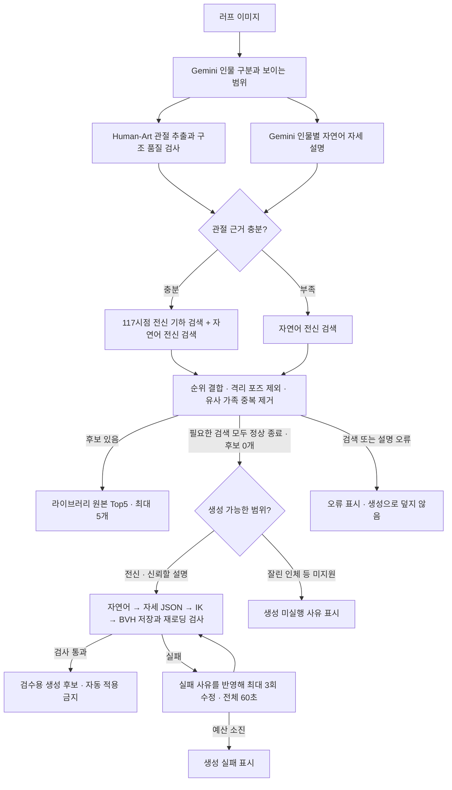

# 전신 동적 라우팅과 API 연결

러프에서 Human-Art 관절과 Gemini 자연어를 추출하고 **라이브러리 원본 포즈 전체를 검색**한다.
관절이 충분할 때도 자연어를 검색해 후보 순위를 결합한다. 상하체 분리 검색, donor 선택,
BVH 합성은 이 경로에서 실행하지 않는다. 검색 결과가 없을 때만 자연어 기반 생성으로 넘어간다.

이 브랜치는 UI·BFF 연결용 실험 구현이다. 배포나 PR은 포함하지 않는다.
`feat/natural-part-text-search-api`의 텍스트 입력 API와 별개이며, 여기서는 기존 `POST /analyze`를 변경한다.

## 파이프라인



그림의 두 추출 노드는 정보 흐름을 뜻한다. 현재 실행 순서는 인물 분석 → 관절 추출·기존 crop
재시도 → 자세 설명이며, 관절 충분 시 **두 검색**을 병렬 실행한다.
두상만 보이거나 얽힌 두 인물은 기존 정책으로 검색을 차단한다. 관절·설명 모두 불충분하면
`undetermined`로 종료한다. 유효 관절만 비교하며, 안 보이는 관절을 VLM이 만들어 채우지 않는다.

## 관절이 잘 보여도 자연어를 사용하는 방법

기하 검색과 자연어 검색이 각각 최대 40개 원본 후보를 제안한다. 같은 포즈가 양쪽에서
선택되면 점수를 합친다. 거리와 문장 점수는 단위가 다르므로 원시값을 더하지 않는다.

`rank_score = 0.65 / (60 + 기하 순위) + 0.35 / (60 + 자연어 순위)`

없는 쪽은 0점이고 한 경로만 사용하면 가중치는 1이다. 최종 후보는 포즈 가족별로 하나씩,
최대 5개다. `rank_score`는 정확도·확률이 아니다. 이 초기 가중치와 거리 컷오프는 실 러프
평가로 보정해야 한다. **자연어의 모든 조건을 강제하는 검증기는 아니며**, 기하 후보가
자연어와 충돌하는 문제를 완전히 해결했다고 볼 수 없다.

117시점은 동일 BVH의 yaw·pitch·원근 투영 비교다. BVH 관절은 바꾸지 않는다.
상반신 관측이면 어깨 기준의 관측 관절만으로 **원본 전신 포즈**를 찾는다.
이것은 상체·하체를 각각 검색하거나 합치는 기능이 아니다. 자동 미러링도 이번 경로에는 없다.

## API 계약

요청은 기존 `POST /analyze`의 multipart `file` 그대로다. 인증·크기 제한도 기존 계약을 따른다.
새 API 목록은 서버의 `/docs`에서 확인한다.

```bash
curl -X POST http://127.0.0.1:8000/analyze -F 'file=@rough.png'
```

새 경로의 단일 결과 목록은 **`people[i].dynamic_search.selected`**다.
구형 `candidates`와 `semantic_candidates`는 빈 목록으로 두므로 UI가 임의로 합치면 안 된다.

| 필드 | 의미 |
| --- | --- |
| `dynamic_search.route` | `hybrid`, `geometric`, `semantic`, `undetermined`, `error` |
| `dynamic_search.status` | `ok`, `no_result`, `partial_error`, `error`, `undetermined`, `blocked` 등 |
| `selected[].pose_id` | 기존 `GET /pose/{id}/bvh`로 가져올 수 있는 라이브러리 원본 ID |
| `selected[].camera` | 기하 검색에서 고른 수치형 시점. 없으면 null |
| `selected[].evidence` | 기하 거리·순위와 자연어 점수·순위를 분리 기록 |
| `selected[].rank_score` | 순위 결합 점수. 확률이나 품질 보증 아님 |
| `branches` | 실행한 검색별 상태·후보·시간·실패 사유 |
| `geometry_evidence` | 관절 충분 여부, 유효 뼈 수, coverage와 기준값 |
| `description_evidence.description` | Gemini가 추출한 실제 자세 문장과 태그 |
| `generation` | 생성 상태·BVH·검사 기록. 원본 selected와 별개 |
| `people[i].keypoints`, `raw_scores` | 추출 관절 좌표와 원본 신뢰도. scores는 refine 안전정책 영향 가능 |

`partial_error`는 검색 한쪽에 오류가 있지만 다른 쪽 후보는 남은 상태다. UI는 오류를 표시하고,
정상 hybrid 성공으로 표시하지 않는다. 설명 오류, DB·인덱스 오류를 생성으로 덮지 않는다.
`selected`가 비어 있는 경우 임의의 기존 포즈를 끼워 5개를 채우지 않는다.

원본 후보도 `actual_mesh_validated=false`, `release_allowed=false`, `refine_allowed=false`다.
이번 경로의 기하·의미 유사성은 실제 피부 메시 건전성을 보장하지 않는다. 후보별 BVH를
기존 3D 뷰어에서 보여주되, 검수 전에 자동 적용·export하지 않는다. 이 API는 렌더 이미지를 생성하지 않는다.

생성 후보는 `generation.candidates[].bvh`의 본문으로만 검수한다. `/pose/{id}/bvh`의
라이브러리 ID로 등록되지 않는다. 검증은 관절 한계·기하 관통·균형·손목·저장 왕복의 수치 검사이며,
실제 스킨 메시 관통과 의미 일치 검증은 별도다. 최초 시도 + 수정 최대 3회가 전체 60초 예산을 공유한다.
60초는 생성 단계 예산이지 `/analyze` 전체 응답시간 상한이 아니다. 생성에는 아직 러프 관절 제약을 전달하지 않는다.

## 실행 설정

이 feature 브랜치의 API는 `ROUTING_FULLBODY_ENABLED`가 **없으면 1**이다.
기존 mock 개발을 위한 `.env.example`에는 명시적으로 0을 넣었다.
0이면 기존 파이프라인 그대로이고, 직접 `Pipeline(...)`을 쓰는 코드도 새 engine을 주입하지 않으면 기존 동작이다.

실제 실행에는 다음 설정과 자산이 필요하다. 원격 모델·라이브러리를 이 커밋에 포함하지 않는다.

```dotenv
ROUTING_FULLBODY_ENABLED=1
POSE_BACKEND=rtmlib
POSE_MODEL_VARIANT=humanart-m
POSE_MODEL_MANIFEST=/absolute/path/to/validated/manifest.json
POSE_CANARY_STAGE=canary-100
POSE_STRICT=1
VLM_PROVIDER=gemini
GEMINI_MODEL=gemini-3.8-flash
GEMINI_API_KEY=<set-secret-outside-git>
DB_PATH=/absolute/path/to/library/poses.db
ROUTING_BVH_ROOT=/absolute/path/to/library/bvh
SEMANTIC_285_TAGS_PATH=/absolute/path/to/library/search-v2.json
SEMANTIC_285_TAXONOMY_PATH=/absolute/path/to/library/search-taxonomy-v2.json
SEMANTIC_285_BODY_INDEX_PATH=/absolute/path/to/library/body.json
SEMANTIC_285_SHAPE_INDEX_PATH=/absolute/path/to/library/shapes.json
POSE_GENERATION_ENABLED=1
POSE_GENERATION_RIG=/absolute/path/to/library/bvh/webtoon_combat_03.bvh
POSE_GENERATION_TAXONOMY=/absolute/path/to/library/search-taxonomy-v2.json
POSE_GENERATION_REVIEW_DIR=/private/review/directory
```

Human-Art manifest의 모델·런타임·라이선스·calibration 검증을 그대로 통과해야 한다.
`SKELETON_KPT_THRESHOLD` 등을 manifest calibration과 맞춰야 하며 위 예시만으로 검증을 우회하지 않는다.
태그·몸 배치·shape 색인은 **동일 라이브러리 버전에 바인딩된 파일**을 지정한다.
`body.json`과 `shapes.json`은 배치 파일명이 다르면 경로를 바꿔야 한다.
기본 예시나 파일 이름이 같다고 현재 라이브러리와 호환되는 것은 아니다.

격리 목록은 geometry와 semantic 양쪽에 적용된다. 미격리 BVH를 읽을 수 없거나 의미 색인이
유효하지 않으면 기동에 실패하며 mock로 숨기지 않는다. 카메라 색인은 기동 시 구축한다.
생성 rig는 코드에 명시된 SHA-256을 만족해야 하며, 불일치는 생성 오류로 반환한다.
생성만 끄려면 `POSE_GENERATION_ENABLED=0`으로 설정한다. 생성 작업은 로컬 검수 폴더에만 저장하고
라이브러리·S3·서비스에 자동 등록하지 않는다.

## 검증과 남은 작업

오프라인 테스트는 충분/부족 관절 분기, 충분해도 자연어 검색, 두 순위 결합,
117시점 투영 일치, 합성·격리 후보 제외, 검색 오류 시 생성 금지, 생성 수정 횟수·시간 제한,
API 결과 직렬화와 기존 경로 회귀를 확인한다.

```bash
python -m pytest -q tests/test_fullbody_routing.py tests/test_natural_pose.py
ROUTING_FULLBODY_ENABLED=0 python -m pytest -q tests/test_search_routing.py \
  tests/test_text_pose_generation.py tests/test_semantic_adapter_285.py \
  tests/test_person_tags.py tests/test_smoke.py
```

다음 검증은 최신 라이브러리 스냅샷을 고정한 실 러프 전후 비교다. 아직 이 브랜치에서
실 Gemini·Human-Art end-to-end 정확도나 지연시간 향상을 주장할 근거는 없다.
별도 브랜치 push는 코드 공유이며 운영 반영이 아니다.
