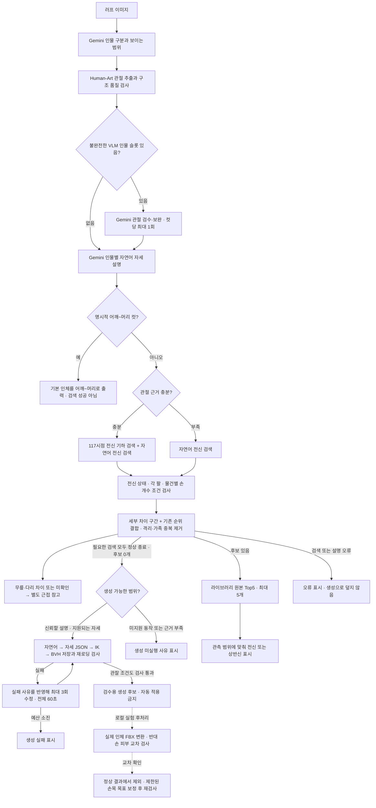

# 전신 동적 라우팅과 API 연결

러프에서 Human-Art 관절과 Gemini 자연어를 추출하고 **라이브러리 원본 포즈 전체를 검색**한다.
관절이 충분할 때도 자연어를 검색해 후보 순위를 결합한다. 상하체 분리 검색, donor 선택,
BVH 합성은 이 경로에서 실행하지 않는다. 검색 결과가 없을 때만 자연어 기반 생성으로 넘어간다.

이 브랜치는 UI·BFF 연결용 실험 구현이다. 배포나 PR은 포함하지 않는다.
저장된 `generated_composition` 포즈도 완성된 전신 BVH로 검색에 포함한다.
이는 요청 중 상하체를 새로 조합하는 기능과 별개다. 품질 격리 목록은 계속 적용한다.
`ROUTING_INCLUDE_STORED_COMPOSITIONS=1`이 기본이며, 0은 이전 제외 방식 비교용이다.
`kind=library_original`은 라이브러리 BVH를 그대로 반환한다는 호환 필드다.
출처는 `selected[].library_source`, 포함 여부는 `stored_compositions_included`로 구분한다.
`feat/natural-part-text-search-api`의 텍스트 입력 API와 별개이며, 여기서는 기존 `POST /analyze`를 변경한다.

## 파이프라인



그림의 두 추출 노드는 정보 흐름을 뜻한다. 현재 실행 순서는 인물 분석 → 관절 추출·기존 crop
재시도 → 조건부 Gemini 관절 검수·보완 → 자세 설명이며, 관절 충분 시 **두 검색**을 병렬 실행한다.
두상만 보이거나 얽힌 두 인물은 기존 정책으로 검색을 차단한다. 관절·설명 모두 불충분하면
`undetermined`로 종료한다. 유효 관절만 비교하며, 검수는 원본 러프·관절 오버레이·좌표를
입력받아 지적된 관절 사슬만 제한적으로 보완한다. 형식 오류·타임아웃에는 원본 관절을
유지하고, 구조 상태가 악화된 수정은 되돌린다. 수치 구조 통과가 시각적 정답을 보장하지는 않는다.
`SKELETON_REPAIR=auto`(기본)는 불완전 슬롯이 있을 때 컷당 최대 1회,
`off`는 비활성, `all`은 진단용 전체 검수다. 기본 호출 제한은 30초다.
명시적 어깨~머리 기본 모델 경로는 설명/구도 근거를 받은 뒤 검색보다 우선한다.
점선의 실제 FBX 피부 검사는 로컬 실험 후처리이며 `/analyze` 서버가 자동 호출하는 단계가 아니다.
상하체를 따로 검색해 조립하는 단계는 없다. 저장된 합성 출처 BVH도 검색 시에는 하나의 전신이다.
API `search_routing.skeleton_repair`에 호출 여부·수정·실패 기록이 남는다.
보완 관절은 `vlm_repair` 출처이며 자동 high 신뢰도·refine은 허용하지 않는다.

## 관절이 잘 보여도 자연어를 사용하는 방법

기하 검색과 자연어 검색이 각각 최대 40개 원본 후보를 제안한다. 같은 포즈가 양쪽에서
선택되면 점수를 합친다. 거리와 문장 점수는 단위가 다르므로 원시값을 더하지 않는다.

`rank_score = 0.65 / (60 + 기하 순위) + 0.35 / (60 + 자연어 순위)`

로컬 가중치 실험은 `FullBodySearch(..., semantic_weight=0.6)`으로 자연어 0.60,
기하 0.40을 비교할 수 있다. 인자는 0과 1 사이의 유한값만 허용한다.
API 팩토리 기본값은 여전히 0.35이며, `ranking` 필드는 실제 적용 가중치를 기록한다.
같은 저장 후보 목록으로 순위만 재계산하면 추출·검색 변동 없이 가중치 효과를 분리한다.

구조화된 물건 관찰이 있는 경우 `pose_query.py`가 물건·잡는 동작·손 개수·위치를
검색 입력에 보존한다. 상세 설명의 손 개수/위치가 짧은 검색문장에서 빠졌으면
상세 설명의 동작 구절을 사용한다. 미소·대화 같은 맥락은 별도 기록하며,
물건 잡기 검색의 미관측 단어 감점으로 쓰지 않는다. 실제 귀에 댄 통화는 유지한다.
`branches.semantic.query_evidence`에 원문·실제 검색문·구조화 태그·제외한 맥락이 남는다.
구조화 태그를 사용해도 스마트폰/휴대폰 같은 문장 어휘의 동의어 덮음 판정은 유지한다.

전신 API 경로는 `pose_requirements.py`로 기하·자연어 양쪽 후보를 같은 조건으로 검사한다.
물건이 없어도 각 팔의 내림/허리/앞으로 뻗음/올림/벌림, 전신 관측의 서기/앉기/눕기를
검사한다. 기하 검색은 전 라이브러리에서 조건을 확인한 뒤 Top40을 고르므로, 기존 Top40에
정답이 없다는 이유만으로 조건 일치 후보가 누락되지 않는다. 물건별 한손/양손 수는 좌우와
독립이며, BVH 해시에 연결된 손 메타데이터를 우선한다. 배경 소품은 잡기 조건에서 제외한다.
핵심 동작 충돌은 제외한다. 핵심 조건의 근거가 없는 후보는 `needs_review`로 기록하고 selected에
채우지 않는다. 무릎·다리 간격의 충돌/미확인은 `near_match`이며 `near_candidates`로만 반환한다.
근접 후보가 있어도 qualified `selected`가 비면 정상 빈 검색의 생성 경로를 실행한다.
다리 간격은 월드 수직축에 투영하지 않고 몸통/골반의 자체 축으로 측정하므로 눕기에도 동일하다.
관측 관절이 충분하면 같은 117시점의 최적 투영에서 몸통 기울기·골반의 발 중심 대비 이동·발목
간격·무릎 각도를 비교한다. 이 수치는 관찰된 2D 차이일 뿐 복원한 3D 각도가 아니다.
핵심 조건/물건·동작 조건 다음으로 세부 차이 구간(0.5 단위)을 먼저 비교하고 구간 안에서 기존
RRF를 유지한다. 자연어/기하 가중치는 바꾸지 않는다. BVH를 수정하거나 부위를 합치지 않는다.
`selected`도 해당 조건 통과일 뿐 러프와 완전히 같은 포즈라는 인증이 아니며 최대 5개다.
`candidate_validation`, `branches.geometry.whole_pose_validation`,
`branches.semantic.query_evidence`, `selected[].core_conditions.whole_pose_validation`에 근거가 남는다.
이 검사는 실험적 BVH 관절 규칙으로, 피부 관통·손가락 접촉·소품 존재를 인증하지 않는다.
생성도 같은 관찰 조건을 재검사하며, 불일치 사유를 기존 60초/최대 3회 수정 루프에 전달한다.
누운 자세에서 핵심 동작은 맞고 다리 간격만 다르면 pelvis 프레임 발목 IK 목표를 좌우 각각
최대 8cm, 2cm 간격으로 수정해 모든 기존 안전 검사를 다시 실행한다. 통과하지 못한 근접 생성은
성공 후보가 아니라 `generation.diagnostics.near_candidates`의 검수 증거로만 남는다.
양손 간 손가락/손바닥 근사체 허용 겹침은 기존 1.5cm에서 0.2cm로 강화했다. 이는 실제 스킨
검사와 별개다. 로컬 실험 보고서는 변환 후 반대 손들의 실제 피부 삼각형 교차도 검사하며,
확인된 교차 후보를 정상/근접 결과에서 제외한다. 이 후처리 검사는 API 서버에 메시 변환기가
연결된 것이 아니며, 손-몸통/소품/동일 손 내부를 포함하는 완전한 충돌 인증도 아니다.
로컬 휴대폰 재검수는 원래 제안의 가슴 프레임 손목 목표를 좌우 각 2/4/6/8cm로 제한해
재계산하고, BVH 안전·관찰 조건과 실제 메시 검사 모두 통과한 최소 이동안을 고른다.
프리셋 손모양만으로 실제 소품 그립을 인증하지 않으며 자동 적용은 계속 금지한다.

없는 쪽은 0점이고 한 경로만 사용하면 가중치는 1이다. 최종 후보는 포즈 가족별로 하나씩,
최대 5개다. `rank_score`는 정확도·확률이 아니다. 이 초기 가중치와 거리 컷오프는 실 러프
평가로 보정해야 한다. 현재 조건 어휘 밖의 행동과 관측 누락은 여전히 검수해야 하며,
정성 평가 정확도는 아직 확정하지 않았다.

117시점은 동일 BVH의 yaw·pitch·원근 투영 비교다. BVH 관절은 바꾸지 않는다.
상반신 관측이면 어깨 기준의 관측 관절만으로 **원본 전신 포즈**를 찾는다.
이것은 상체·하체를 각각 검색하거나 합치는 기능이 아니다. 자동 미러링도 이번 경로에는 없다.

## API 계약

요청은 기존 `POST /analyze`의 multipart `file` 그대로다. 인증·크기 제한도 기존 계약을 따른다.
새 API 목록은 서버의 `/docs`에서 확인한다.

```bash
curl -X POST http://127.0.0.1:8000/analyze -F 'file=@rough.png'
```

새 경로의 단일 결과 목록은 **`people[i].dynamic_search.selected`**다.
구형 `candidates`와 `semantic_candidates`는 빈 목록으로 두므로 UI가 임의로 합치면 안 된다.

| 필드 | 의미 |
| --- | --- |
| `dynamic_search.route` | `hybrid`, `geometric`, `semantic`, `undetermined`, `error`, `basic_model` |
| `candidate_validation` | 전신 상태·각 팔·손 개수 조건과 결측 처리 정책 |
| `near_candidates` | 핵심 동작은 맞지만 다리/무릎 세부 충돌·미확인인 별도 검수 참고. 자동 적용 금지 |
| `selected[].pose_detail_fit` | 동일 카메라 투영의 관측 2D 세부 차이와 수치 근거. 정확도 아님 |
| `dynamic_search.status` | `ok`, `no_result`, `partial_error`, `error`, `undetermined`, `blocked` 등 |
| `selected[].pose_id` | 기존 `GET /pose/{id}/bvh`로 가져올 수 있는 라이브러리 원본 ID |
| `selected[].camera` | 기하 검색에서 고른 수치형 시점. 없으면 null |
| `selected[].evidence` | 기하 거리·순위와 자연어 점수·순위를 분리 기록 |
| `selected[].rank_score` | 순위 결합 점수. 확률이나 품질 보증 아님 |
| `branches` | 실행한 검색별 상태·후보·시간·실패 사유 |
| `geometry_evidence` | 관절 충분 여부, 유효 뼈 수, coverage와 기준값 |
| `description_evidence.description` | Gemini가 추출한 실제 자세 문장과 태그 |
| `generation` | 생성 상태·BVH·검사 기록. 원본 selected와 별개 |
| `people[i].keypoints`, `raw_scores` | 추출 관절 좌표와 원본 신뢰도. scores는 refine 안전정책 영향 가능 |

`partial_error`는 검색 한쪽에 오류가 있지만 다른 쪽 후보는 남은 상태다. UI는 오류를 표시하고,
정상 hybrid 성공으로 표시하지 않는다. 설명 오류, DB·인덱스 오류를 생성으로 덮지 않는다.
`selected`가 비어 있는 경우 임의의 기존 포즈를 끼워 5개를 채우지 않는다.

### 러프에 맞춘 출력 범위

`people[].output_scope.detected`는 VLM이 읽은 구도이며 `mesh_scope`는 실제
변환기에 요청할 범위다. UI/BFF는 `/convert-framed`의 `output_scope`에
`mesh_scope`를 전달한다. `full`은 전신, `half`는 허리 위와 팔·손 보존,
`shoulder_head`는 목·어깨선·머리만 남기는 출력이다. 기존 `bust` 검출은
팔을 잃지 않도록 `mesh_scope=half`로 대응한다. 명시적 두상 `head`는 유지한다.

자세 설명이 머리·목·어깨만 있는 클로즈업이라고 명시하면 half/bust를
shoulder_head로 좁히고 출처를 `vlm_description`으로 기록한다.
관절 부족만으로 좁히지 않으며, full/observed_legs 판정은 우선한다.
새 기본 분석 프롬프트 `p3-output-scope`도 `body_scopes=shoulder_head`를 직접 지원한다.
이전 p1/p2 프롬프트는 보존하며, 명시적으로 p1/p2를 설정한 서버는 그대로 사용한다.

`converter/framing.py`는 피부 가중치로 팔·하체를 구분하고, shoulder_head에서는
몸통 방향의 어깨 절단면을 추가한다. 원본 BVH와 뼈대는 보존한다.
프레이밍 버전은 `skin-regions-v2-shoulder-head`다. 검색 후보가 없는 컷의
기본 인형은 범위 확인용으로만 표시하고 검색 후보나 자동 생성 성공으로 집계하지 않는다.

원본 후보도 `actual_mesh_validated=false`, `release_allowed=false`, `refine_allowed=false`다.
이번 경로의 기하·의미 유사성은 실제 피부 메시 건전성을 보장하지 않는다. 후보별 BVH를
기존 3D 뷰어에서 보여주되, 검수 전에 자동 적용·export하지 않는다. 이 API는 렌더 이미지를 생성하지 않는다.

생성 후보는 `generation.candidates[].bvh`의 본문으로만 검수한다. `/pose/{id}/bvh`의
라이브러리 ID로 등록되지 않는다. 검증은 관절 한계·기하 관통·균형·손목·저장 왕복의 수치 검사이며,
실제 스킨 메시 관통과 의미 일치 검증은 별도다. 최초 시도 + 수정 최대 3회가 전체 60초 예산을 공유한다.
60초는 생성 단계 예산이지 `/analyze` 전체 응답시간 상한이 아니다. 생성에는 아직 러프 관절 제약을 전달하지 않는다.

## 실행 설정

이 feature 브랜치의 API는 `ROUTING_FULLBODY_ENABLED`가 **없으면 1**이다.
기존 mock 개발을 위한 `.env.example`에는 명시적으로 0을 넣었다.
0이면 기존 파이프라인 그대로이고, 직접 `Pipeline(...)`을 쓰는 코드도 새 engine을 주입하지 않으면 기존 동작이다.

실제 실행에는 다음 설정과 자산이 필요하다. 원격 모델·라이브러리를 이 커밋에 포함하지 않는다.

```dotenv
ROUTING_FULLBODY_ENABLED=1
POSE_BACKEND=rtmlib
POSE_MODEL_VARIANT=humanart-m
POSE_MODEL_MANIFEST=/absolute/path/to/validated/manifest.json
POSE_CANARY_STAGE=canary-100
POSE_STRICT=1
VLM_PROVIDER=gemini
GEMINI_MODEL=gemini-3.8-flash
GEMINI_API_KEY=<set-secret-outside-git>
DB_PATH=/absolute/path/to/library/poses.db
ROUTING_BVH_ROOT=/absolute/path/to/library/bvh
SEMANTIC_285_TAGS_PATH=/absolute/path/to/library/search-v2.json
SEMANTIC_285_TAXONOMY_PATH=/absolute/path/to/library/search-taxonomy-v2.json
SEMANTIC_285_BODY_INDEX_PATH=/absolute/path/to/library/body.json
SEMANTIC_285_SHAPE_INDEX_PATH=/absolute/path/to/library/shapes.json
POSE_GENERATION_ENABLED=1
POSE_GENERATION_RIG=/absolute/path/to/library/bvh/webtoon_combat_03.bvh
POSE_GENERATION_TAXONOMY=/absolute/path/to/library/search-taxonomy-v2.json
POSE_GENERATION_REVIEW_DIR=/private/review/directory
```

Human-Art manifest의 모델·런타임·라이선스·calibration 검증을 그대로 통과해야 한다.
`SKELETON_KPT_THRESHOLD` 등을 manifest calibration과 맞춰야 하며 위 예시만으로 검증을 우회하지 않는다.
태그·몸 배치·shape 색인은 **동일 라이브러리 버전에 바인딩된 파일**을 지정한다.
`body.json`과 `shapes.json`은 배치 파일명이 다르면 경로를 바꿔야 한다.
기본 예시나 파일 이름이 같다고 현재 라이브러리와 호환되는 것은 아니다.

팔 상태 색인 `bvh-body-v2-torso-relative-arms`는 골반→어깨의 몸통 축을 기준으로
손·팔꿈치 위치를 계산한다. 엎드림·기울임 때문에 월드 높이가 낮아진 손을
곧바로 `lowered`로 판정하지 않는다. 판정 구간 밖은 `unknown`으로 유지한다.
기존 `bvh-body-v1` 캐시는 새 코드에서 거부하므로 같은 DB·태그·BVH로
`scripts/build_semantic_body_index.py`를 실행해 다시 만들고
`SEMANTIC_285_BODY_INDEX_PATH`에 지정해야 한다.

휴대폰의 양손 조건은 설명에 명시된 한 손 사용만 충돌로 처리한다.
설명에 손 개수가 없으면 양손 여부는 미확인이며, 양손 확인 가점을 주거나
한 손으로 단정해 0.25배 감점하지 않는다. 다른 행동·자세의 관련성 검사는 유지한다.

자세 설명 `d3-observed-body-anatomical-hands`는 `held_object_hands`에 물건별
인물 본인 기준 `left/right/both/unknown`을 기록한다. 화면 좌우와 구분하며,
가려지거나 모호하면 `unknown`으로 기권한다. `SemanticQuery`까지 이 필드를
전달하고, 자연어·기하 검색 후보 모두에서 좌우 조건을 확인한 뒤 가족 중복을 제거한다.
라이브러리는 `meta.body_parts.hands`의 물건별 손 기록을 사용하되,
`meta.bvh_sha256`이 몸 색인의 `source_sha256`과 일치할 때만 인정한다.
미러 포즈의 손 기록은 이미 교환되어 있으므로 다시 뒤집지 않는다.
메타데이터가 없거나 바인딩이 다르면 좌우는 미확인이며 일치로 표시하지 않는다.
이는 라이브러리에 존재하는 미러 BVH를 고르는 과정이며 PNG 반전이나 새 합성이 아니다.

격리 목록은 geometry와 semantic 양쪽에 적용된다. 미격리 BVH를 읽을 수 없거나 의미 색인이
유효하지 않으면 기동에 실패하며 mock로 숨기지 않는다. 카메라 색인은 기동 시 구축한다.
생성 rig는 코드에 명시된 SHA-256을 만족해야 하며, 불일치는 생성 오류로 반환한다.
생성만 끄려면 `POSE_GENERATION_ENABLED=0`으로 설정한다. 생성 작업은 로컬 검수 폴더에만 저장하고
라이브러리·S3·서비스에 자동 등록하지 않는다.

## 검증과 남은 작업

### develop 손 모양·다인 장면 기능과의 통합 (2026-10-17)

`people[].hands`와 손 카탈로그·썸네일 API는 동적라우팅과 함께 유지한다.
`VLM_HAND_SHAPES=1`인 경우 별도 손 추천 호출 결과를 모든 검색 경로의
descriptor 생성 전에 합친다. hybrid·자연어 전용 경로에서도 인물별 손 정보가
누락되지 않으며, 꺼짐/실패 시에는 기존 기본 손과 상태를 반환한다.
손 프리셋은 검색 조건·순위에 섞지 않는다. 자세 설명과 손 모양 호출의
프롬프트·타임아웃은 서로 독립이며 `p3-output-scope` 기본 구도를 유지한다.

develop의 손 FBX 굽기·다인 장면 변환 모듈과 API는 그대로 유지한다.
다인 **장면 배치**와 금지된 런타임 **상하체 분리 검색·합성**은 별개이며,
후자는 계속 비활성이다. 이 통합은 자동 배포나 생성 후보의 자동 export를 허용하지 않는다.

오프라인 테스트는 충분/부족 관절 분기, 충분해도 자연어 검색, 두 순위 결합,
117시점 투영 일치, 저장 합성 포즈 포함·격리 후보 제외, 검색 오류 시 생성 금지, 생성 수정 횟수·시간 제한,
API 결과 직렬화와 기존 경로 회귀를 확인한다.

```bash
python -m pytest -q tests/test_fullbody_routing.py tests/test_natural_pose.py
ROUTING_FULLBODY_ENABLED=0 python -m pytest -q tests/test_search_routing.py \
  tests/test_text_pose_generation.py tests/test_semantic_adapter_285.py \
  tests/test_person_tags.py tests/test_smoke.py
```

다음 검증은 최신 라이브러리 스냅샷을 고정한 실 러프 전후 비교다. 아직 이 브랜치에서
실 Gemini·Human-Art end-to-end 정확도나 지연시간 향상을 주장할 근거는 없다.
별도 브랜치 push는 코드 공유이며 운영 반영이 아니다.

## 2026-10-16 로컬 동작·좌우 재실험

`d4-visible-action-relations`는 물건을 쥔 손 외에 머리/얼굴에 손, 손목·시계 확인 등
관찰 관계를 전달한다. 독립 VLM 검수는 이전 좌우 답을 주지 않고 팔 연결을 다시 묻는다.
불명확·충돌·호출 실패는 `unknown`이며, 모델 간 동의는 정답 인증이 아니다.
머리 근처 손은 원본 해시가 일치하는 BVH의 근사 관절 거리로 비교하고,
시계 확인의 좌우는 BVH와 연결된 authored active_hand를 사용한다. 시선·손목 회전 인증은 아니다.
구체 동작(예: 턱걸이)을 단순 팔 들기로 대체하지 않는다.

관절이 없는 머리·어깨 컷도 설명 근거를 평가한다. 중립 인형의 방향 참고는
`framing_references`에만 반환하며 검색 성공으로 세지 않고 빈 검색의 생성을 막지 않는다.
상반신/클로즈업도 정상 빈 검색이면 생성 검증을 실행한다. 시스템 오류는 생성으로 덮지 않는다.
설명 추출의 일시 오류는 최대 1회 재시도한다.

실험 산출물은 workspace `tmp/standin-local-routing/set2-relations-10/`에 있다.
이전 set2 10장·최종 Human-Art/VLM 관절을 고정하고 설명만 새로 추출했다.
라이브러리 5,809개/검색 5,798개, 117시점, 기하 .4/자연어 .6을 유지했다.
원본 Top5 목록은 5장 변경됐으며 정확도 개선률을 의미하지 않는다.
276의 올린 손은 개선됐지만 앉은 하체 후보 및 출력 범위 충돌이 남았다.
084는 시계 확인 후보가 상위로 올라왔다. 067·086은 생성 검증 실패, 191은 설명 오류,
168은 독립 좌우 검수 실패로 원본·미러를 함께 제시했다. 새 상하체 합성은 하지 않았다.
실패 생성은 같은 설명으로 후속 검색을 재생할 때 기록을 재사용했고, 성공으로 바꾸지 않았다.
S3/서비스/원격 브랜치에 업로드하지 않았다.
