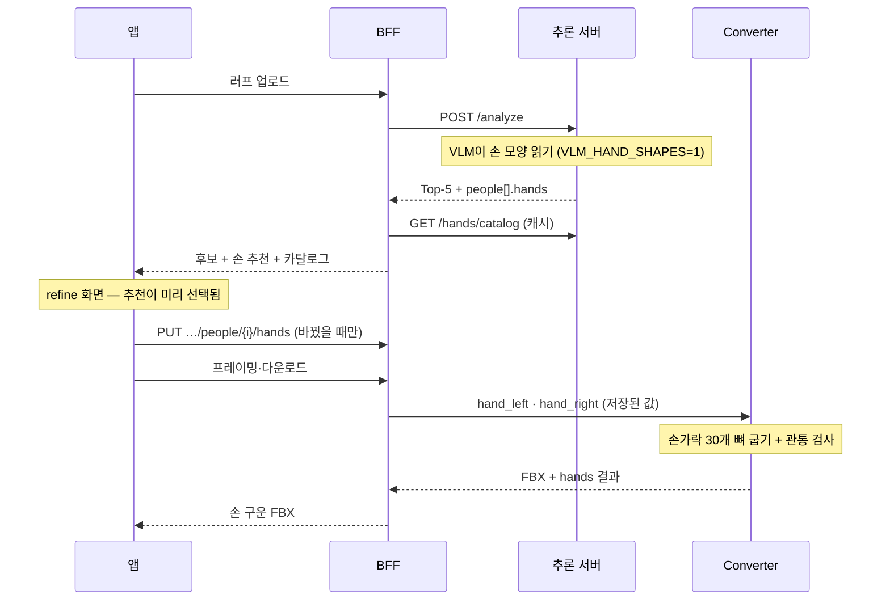

# 손 선택 설계 — refine 화면 · BFF · API (04J-290)

Top-5에서 포즈를 고른 다음 화면(refine)에서 인물별 왼손·오른손을 확인한다. VLM이 러프에서 읽은 손이
**미리 골라져 있고**, 사용자는 바꾸고 싶을 때만 바꾼다. 고른 손은 미리보기와 다운로드 FBX에 **구워진다**.

- 서버(추론 서버·converter)는 이 저장소에 구현돼 있다(PR #89).
- **BFF·앱은 아직 없다.** 이 문서의 §4·§5가 BFF·UI 담당이 만들 것이다.
- 손 라이브러리 자체(79종, 각도 규약, 관통 검사): [`HAND_LIBRARY.md`](HAND_LIBRARY.md)
- HTTP 계약 원문: [`API_CONTRACT.md`](API_CONTRACT.md)의 손 절

---

## 0. BFF·UI 담당이 할 일 (한눈에)

| 쪽 | 할 일 | 참고 |
|---|---|---|
| BFF | 분석 결과의 `people[].hands`를 인물별로 저장(추천값·최종값 따로) | §4 |
| BFF | `PUT /v1/analysis/jobs/{jobId}/people/{personIndex}/hands` | §4 |
| BFF | `GET /v1/hands/catalog`, 썸네일 중계(추론 서버 응답 그대로, 캐시 헤더 유지) | §4 |
| BFF | 프레이밍·다운로드 때 저장된 손을 converter `hand_left`·`hand_right`로 전달, 결과 캐시 키에 손 포함 | §3·§4 |
| UI | refine 인물 카드에 손 칩 2개(왼손·오른손) | §5 |
| UI | 칩을 누르면 선택 시트: 추천 후보 4개 → 묶음 탭 9개 → 전체 79종, 검색 | §5 |
| UI | "추천으로 되돌리기", VLM 실패 안내 한 줄 | §5·§6 |

**꼭 지킬 것 두 가지**
1. `left`/`right`는 **캐릭터 자신의** 손이다. 화면 좌우가 아니다. 정면 인물이면 화면 오른쪽 손이 `left`다. UI에서 좌우를 뒤집지 않는다.
2. 손을 바꿔도 **refine 3D 미리보기는 바로 바뀌지 않는다**(칩 썸네일만 바뀜). 구워진 손은 프레이밍·다운로드 결과에서 보인다.

목업용 예시 데이터: [`examples/hands/analyze_people_hands.json`](examples/hands/analyze_people_hands.json)(실제 Gemini 결과, 3명),
[`examples/hands/catalog.json`](examples/hands/catalog.json)(실제 카탈로그 전체).

---

## 1. 흐름



손은 몸 포즈 검색과 **별개**다. 손을 바꿔도 Top-5나 refine을 다시 돌리지 않는다.

---

## 2. 추론 서버 API (구현 완료)

| 호출 | 용도 | 비고 |
|---|---|---|
| `POST /analyze` → `people[].hands` | 인물별 추천 손과 후보 | `VLM_HAND_SHAPES=1`일 때 별도 VLM 호출로 채움. 관절 추출과 동시에 돌아 지연 거의 없음 |
| `GET /hands/catalog` | 손 칩·선택 시트 목록 | 79종·9묶음, 라벨·설명·썸네일 경로·`library_sha256`. `max-age=3600` + ETag |
| `GET /hands/{preset_id}/thumbnail?side=left\|right` | 칩용 마네킹 손 PNG | 224×224 투명 배경, `max-age=86400` + ETag, 304. 라이브러리와 안 맞는 옛 그림은 404 |

`people[].hands` 한 인물(실제 예시 일부):

```json
{
  "left":  {"preset": "hold_phone", "source": "vlm", "confidence": "high", "visible": true,
            "candidates": ["hold_phone", "grip", "cup", "pinch"]},
  "right": {"preset": "relaxed", "source": "default", "confidence": null, "visible": false,
            "candidates": ["relaxed", "fist", "open", "grip"]},
  "library_version": "hand-library-v1",
  "status": "vlm"
}
```

- `preset`: 미리 골라 둘 값. VLM이 보이는 손에 모양을 골랐으면 그 값, 안 보이거나 실패면 `relaxed`.
- `source`: `vlm`(VLM이 고름) · `default`(기본값).
- `visible`: `false`면 그림에 손이 안 보인다고 VLM이 판단한 것. UI는 "기본"으로 흐리게 표시.
- `candidates`: 최대 4개, 첫 번째 = `preset`. VLM 1순위 → 대안 → 1순위와 같은 묶음 → 기본 순서.
- `status`: `vlm`(읽음) · `not_requested`(기능 꺼짐) · `unavailable`(호출 실패·인원 불일치). **어느 경우든 `preset`·`candidates`는 채워져 온다.**

카탈로그 응답 구조(전체는 예시 파일):

```json
{
  "schema_version": 1,
  "library_version": "hand-library-v1",
  "library_sha256": "c031c50f…",
  "default_preset": "relaxed",
  "fallback_order": ["relaxed", "fist", "open", "grip"],
  "thumbnails_available": true,
  "categories": [
    {"id": "basic", "label": "기본", "presets": [
      {"id": "open", "label": "편 손", "description": "손가락을 곧게 펴고 살짝 벌린 손. …",
       "thumbnails": {"left": "/hands/open/thumbnail?side=left", "right": "/hands/open/thumbnail?side=right"}}
    ]}
  ]
}
```

썸네일 경로는 추론 서버 기준 상대 경로다. BFF가 중계하면 앞부분을 BFF 경로로 바꿔서 내려준다.

---

## 3. Converter API (구현 완료)

손은 FBX를 만들 때 굽는다. 몸 포즈는 그대로 두고 손가락 30개 뼈만 바꾼 뒤 `rigged_rest`로 다시 내보낸다.
몸 뼈가 바뀌지 않았는지(1e-5)와 손가락 관통이 없는지를 함께 검사해 결과에 남긴다.

| 항목 | 내용 |
|---|---|
| 요청 | `/convert`, `/convert-bundle`, `/convert-framed` 폼에 `hand_left`, `hand_right`(프리셋 id, 선택). 둘 다 없으면 손을 굽지 않고 지금과 같은 결과 |
| 응답 | `/convert`·`/convert-bundle`: 헤더 `X-Standin-Hands`(JSON). `/convert-framed`: 본문 `"hands"`. 번들 manifest `options.hands` |
| 확인 | `GET /healthz` → `hand_library {version, sha256, presets}`. 손 기능 없는 이미지면 `null` |
| 오류 | 모르는 id → `400 INVALID_HAND_PRESET`. `force_exact_v324`와 함께 쓰면 거부 |

```json
{
  "version": "hand-bake-v1",
  "library_version": "hand-library-v1",
  "library_sha256": "c031c50f…",
  "left": "hold_phone", "right": "relaxed",
  "applied_bones": 30,
  "body_bones_preserved": true,
  "self_collision_free": true
}
```

---

## 4. BFF 설계 (제안 — BFF 담당이 확정)

BFF는 손 선택을 **인물별로 저장**하고, 프레이밍·다운로드 때 저장된 값을 converter에 넘긴다.
앱이 변환 요청마다 손을 보내지 않아도 되게 하는 것이 목적이다.

- **저장 단위**: 분석 job의 인물(`personIndex`)별 `{left, right}`. 추천값(`recommended`)과 최종값(`selected`)을 따로 둔다(추천 대비 변경률을 나중에 볼 수 있다).
- **처음 값**: `/analyze` 결과의 `people[].hands.{left,right}.preset`을 `recommended`와 `selected`에 같이 넣는다.
- **변경**: `PUT /v1/analysis/jobs/{jobId}/people/{personIndex}/hands`

```jsonc
// 요청 — 한쪽만 보내면 다른 쪽은 유지
{"left": "grip", "right": "point", "library_sha256": "c031c50f…"}
// 응답 200
{"left": "grip", "right": "point",
 "recommended": {"left": "hold_phone", "right": "relaxed"},
 "changed": ["left", "right"]}
```

- **id 검사**: BFF가 캐시한 카탈로그로 먼저 하고, 최종 검사는 converter가 한다.
- **카탈로그 중계**: `GET /v1/hands/catalog`와 썸네일은 추론 서버 응답을 그대로 넘기고 캐시 헤더(ETag 포함)를 유지한다. CDN에 올려도 된다.
- **변환 시**: 프레이밍·다운로드는 저장된 `selected`를 `hand_left`/`hand_right`로 converter에 넘긴다. 결과 캐시 키에 손 두 값과 `library_sha256`을 넣는다. 손만 바꿔도 새로 굽는다.
- **경합**: 변환 중에 손이 바뀌면, 끝난 결과의 `hands`가 저장값과 다르므로 그 결과는 버리고 `409 HANDS_CHANGED`로 앱에 다시 요청하게 한다.
- **converter가 손 기능이 없을 때**(`healthz.hand_library == null`): 손을 보내지 않고 기본 손 FBX를 준다.

---

## 5. 앱 화면 (refine)

1. **인물 카드마다 손 칩 두 개**(왼손·오른손, 캐릭터 기준). 칩에는 썸네일과 라벨.
   VLM이 고른 손에는 "추천" 표시, 안 보이던 손(`visible: false`)은 흐리게 "기본".
2. **칩을 누르면 선택 시트**. 맨 위 줄은 `candidates` 4개, 그 아래 9개 묶음 탭과 전체 79종. 검색은 라벨·설명으로 거른다.
3. **고르면 바로 저장**(`PUT …/hands`). 3D 미리보기는 칩 썸네일만 바뀐다.
4. **"추천으로 되돌리기"** 버튼으로 `recommended`로 돌아간다.
5. 여러 명이면 인물 순서는 refine 화면의 인물 순서와 같다(`personIndex`).

`status`가 `unavailable`이면 칩 위에 "손 자동 인식 실패 — 기본 손" 한 줄을 띄운다. 선택은 그대로 가능하다.

```text
┌ 인물 1 ───────────────────────────┐
│ [✋ 왼손: 휴대폰 쥐기 · 추천]       │
│ [🖐 오른손: 힘 뺀 손 · 기본(흐림)]  │
│ (추천으로 되돌리기)                 │
└───────────────────────────────────┘
선택 시트(오른손)
  추천 후보  [힘 뺀 손][주먹][편 손][쥐는 손]
  묶음 탭    기본 · 물건 쥐기 · 무기 · 스포츠·공 · 도구·악기 · 일상 동작 · 제스처 · 감정 표현 · 액션·감정
  [검색: 칼, 컵, 기침 …]
  [썸네일 그리드 …]
```

---

## 6. 오류·예외 규칙

| 상황 | 처리 |
|---|---|
| VLM 손 호출 실패·시간 초과(15초) | `status: unavailable`, 양손 `relaxed`. 분석 자체는 성공 |
| VLM 인원 수가 감지 인원과 다름 | 매칭하지 않고 `unavailable`(엉뚱한 사람에게 손이 붙는 것 방지) |
| VLM이 목록 밖 id를 냄 | 그 손은 `relaxed`, `source: default` |
| 앱이 모르는 id 저장 시도 | BFF `400 INVALID_HAND_PRESET` |
| 라이브러리가 바뀌어 `library_sha256` 불일치 | BFF `409 HAND_LIBRARY_CHANGED`. 앱은 카탈로그를 다시 받고, 없어진 id는 `relaxed`로 바꾼다 |
| 썸네일 없음·해시 불일치 | `thumbnails_available: false`, 썸네일 404. 앱은 라벨만 보여준다 |
| converter가 손 기능 없는 이미지 | `healthz.hand_library == null`. BFF는 손을 보내지 않고 기본 손 FBX를 준다 |
| 굽기 후 관통·몸 뼈 변화 감지 | converter 실패(5xx). 손 없이 재시도하지 않고 오류로 보고한다 |

---

## 7. 배포 순서

뒤쪽(converter)부터 앞쪽(앱)으로. 앞 단계가 없어도 뒤 단계는 기존 동작 그대로라 끊기지 않는다.

1. **converter** — 손 파라미터가 없으면 지금과 같다. `healthz.hand_library` 확인.
2. **추론 서버** — `VLM_HAND_SHAPES=0`으로 먼저. 카탈로그·썸네일만 열림. 이후 `1`로 켠다.
3. **BFF** — 저장·PUT·중계·캐시 키.
4. **앱** — refine 손 칩과 선택 시트.

## 8. 실험 근거

gemini-3.8-flash, 러프 24컷 · 손 91개, 사용자 검수(2026-10-15): 보이는 손 자동 정답 92%(47/51), 후보 4개 안 98%(50/51),
안 보이는 손 판단 100%(40/40). 검수자가 추천을 보고 채점해 후할 수 있다. 엄격한 초안 정답 기준으로는 자동 72~74%, 후보 4개 91%.
→ "자동으로 굽고, 틀리면 후보에서 고르기" 설계를 유지한다.
