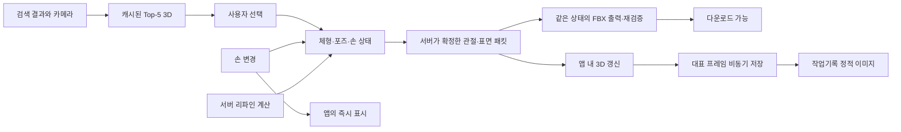

# 앱 내 3D 포즈 표시와 비동기 FBX 생성·검증 설계

작성일: 2026-11-04 KST. 상태: 구현 전 설계안. 코드 변경·앱 실행·배포·유료 추론은 하지 않았다.

## 1. 제품 결정

캡처/업로드 검색 Top-5, 손 수정, 리파인 결과, 최종 확인은 앱 내 3D로 표시한다. 작업기록/대시보드의 작업 목록과 자연어 검색 결과 목록은 정적 포스터를 유지한다. 자연어 검색도 후보를 선택해 상세·손 수정·최종 확인에 들어가면 공통 3D 뷰어를 사용한다.

포즈 결과를 표시하는 화면의 정책이다. 입력 러프, 손 프리셋 견본, 스킨 견본, 체형 카드 등의 기존 이미지까지 삭제하는 결정은 아니다. 첫 단계에서는 Top-5의 기본 체형 비교 정책을 유지한다. 다섯 후보를 사용자 커스텀 체형으로 서버에서 매번 변환하지 않는다.

원하는 사용자 흐름:

| 화면/행동 | 표시 | 파일 처리 |
|---|---|---|
| 캡처 Top-5 도착 | 준비된 3D 포즈를 검색 카메라 시점으로 표시, 자유 회전 | 후보 표시 때문에 FBX 생성하지 않음 |
| 후보 선택 | 선택한 체형의 편집용 3D 준비, 기존 포즈 표시 | 결과 버전에 맞는 FBX 준비 시작 |
| 손 프리셋 변경 | 지원 리그에서 손을 앱 안에서 바로 갱신 | 손 변경을 묶어 최신 버전만 비동기 생성·검증 |
| 리파인 진행 | 기존 포즈를 계속 표시, 보정 중 상태 | 서버에서 기존 자동 보정 계산 |
| 리파인 계산 완료 | 보정된 관절·표면 상태를 받아 즉시 3D 갱신 | 같은 상태를 FBX로 출력·재검증 |
| FBX 준비 완료 | 3D 조작은 계속 가능, 다운로드 버튼 활성화 | 검증한 동일 파일을 명시적 다운로드 동작으로 저장 |
| 작업기록 목록 | 대표 정적 이미지 | 대표 프레임을 비동기로 보관, 목록에서 3D를 여러 개 켜지 않음 |
| 자연어 검색 목록 | 기존 정적 이미지 | 선택 후부터 공통 3D 흐름 |

‘바로’는 로드된 자산에 대한 로컬 손 조작과, 서버 리파인 **계산 완료 후 파일 출력을 기다리지 않는 표시**를 뜻한다. 리파인 계산·체형 준비·최초 다운로드 자체를 없앤다는 뜻은 아니다.

## 2. 현재 구현에서 확인한 사실

원격 develop의 다음 커밋을 읽었다. 운영/설치 앱의 배포 상태나 실제 지연을 확인한 결과는 아니다.

- Client: `5fe483e936e2a2ac22e9df9242a5a193504e4241`
- BFF: `37adaa616b21ac49933974f73b56fbc5c575b0c2`
- Server/Converter: `592ab0f059089e64a5c88a3ad607539124e8e6c6`

| 현재 경로 | 사실과 설계에 미치는 영향 |
|---|---|
| `PoseCandidateCard.tsx` / `posePoster.ts` | Top-5는 기본 체형 포스터 이미지. 손·선택 체형에 종속되지 않음 |
| `modelContract.ts` / `preview_model.py` | 현재 GLB는 검증 FBX의 평가된 정적 표면. skins/animations를 허용하지 않으며, 손 관절을 로컬 편집할 수 없음 |
| `mountReviewModel.ts` | 현재는 정투영, 최초/resize 렌더. 완전한 orbit 조작과 검색 원근 전달을 추가해야 함 |
| `useFramedReview.ts` | `ready`로 FBX 생성·검증 결과를 받고 이미지는 별도 조회. 이미 다운로드 준비와 PNG 대기를 분리함 |
| BFF `framingRoutes.ts` / `finalPreview.ts` | `previewFormat:none`으로 파일 준비 후, 동일 FBX를 `/render-final-preview`에 보내 PNG를 만듦 |
| `useRefineSelection.ts` / BFF `refine/service.ts` | 조건에 따라 이미지 생성을 지연시키는 기존 경로가 있음. 새 설계에서는 대상 화면의 인라인 PNG 경로를 제거 |
| Converter `worker.py` / `hands.py` | 기존 몸 변환에서 초기 FBX를 출력하고, `bake_hands(path)`가 그 FBX를 읽어 손 적용. 화면만 바꿔서는 이 중간 FBX 비용을 제거할 수 없음 |
| Converter `retarget_cache.py` 관련 worker 조건 | 손 반복 변경용 베이스 재사용 경로가 있지만 shape/preview_model 등 조건 제한이 있음. 모든 체형에 이미 적용된 최적화라고 취급하지 않음 |

따라서 **정적 포스터 → canvas 교체**와 **손/보정 상태를 파일 출력보다 먼저 전달**은 서로 다른 작업이다. 두 가지를 모두 구현해야 목표에 도달한다.

## 3. 구조: 화면 상태와 출력 파일의 공통 원본

공통 원본은 서버가 확인한 `SolvedPoseState`다. Client는 화면에 보이는 결과를 참고해 별개의 FBX를 재계산하도록 주문하지 않는다. 서버는 동일 상태를 화면 패킷과 파일로 나눈다. 클라이언트가 보낸 관절/메시를 서버가 검증 없이 최종 정답으로 신뢰하지 않는다.

두 개의 준비 상태를 둔다:

- `previewState`: loading / local-draft / solving / authoritative / error.
- `exportState`: not-requested / queued / building / validating / ready / failed / superseded.

화면 렌더 실패와 파일 실패는 독립이다. 검증된 파일이 준비되면 이미지나 GPU 문제로 다운로드를 막지 않는다. 반대로 화면에 인형이 보여도 최신 파일의 검증이 끝나기 전에는 다운로드 준비 완료로 표시하지 않는다.

## 4. Top-5 3D

### 자산

이미 동결·검증된 라이브러리 포즈의 경량 정적 GLB를 재사용한다. 3D 표면이 고정이어도 전체를 회전해 관찰하는 데는 문제가 없다. 현재 자산의 존재·해시·모든 출력 범위 coverage를 먼저 목록으로 검증한다. 누락 시 각 카드가 Converter를 자동 실행하는 구조를 만들지 않는다.

Top-5 응답은 승인된 모델 자산 식별자/버전, BVH SHA, 기본 체형 SHA, 출력 범위와 검색 카메라를 전달한다. 앱은 Top-1부터 점진적으로 표시하고 화면에 보이는 나머지 후보를 제한된 동시성으로 준비한다. 숨겨진 인물·탭의 수십 개 모델을 한꺼번에 파싱하지 않는다.

캐시된 정적 표면을 먼저 표시하고 선택한 후보의 편집용 리그 자산은 미리 준비할 수 있다. 이 준비가 Top-5 첫 표시나 포즈 선택 버튼을 막지 않는다. 선택 시 다른 기본 포즈를 잠깐 보여 주는 전환은 피한다.

### 조작

- 카드 안 드래그: 좌우 360도와 상하 궤도 회전. 초기에는 뒤집힘을 방지하는 극점 제한을 두고, 전체 구면 탐색이 가능하게 한다.
- 확대 아이콘: 큰 공통 뷰어로 열기. 이곳에서 회전·줌·이동·최초 시점 복원 제공.
- 포즈 선택: 기존 명시적 선택 버튼 유지. 드래그를 클릭 선택으로 잘못 처리하지 않음.
- 페이지/가로 카드 스크롤과 뷰어 입력 충돌 방지. 작은 카드의 세로 휠은 기본 페이지 스크롤로 두고 줌은 확대 뷰어에서 제공.
- 관찰용 회전은 선택/포즈/저장 방향을 바꾸지 않음. ‘처음 시점’은 정면이 아니라 검색으로 찾은 초기 시점.
- 키보드로 회전·복원·확대·포즈 선택을 할 수 있어야 함.

## 5. 손을 즉시 바꿀 수 있는 자산과 규칙

현재 정적 GLB 검증기를 완화하지 않고 별도 `interactive-pose-model-v1` 계약을 추가한다. 허용하는 구조는 내부 버퍼의 mesh, skin, 정해진 humanoid bones, inverse bind matrices, weights, bounded morph/표면 보정 데이터다. 외부 URI·스크립트·임의 확장·무제한 애니메이션은 받지 않는다.

캐릭터별로 필요한 데이터:

- mesh topology·법선·단위·좌표계, rig profile과 bone parent/rest 행렬
- skin weights와 inverse bind matrices, 출력 범위별 crop/cap 정보
- 검수된 손 프리셋의 **해당 리그 로컬 좌표** 회전, 손목/손가락 축 정의, 손 라이브러리 hash
- 몸/손가락 한계 및 호환되는 보정 규칙의 버전
- 현재 체형에 베이크된 기준 표면과 shape hash. 미지원 shape를 단순 스케일로 흉내 내지 않음

즉시 표시:

1. 지원 리그 자산과 손 라이브러리가 로드되면 선택한 손의 관절 행렬만 갱신한다.
2. 몸통·반대손·손목은 프리셋이 명시적으로 담당하는 범위 외에는 보존한다. 원본 BVH 손가락과 수동 프리셋 우선순위는 서버와 같게 유지한다.
3. 서버와 동일한 축·제한·순서·surface 보정을 공유 데이터/결정적 모듈로 적용한다. 독립적으로 비슷한 손 모양을 재작성하지 않는다.
4. 최신 revision을 서버에 보내 저장 상태를 준비한다. 화면에는 작은 상태 표시 ‘변경 적용 중’을 둔다.
5. 서버 확정 패킷과 비교하고, 차이가 허용 오차를 넘으면 최신 확정 표면으로 교체한다. 검증 전 로컬 예측을 최종 파일과 동일하다고 표시하지 않는다.

모든 형태의 보정이 GPU skinning만으로 재현되지는 않는다. 해당 shape/rig에 정확한 로컬 적용이 검증되지 않았으면 이전 서버 확정 포즈를 유지하면서 변경 중 상태를 표시하고, 패킷 도착 시 변경한다. 다른 모델로 바꾸거나 종이인형으로 대체하지 않는다. 미지원 개인 FBX·CS3C에는 이 기능의 capability를 자동 부여하지 않는다.

요청은 200~300ms의 제안 debounce와 supersede를 사용하되 입력의 즉시 시각 반영은 debounce하지 않는다. 이미 시작한 고비용 작업은 가능한 단계에서 취소하고, 최신 작업이 오래된 요청 뒤에 계속 쌓이지 않게 한다.

## 6. 리파인: 계산 완료와 파일 출력 완료 분리

러프 관측/VLM·기존 자동 보정 흐름, 인물 소유권, 관절 제한, base 복구, selector 안전 게이트는 유지한다. 화면 전환 때문에 추가 VLM 호출을 넣지 않는다.

목표 순서:

1. 서버의 기존 리파인이 선택한 포즈를 계산한다. 이 동안 기존 인형은 계속 회전해 볼 수 있다.
2. 보정 BVH가 결정되면 선택 체형으로 retarget/손 적용/표면 보정을 계산한다.
3. 필요한 pose/surface 안전 검사를 거친 **파일 출력 전 상태**를 `SolvedPoseState`로 고정하고, 검증 가능한 화면 패킷을 먼저 게시한다.
4. 앱이 그 패킷을 표시한다. raw BVH 관절을 임의의 공통 인형에 바로 꽂아 최종 체형 결과라고 하지 않는다.
5. 같은 고정 상태에서 FBX 출력·새 프로세스 재읽기·관절/표면/skin/범위/해시 검증을 수행한다.
6. 파일 검증 통과 시 해당 revision의 다운로드를 연다. 실패 시 화면은 남길 수 있지만 저장 가능 상태는 내지 않는다.

리파인 결과를 얻기 전에 보정 완료 자세를 즉시 보여 주는 것은 약속하지 않는다. 또한 서버 solve에는 필요한 안전 계산이 남는다. 줄이는 대상은 그 후의 FBX 입출력·PNG 작업으로 인한 화면 대기다.

새 worker 구조는 solve 단계와 exporter를 나눈다. 같은 살아 있는 scene을 순서대로 읽거나, 검증된 pose+surface 상태를 독립 저장 후 두 소비자가 사용한다. 같은 메모리 scene을 동시에 수정하지 않는다. 재시작 시 같은 snapshot에서 재현 가능한 상태를 보관하며, 불가능하면 재계산 사실과 비용을 기록한다.

**현행 frozen solver는 초기 FBX 출력이 함수에 묶여 있다.** 1차 어댑터가 이 파일을 사용한다면 첫 패킷이 그 비용을 여전히 기다린다고 기록한다. 진짜 출력 전 패킷은 새로운 버전의 solve/export 경계를 구현하고 동결 대조군과 동등성 검증 후 활성화한다. `retarget.py`나 동결 SHA를 조용히 수정하거나 검증을 생략해 빠르게 만들지 않는다.

손만 바뀌면 body/refine 상태를 재사용하고 해당 손 변경과 최종 검증만 수행한다. 새 손이 refine의 접촉 제약 입력인 경로는 그 의존성까지 명시적으로 무효화한다. 리파인이 늦게 끝나도 가장 최근의 사용자가 선택한 손 위에 적용하며, 오래된 손으로 되돌리지 않는다.

## 7. 카메라: 회전과 원근을 끝까지 보존

`rotation`만 전달해서는 현재 검색 원근을 재현할 수 없다. 검색 카메라의 projection, 회전, torso 기준 거리, 중심·scale·crop 변환을 함께 버전 관리한다. Y-up/hip-origin과 검색 좌표의 변환을 명시하고 golden case로 검증한다.

- 정투영 검색이면 OrthographicCamera, 원근 검색이면 동등한 PerspectiveCamera 또는 동등한 projection matrix를 사용한다.
- `distance_torso`는 어떤 체형의 torso를 기준으로 계산됐는지 패킷에 포함한다. 선택 체형 변경에 따른 재정합 여부도 명시한다.
- 정규화 피처만으로 실제 물리적 초점거리의 유일한 정답을 복원했다고 주장하지 않는다. 검색이 선택한 가설의 재현이 목표다.
- 카메라가 메시/BVH에 이미 베이크됐는지 명시하고 중복 회전하지 않는다. labels_swapped·pose mirror·view orbit를 구분한다.
- 최초 시점은 후보별로 러프에 대응하는 시점이다. 궤도 회전의 target과 near/far clipping은 포즈·범위에 맞춰 설정한다.
- 전체화면/플로팅 바는 같은 카메라와 모델·상태 계약을 쓴다.
- 관찰용 orbit은 export 상태 hash에서 제외한다. 저장 방향을 바꾸는 기능은 별도 명시적 동작이며 그때는 export hash를 갱신한다.
- CSP의 최종 카메라/원근 재현은 FBX 형상 전달과 별개다. 앱 3D가 맞다고 CSP 카메라 자동 적용까지 완료 처리하지 않는다.

## 8. 버전·해시·변경 중 저장 방지

`stateHash`는 다음의 canonical serialization으로 계산한다. 시간/경로·임의 JSON 순서로 identity를 만들지 않는다.

- 설치/작업/인물/후보와 선택 버전
- 원본 BVH SHA, refined BVH SHA, refine 알고리즘/실행 버전
- character/rig/shape SHA와 topology/skin/보정 버전
- 왼손·오른손 preset, hand library hash·revision
- 출력 범위, mirror, 저장용 camera/좌표 변환, solved state schema/solver 버전

순수한 geometry 캐시와 설치 소유 결과/권한을 분리한다. 공통 기본 자산 캐시를 공유해도 사유 작업·shape/이름/원본 파일을 다른 설치에 공개하지 않는다. 모델 bytes/서버 패킷 및 최종 파일 hash를 검증한다.

앱은 인물별 단조 증가 revision을 쓰며 모든 응답은 revision+stateHash가 현재 선택과 맞을 때만 반영한다. 서버도 prepare/조회/다운로드 때 소유권·현재 선택·source lineage·quarantine·수동 확정 및 만료를 다시 검사한다.

파일이 준비된 후 손을 바꾸면 기존 파일의 준비 상태를 즉시 해제하고 새 revision을 준비한다. 이미 사용자가 저장한 파일은 덮어쓰거나 원격으로 바꾸지 않는다. 다음 다운로드는 변경 결과임을 표시하고 새 파일/버전으로 저장한다. 이름 변경만으로 pose/FBX를 재계산하지 않는다. 여러 인물은 각자의 준비 상태를 유지하며 일부 저장 확인 정책을 보존한다.

## 9. 제안 HTTP/이벤트 계약 — 아직 없는 API

기존 endpoint의 권한 검사를 재사용하되 기존 `modelContract`/`verified-fbx-v1` 계약을 묵시적으로 바꾸지 않는다. 아래 경로와 schema 이름은 구현 시 버전 협의할 제안이다.

| 제안 | 역할 |
|---|---|
| `POST /v1/analysis/jobs/{job}/people/{person}/interactive-state` | 현재 서버 선택과 expected revision/hash로 pose 상태 준비. 입력은 포즈·체형·손의 서버 식별자이며 임의 클라이언트 mesh를 최종 상태로 채택하지 않음 |
| `GET .../interactive-state/{operation}` | solving / preview-ready / export-building / export-ready / failed 상태와 최신 revision 반환 |
| `GET .../interactive-state/{operation}/events` | 선택적 SSE. 재연결·중복 이벤트·순서 뒤집힘을 revision으로 처리. polling도 지원 |
| `GET .../interactive-state/{operation}/model` | 타입/크기/해시/lineage를 검증할 편집용 자산 또는 서버 확정 패킷 |
| `POST .../interactive-state/{operation}/export` | 같은 state의 최종 FBX를 idempotent하게 준비. 앱은 안정된 선택 후 자동 호출 가능 |
| `GET .../interactive-state/{operation}/file` | 검증된 파일만 다운로드. 기존 export ownership·review 검사를 동일하게 적용 |

화면 패킷에는 schema/version, operation/revision, stateHash, source/shape/rig/hand identity, camera/frame 정의, bounded bones/matrices 및 필요 표면보정 buffer 해시, readiness, 한계를 포함한다. SSE에 무거운 모델 bytes를 직접 넣지 않고 소유권이 검증되는 artifact 참조를 보낸다.

최종 export receipt는 FBX SHA만이 아니라 같은 stateHash와 worker solver/검증 버전에 결합한다. preview-ready는 export 권한이나 실제 파일 안전 인증이 아니다. raw diagnostic bones와 배포 가능한 패킷을 구분한다.

## 10. 앱 렌더와 서버 자원

- 한 화면에 WebGL renderer 하나와 여러 viewport/scissor를 우선 적용한다. Top-5마다 context와 상시 animation loop를 만들지 않는다.
- 표시 직후, 드래그·줌·resize·포즈/손 갱신 때만 렌더한다. interpolation이 있으면 그 짧은 구간만 loop를 켠다.
- 공통 geometry/material은 공유하고 pose 행렬/자원 수명은 카드별 관리한다. 화면 이탈·취소·context loss에서 GPU/worker 자원을 회수한다.
- 파일 다운로드/모델 파싱/손 라이브러리 적재를 분리하며 취소 가능한 제한된 queue를 둔다. GLB decode는 가능하면 Web Worker를 사용한다.
- 압축/양자화는 디코드 비용과 형상 오차를 함께 비교해 채택한다. 손가락·관절·시각 silhouette를 손상시키는 축소를 기본 적용하지 않는다.
- 서버는 손 변경 때 승인된 body pose/shape 상태를 재사용한다. 요청별 전체 라이브러리 로딩·캐릭터 import·body retarget를 반복하지 않는 것을 목표로 하되 실제 캐시 hit와 적용 가능 범위를 기록한다.
- 짧은 preview-state 준비와 긴 export를 별도 실행 슬롯/우선순위로 분리한다. ‘낮은 우선순위’ 라벨만으로 이미 실행 중인 긴 Blender 작업이 비선점적으로 UI를 막는 문제가 해결되지는 않는다.
- PNG는 작업기록/자연어 포스터 캐시 누락용 저우선 작업만 남긴다. 같은 pose 상태에서 반복 손 변경이 포스터 큐를 쌓지 않게 한다.

3D 불가 시 로딩 무한 반복 대신 재시도/확대 화면 안내를 제공한다. 이 설계의 Top-5 기본 경로에 정적 포스터 fallback을 몰래 넣지는 않는다. 별도 rollout flag로 전체 기존 경로 복귀는 가능하게 한다. WebGL 지원/자산 coverage가 출시 기준을 못 맞추면 단계 전환을 보류한다.

## 11. 작업기록·자연어 검색의 정적 이미지

### 작업기록/대시보드

대표 인물/선택 포즈를 기존 정책으로 고르고, 서버 확정 state의 대표 프레임 1장을 비동기 저장한다. 미선택 작업은 검색 상위 후보의 대표 화면을 사용할 수 있으며 selected/result 이미지와 출처를 구분한다.

일반적인 앱 캡처는 인형 canvas만 대상으로 한다. 러프·검색어·개인 파일 이름·OS 화면을 새로 캡처하지 않는다. job/stateHash/camera/frame/renderer 버전과 이미지 hash를 묶고 기존 설치 소유 보관 정책을 따른다. Client 캡처는 UI 편의 자산이지 검증 증거가 아니다. 신뢰 가능한 provenance가 필요한 이미지는 서버 확정 패킷으로 서버에서 비동기 생성한다.

리파인/손이 로컬 임시 상태일 때 캡처를 최종 저장 결과처럼 게시하지 않는다. 재시도/순서 뒤집힘 때 이전 revision이 최신 작업기록을 덮지 못하게 한다. 클라이언트가 종료되거나 GPU가 실패해 캡처가 없으면 기존 placeholder를 쓰고 서버 저우선 포스터를 나중에 채운다. 목록이 이미지 생성 완료를 기다리지 않는다.

### 자연어 검색

검색 결과 목록은 기존 저장 포스터/대표 방향 이미지를 사용한다. 러프가 없으므로 러프 맞춤 시점이라고 설명하지 않는다. 결과 선택 이후 상세·손 수정·저장 화면은 공통 3D를 사용한다. 기존 의미 후보의 release/refine 제한은 그대로 유지하며, 3D를 표시할 수 있다고 보정/저장 권한을 늘리지 않는다.

## 12. 사용자 표시

| 상황 | 표시/동작 |
|---|---|
| 손의 로컬 임시 변경 | 변경 모습 표시 + ‘변경 적용 중’ |
| 리파인 계산 중 | 기존 포즈 유지 + ‘포즈 보정 중’ |
| 서버 확정 3D 준비, 파일 생성 중 | 새 3D 표시 + 다운로드 버튼 ‘파일 준비 중’ |
| 최신 FBX 검증 완료 | ‘다운로드’ 활성화 |
| 파일 생성 실패 | 3D는 유지, 파일 오류와 복구 동작 표시 |
| 최신 파일 준비 완료, 3D 렌더 실패 | 파일 다운로드 허용 + 3D 다시 보기 |

카메라 회전/스킨/외곽선 설정이 파일에 실제로 포함되지 않는 경우 저장 반영을 약속하지 않는다. 기존 스킨·외곽선 UI 검수 및 개인 체형 세션과 공통 뷰어 interface를 맞추되 그 미승인 기능을 이 설계 때문에 자동 출시하지 않는다.

## 13. 지표와 검증

실측 전 ‘더 빠르다’고 확정하지 않는다. 같은 설치/기기/OS/네트워크, 같은 자산과 선택으로 현행 PNG 흐름과 비교한다. cold/warm cache, 1명/다인, 기본/shape, 전체/부분 범위를 나눈다.

측정 경계:

- 검색 요청→결과 JSON, JSON→첫 3D 프레임, JSON→보이는 Top-5 전부 준비
- 손 입력→첫 변경 프레임, 손 입력→서버 확정 3D, 손 입력→검증 FBX 준비
- refine 요청→계산 완료→pose 패킷→3D 표시→파일 검증 완료
- 모델 다운로드·파싱·GPU 업로드, worker queue/시작·베이스 restore·retarget·손·표면·export·재읽기 검증
- 변경 후 저장 불일치/예전 revision 표시/캐시 miss/context loss, 서버 비용/메모리/앱 GPU 부하

제안 성능 기준(측정 결과가 아님): 캐시된 자산의 손 입력→화면 반영 p95 100ms 이내, 조작 중 p95 frame 33ms 이내. 초기 Top-5 표시의 p50/p95는 현행 정적 경로와 별도로 제시하고, 느려지는 정도를 제품 검수로 승인받는다. 캐시 준비 전 화면과 저사양 기기에 100ms 목표를 확대 적용하지 않는다. 측정 시간을 왜곡하는 서버/네트워크 단계 제외를 명시한다.

배경 FBX 생성은 `artifact_prepare_requested/ready/failed`로 계측하고 사용자의 다운로드/디스크 저장 이벤트와 구분한다. 미리 파일만 만들어 놓은 것을 실제 저장·리텐션으로 집계하지 않는다. 전체화면/플로팅 바, 기능, state revision, 실패 단계별로 기록하며 개인 파일 이름/원본을 지표에 넣지 않는다.

필수 검사:

- 같은 pose/rig/shape/hand의 브라우저 행렬·표면을 서버 확정 상태와 비교. 기본, 극단 체형, 손 프리셋, 좌우, 4범위, 반전, 원근/정투영 포함.
- 최종 FBX 재임포트 결과와 패킷의 joint/vertex/skin identity 비교. 허용 오차는 기존 검증 기준을 계승하고 임의로 완화하지 않음.
- 카메라 8방향 및 연속 회전·상하 시점에서 검색 projection과 표시 좌표를 비교. CSP 카메라는 별도 검증.
- 빠른 연속 손 변경, refine 완료와 손 변경 경합, 삭제/이탈/앱↔바 전환, 만료·다른 설치·quarantine·권한 오류에서 stale 파일 저장 차단.
- 5개 동시 표시 및 다인 숨김, 메모리/GPU/context 회수, 실패 복구와 접근성.
- 마지막 클릭 전에 완료된 파일을 사용자 저장으로 잘못 집계하지 않음.

## 14. 구현 순서와 저장소 경계

| 단계 | 작업 | 완료 조건 |
|---|---|---|
| 0. 기준 측정·계약 | 현재 단계별 지연, 자산 coverage, 공통 state/camera/rig 계약, UI 시안 | PNG 대기와 solve/export 대기를 구분한 대조군 확보 |
| 1. Top-5 3D | 기존 static GLB cache, shared viewport, orbit/확대/복원 | 새 변환 없이 후보 표시, 양 화면 비율·입력 검수 |
| 2. 편집용 3D·손 즉시 반영 | 새 rigged 자산, 공유 손 규칙, revision/임시 상태 | 지원 체형에서 로컬/서버 일치와 stale 방지 통과 |
| 3. 리파인 상태 조기 전달 | solve/export 분리 worker, frozen 비교, 서버 확정 패킷 | 파일 쓰기 대기 없이 solve 후 표시, 같은 상태에서 FBX 검증 |
| 4. 기록·자연어 연결 | 확정 프레임 비동기 저장, 자연어 목록 정적 유지·상세 3D | 기록 이미지 실패가 작업/저장을 막지 않음 |
| 5. 스테이징·승격 검토 | 실제 앱·BFF·Converter·다운로드·CSP, OS별 성능/품질 | 사용자 UI 검수 및 단계별 지표 근거로 활성화 판단 |

Client: 공통 뷰어/스케줄러, 편집용 자산/손 데이터, revision 상태, 오류/다운로드 UI, 기록 프레임.
BFF: 소유권이 검증되는 비동기 operation, immutable state/receipt, 이벤트·취소, 최신 선택 재검사, 기록 이미지/지표.
Inference: 기존 검색/카메라와 refine 결과 및 source identity 전달. PNG 생성 요청 제거가 알고리즘 변경이 되지 않게 함.
Converter: 편집 가능한 승인 자산, solve/export 상태 분리, 손 베이스 재사용, 최종 FBX/표면 검증.

기존 3D/PNG 계약은 단계 전환 동안 유지하고 새 capability로 협상한다. 기존 앱에 지원하지 않는 GLB를 갑자기 보내지 않는다. 자연어 목록·작업기록 포스터를 위한 저장 자산은 삭제하지 않는다. 구현 시작 시 각 저장소 최신 develop 및 다른 개인 모델/스킨/외곽선 PR과 다시 대조한다. 문서 작성은 구현·병합·배포 승인이 아니다.

## 15. 기준 코드

- [Client Top-5](https://github.com/04JUNG/Standin-client/blob/5fe483e936e2a2ac22e9df9242a5a193504e4241/src/features/pose-viewer/components/PoseCandidateCard.tsx)
- [현재 모델 검증: 정적 표면](https://github.com/04JUNG/Standin-client/blob/5fe483e936e2a2ac22e9df9242a5a193504e4241/src/features/pose-viewer/preview/modelContract.ts)
- [현재 3D 뷰어](https://github.com/04JUNG/Standin-client/blob/5fe483e936e2a2ac22e9df9242a5a193504e4241/src/features/pose-viewer/preview/mountReviewModel.ts)
- [다운로드 준비와 이미지 분리](https://github.com/04JUNG/Standin-client/blob/5fe483e936e2a2ac22e9df9242a5a193504e4241/src/features/pose-viewer/hooks/useFramedReview.ts)
- [BFF 파일/미리보기 경계](https://github.com/04JUNG/Standin-app-server/blob/37adaa616b21ac49933974f73b56fbc5c575b0c2/src/output-scope/framingRoutes.ts)
- [BFF 최종 FBX의 PNG 렌더](https://github.com/04JUNG/Standin-app-server/blob/37adaa616b21ac49933974f73b56fbc5c575b0c2/src/converter/finalPreview.ts)
- [Converter worker: 초기 FBX와 손 적용](https://github.com/04JUNG/Standin-server/blob/592ab0f059089e64a5c88a3ad607539124e8e6c6/converter/worker.py)
- [손 프리셋 베이크](https://github.com/04JUNG/Standin-server/blob/592ab0f059089e64a5c88a3ad607539124e8e6c6/converter/hands.py)
- [기존 정적 GLB 생성](https://github.com/04JUNG/Standin-server/blob/592ab0f059089e64a5c88a3ad607539124e8e6c6/converter/preview_model.py)
- [관련 검색 원근 적용 검토](../../artifacts/perspective-search-application-20261031/APPLICATION.md). 이 새 설계의 Top-5 3D 정책은 그 문서의 사전 생성 이미지 제안보다 우선하는 후속안이다.
