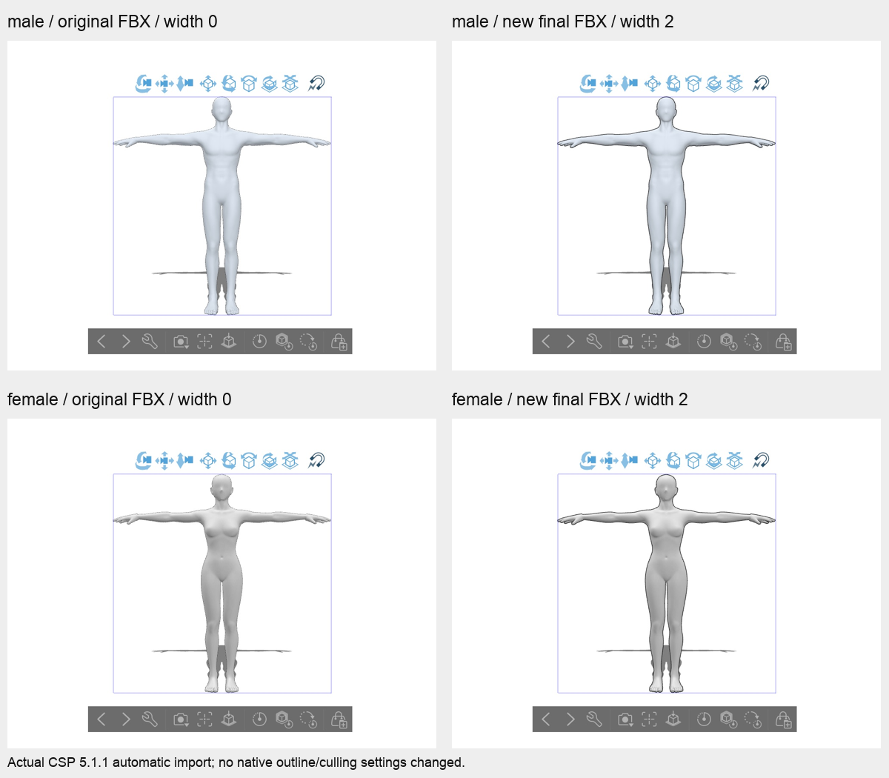
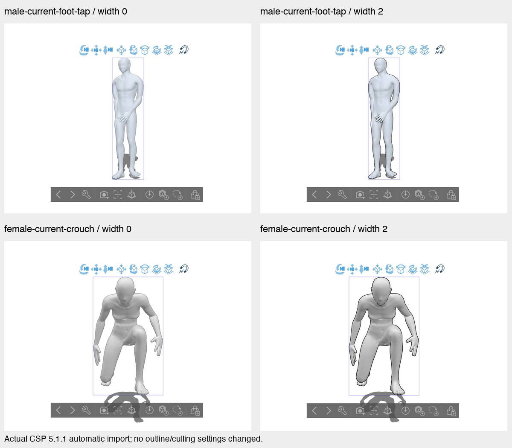
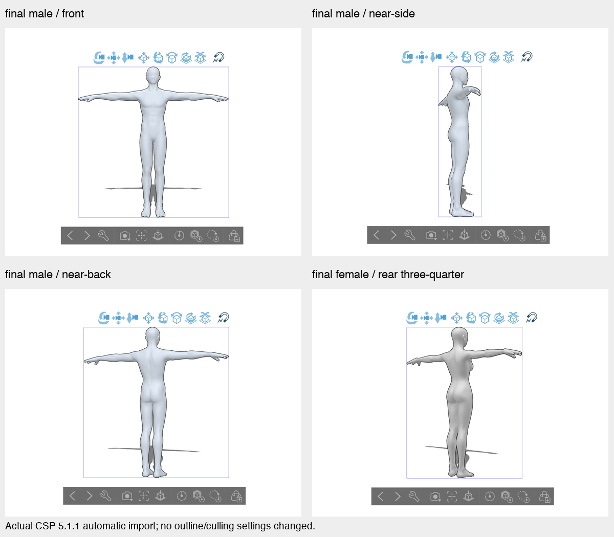

# Final FBX outline preparation and CSP acceptance

Current status: **Accepted for the bounded current product flow: pre-posed individual FBX export → automatic CSP import.** The exact current male/female final files retain grey body surfaces and black contours, including tested poses and camera views. The user clarified on 2026-11-06 that `.clip` is unsupported and CSP-internal joint posing is outside this app flow; neither blocks this acceptance. Support is limited by the exact model/scope/width capability below. Width zero keeps the existing bytes/path; the environment default stays off. No merge, deployment or global activation is included.

## Actual CSP observations

CSP EX 5.1.1 build 202607291835 was tested in separate new canvases using File > Import > 3D Data, automatic import, with no mode-selection prompt. The exact Basic/Realistic property was not read. These observations do not certify every mode or renderer.

| Representation | Actual CSP result | Decision |
|---|---|---|
| Original body, width 0 | Grey surfaces with CSP's existing native contours | Preserve original bytes/path |
| Opaque reversed skinned hull, Off/OnCCW/OnCW | Solid black surfaces | Reject v1 |
| Transparent reversed hull | Grey body without useful extra contour | Reject |
| Transparent outward-facing skinned guide | Grey body plus darker contours on actual male/female final files | Implement v2; retain certification gate |
| Fixed-view black contour tubes | No black body initially; internal lines after orbit | Diagnostic only |
| Blender Backfacing/Mix/Transparent graph | Required nodes absent after FBX reimport | Reject as portable FBX expression |

The new guide keeps outward winding/normals and `CullingOff`. Its black material has `Opacity=0`, `TransparencyFactor=1`, `TransparentColor=(1,1,1)`. CSP's automatic outline pass visibly outlines the expanded transparent guide while retaining the original body. This is observed CSP behavior, not an assumption about shader graphs or backface culling surviving transport. Other renderers need not draw the transparent guide.

Actual CSP evidence:

- Current male/female full-body comparisons at 0/.5/1/2, male crouch, preserved male bend/female sit: grey surfaces and progressively stronger contours. This is visual comparison, not measured pixel width.
- Exact final implementation male/female width-2 imports and 200% front detail: no large black patch, obvious white halo or doubled exterior silhouette in these views. Fine dotted interior occlusion lines remain near some knee/shin views.
- Exact final male front/three-quarter/near-side/near-back orbit succeeded after the user unlocked the Mac. Exact final female near-side/rear-three-quarter orbit also succeeded. Earlier candidate hashes stay separate; no exact-angle, elevation or arbitrary-view guarantee. The female screenshot named `back` is a rear-three-quarter observation.
- Exact final posed male foot-tap and female crouch were imported separately against their original width-zero sources: pose, grey surfaces and exterior/occlusion contours remain. This proves pre-posed FBX transport, not joint manipulation inside CSP.
- Both sexes at half/bust/shoulder_head/head: eight paired 0/2 comparisons, 16 exact hashes checked; grey bodies and stronger contours in every initial view. Both head width-2 files were orbited near-side/profile with a clean visible lower cut edge. Head zero already has native contour; width two is modestly stronger. Cropped .5/1 are file-tested, not CSP UI-tested. Male bust/shoulder cut jaggedness already exists in zero controls.

The user removed `.clip` from current acceptance because the app does not support it. The historical Save As license dialog is not a current blocker. These FBXs appear as 3D objects without a Pose category; CSP-internal posing/Modeler character setup was not performed and is not promised. Arbitrary views and every occluded cut face are not certified. Some native interior occlusion lines remain.

Actual screenshots are committed as canvas-only crops, with source screenshot hashes and crop coordinates in [the evidence index](qa/outline-fbx-csp-20261106/evidence.json). No model assets, tokens or unrelated user-document UI are included.

Official references checked during the investigation: [CSP FBX import and modes](https://help.clip-studio.com/en-us/manual_en/660_3d/Importing_3D_Files.htm), [CSP outline/backface settings](https://help.clip-studio.com/en-us/manual_en/810_subtools/P.htm), [Autodesk culling tokens](https://help.autodesk.com/cloudhelp/2020/ENU/FBX-API-Reference/cpp_ref/fbxfiletokens_8h.html), [Blender material-node export](https://docs.blender.org/manual/en/4.1/addons/import_export/node_shaders_info.html). These describe settings/data, not acceptance of this expression; screenshots and hashes establish the observations above.

## Integrity and versioned mapping

`outline_spec.py` strictly validates `{version:"fbx-outline-v1",width:0..2}`. Bools, nonfinite values, unknown versions/keys and invalid ranges fail. The logical schema stays stable while v2 changes expression/mapping/runtime identity. Missing/zero appearance stays outside legacy identity/output handling.

`outline_fbx.py` preserves original typed FBX object values and adds named guide geometry/material, copied skin/cluster records and a separate bind pose. Original geometry/normals/UVs/morphs/materials/skin/bones are not re-exported through Blender. Unsupported source structures and animated sources fail. The independent verifier reconstructs an exact allowlist and compares every scene-affecting typed record. It checks actual imported Principled Base Color/Alpha sockets, not viewport diffuse alpha, then removes only the exact validated guide set before the unchanged strict body comparator runs. Extra/missing meshes, material/skin changes, stale width/culling and opaque-guide corruption fail.

Frozen solver, retarget, immutable solved state/display model, bone/weight tolerances and preview outline renderer remain unchanged. Personal models, combined-scene FBX and VRM ZIP remain outside nonzero support. Models/controllers/keys and raw/private screenshots stay Git-excluded. Sanitized canvas-only QA PNGs are included for review.

Expression: `skinned-outward-transparent-native-outline-v2`.
Mapping: `csp-native-scope-stature-v2-experimental`.

World-metre displacement = width / 2 × supplied full stature in metres × 0.0015 × scope factor.

| Scope | Factor |
|---|---:|
| full | 1.00 |
| half | 0.60 |
| bust | 0.35 |
| shoulder_head | 0.27 |
| head | 0.15 |

The factors reduce excessive expansion in close framing. Full stature is explicit, never inferred from cropped/posed bounds. At 1.75m, full .5/1/2 gives .65625/1.3125/2.625mm; head width two gives .39375mm. Current-default jobs use resolved stature. Height variants use approved hash-pinned sources/controllers within original ranges. This is experimental style mapping, not CSS-pixel conversion or constant pixels across cameras.

Legacy diagnostics retain `skinned-inverted-hull-fbx-culling-v1` / `stature-relative-v1-experimental` and original unscaled opaque behavior. API jobs explicitly select v2. Cache identity binds source, normalized appearance, stature, scope, character, expression, mapping and runtime; old representation bytes cannot masquerade as v2.

## Internal API and release gate

`GET /outline-contract` reports appearance version, expression, mapping, runtime revision, enabled state, `acceptance_scope:"posed-fbx-import"` and `supported_targets`. `CONVERTER_OUTLINE_ENABLED=false` stays the default. The compile-time v2 acceptance set covers only these current approved model hashes:

- male-default83-v0-7-6-p1: `085dd9c65a3a66035f7e0ce9e0a9171b9abb0e33dada92194676d92e00c8b026`
- female-default80-v0-3-9-p1: `712ac75e58efd4d6ccded0b1e931590900015de023327f1320cf6d7d94026ffc`

Each model supports `full` continuous **0 < width <= 2** and `half/bust/shoulder_head/head` **width 2 only**. Existing preserved baselines and untested cropped widths are unsupported. Full interpolation uses the same linear displacement between actual CSP .5/1/2 observations, with extra independent .25/.65/1.25/1.75 HTTP/Blender checks. Both HTTP-generated .65 files were additionally imported into CSP: grey surfaces and thin exterior contours retained. This does not imply every numeric value/view has an independent screenshot.

Each exact capability row is `{character_id,character_sha256,output_scope,width:{min,max,min_exclusive}}`: full `{min:0,max:2,min_exclusive:true}`, crops `{min:2,max:2,min_exclusive:false}`. BFF/client must test the exact row and width, not take a Cartesian product of summary supported lists. The global width bounds describe schema only. No silent rounding or nonzero-to-zero fallback. An environment flag cannot certify another expression/model/scope/width.

`POST /outline-fbx` uses the existing private interactive Bearer token and multipart `fbx`, `source_artifact_sha256`, `appearance`, `output_scope`, `character_id`, `character_sha256`, `binding_sha256`, `stature_m`. Binary FBX is bounded to 30 MiB. Zero returns `OUTLINE_ZERO_USE_LEGACY` for existing-byte reuse. Default-off nonzero requests fail with `OUTLINE_DISABLED`; explicitly enabled local/private preparation succeeds only for an accepted exact target. Other combinations fail closed without fallback success/file-ready markers.

The actual positive envelope is `{artifact_contract:"outlined-fbx-v1",fbx_base64,fbx_sha256,receipt}`. Verifier receipts bind source/final hashes, appearance/hash, selection binding, character SHA, scope, stature, displacement, expression/mapping/runtime, exact manifest, skin/displacement checks, unchanged-body correspondence and separate file/CSP booleans. `csp_certified` is recomputed from the exact expression/mapping/model/scope/width acceptance. It means posed-FBX-import acceptance only. Unsupported diagnostic QA combinations retain false; a file check alone never certifies them.

BFF validates capability, operation/revision/cache identity, returned byte hashes and ownership/authorization/expiry/current-selection fences at build/delivery. BFF owns byte reuse/latest-operation rebinding. Slider motion does not start Blender per frame; converter has no persistent artifact cache. Failure/cancellation cleans temporary files and preserves the previous successful download.

Errors: 400 `INVALID_OUTLINE` / `OUTLINE_ZERO_USE_LEGACY`; 401 `UNAUTHORIZED`; 409 `SOURCE_FBX_SHA256_MISMATCH` / `OUTLINE_BINDING_MISMATCH`; 422 `OUTLINE_UNSUPPORTED`; 503 `OUTLINE_DISABLED` / `OUTLINE_NOT_CSP_CERTIFIED`; 500 `OUTLINE_INTEGRITY_ERROR`; 504 `OUTLINE_TIMEOUT`.

## Verification evidence

- Python 3.12/pinned converter requirements: exact CI Python list **529 passed / 1 existing skip**; repository smoke **54/54**; compileall, frozen lineage and whitespace pass. Docker's explicit copy list includes every outline module, tested via isolated capability/runtime import. Linux CI also runs the synthetic real-binary verifier.
- Final scoped v2 matrix **240/240 passes**: 16 sources × five scopes × .5/1/2. Distinct source sets: preserved approved baselines neutral/bend/sit (6), approved-controller 160/190cm variants (4), current approved defaults neutral/crouch/foot-tap (6).
- **80 zero** path/hash records and **80 actual Blender pose-edit checks** moving elbow/finger/knee/spine/neck. Original position/normal/matrix/weight comparator maxima **all zero**. Maximum imported displacement error **1.6799306554291134e-7m**; maximum dynamic skin transport error **4.643455606442997e-7m**. Blender editing does not substitute for CSP editing.
- **10 binary corruption/stale cases rejected**, including native opacity. Native synthetic import checks shader Alpha=0 and exact original object fingerprints.
- Internal host preparation with two fresh Blender processes: **3.057s first / 2.575s repeated**, identical repeated SHA. Warm local samples exclude solver/network/CSP and are not production latency promises.
- Real local TCP HTTP endpoint with real Blender: **14 positive files and 5 failure boundaries pass**, including both sexes at .25/.65/1.25/1.75/2, final male foot-tap/female crouch, both head2; downloaded hashes and complete receipt bindings match. All original-body errors remain zero; existing final-width2 SHA values are unchanged. Negative checks cover zero-path reuse signal, untested crop width, source mismatch, personal model and missing auth.
- Earlier v1 results are historical; CSP rejected v1. BFF/client are separate owners of app save/stale/native integration; converter HTTP success alone does not claim one live app transaction.

Exact current-default implementation files imported into CSP, width 2:

| Body | Original source SHA-256 | Final FBX SHA-256 | Bytes |
|---|---|---|---:|
| male-default83-v0-7-6-p1 | `085dd9c65a3a66035f7e0ce9e0a9171b9abb0e33dada92194676d92e00c8b026` | `02799598d9f60899e83627446c80bf9c6f7f737a47b8b2de7e7f92612200a4e3` | 3,881,916 |
| female-default80-v0-3-9-p1 | `712ac75e58efd4d6ccded0b1e931590900015de023327f1320cf6d7d94026ffc` | `07295db35bb6a148f14da4fad91d459ee05d1f5859225b29638b71dce9754e3b` | 2,975,260 |

Git-ignored local evidence: `out/outline-fbx-csp-v2/native-scope-qa/{inputs,export-results,verification-results}.json`, `host-qa.json`, `final-tamper/report.json`, `summary.json`, `images/csp-final-comparison.png`, `images/photo-index.json`. Exact final files: `native-scope-qa/cases/{male,female}-current-neutral/full/2/artifact.fbx`. The comparison crops actual CSP canvas screenshots without retouching model pixels. Shared original photos/hashes and reports: primary checkout `artifacts/outline-fbx-csp-20261105/csp-v2/{results.json,report.html,scope-results.json,scope-report.html}`.

## Approved default base-import compatibility

The real BFF base-solve path exposed a separate pre-outline defect: the frozen legacy FBX importer uses `ignore_leaf_bones=True`, removing the actual terminal Head on the fixed #168 defaults. A narrow interactive adapter selects the existing `shape_bake.import_full_character` only for the two exact approved current ID+SHA pairs when no shape recipe is present. It wraps the existing worker call and restores the previous importer in `finally`. Other model IDs, mismatched hashes and the existing shaped path keep their previous behavior. Frozen solver files, source SHA checks, solver acceptance, final skin validation and strict correspondence tolerances are unchanged.

The actual failing `rokoko_Flirty_mixamo_00964.bvh` (SHA `d3f7039dbc4e5fbab6f8ca2ac9af6f7ec278c5d77f686d28115036c4d8cf1fc6`) now passes approved male/female `prepare_body → validated body snapshot → solve_from_body`, retaining all 52 bones including Head. Independent fresh exporter/verifier final FBXs also pass. This is an actual base solve, separate from the earlier pre-posed outline fixtures. Eight regression cases cover approved/unknown-ID/wrong-SHA/shaped selection and success/exception restoration. [Sanitized source/runtime/FBX hashes and exact correspondence](qa/outline-fbx-csp-20261106/base-import-regression.json). Original local private evidence: `out/outline-fbx-csp-v2/base-import-adapter-r2/{report,final-export}.json`.

`interactive_adapter.py` is included in interactive runtime hashing, so this change invalidates prior body/snapshot/cache identities automatically. BFF/client must obtain fresh real metadata and states; substituting hashes is prohibited. Interactive and outline runtime revisions remain separate. The local outline server stays available for companion integration checks.

## HTTP reproduction and limits

Run `python scripts/verify_outline_http.py --fixture /private/path/fixture.json` against a local explicitly enabled converter with the approved immutable character registry and real Blender. The private fixture holds `{url,token_file,output,cases:[{name,source,fields,expected_sha256}]}`; fields are exactly the multipart request, with appearance as an object. The script reads the local token without printing it, validates source/download/receipt hashes and bindings, and writes a local report. No source models or token values belong in Git.

The coordinating workspace publishes `converter-http-fixture-v2.json` with current local source paths, registry, token-file path, start/check argv and cwd. Its server is a disposable loopback process, not a deployment. BFF must replace/rebind the fixture selection binding and enforce its own ownership, revision and stale-result checks.

The converter's bounded posed-FBX-import acceptance is complete for the advertised matrix. Cropped intermediate widths, old/personal models, other formats/modes, arbitrary angles and CSP-internal posing remain outside support. Fine native occlusion lines remain visible at some tested views. `.clip` is outside current product scope. App-native save through BFF is separately validated by companion owners. PR remains Draft pending coordinated review; no merge/deploy/global activation.

Related: [client #162](https://github.com/04JUNG/Standin-client/pull/162), [BFF #161](https://github.com/04JUNG/Standin-app-server/pull/161), merged [base server #167](https://github.com/04JUNG/Standin-server/pull/167). No staging branch or personal-model #142 code imported.
