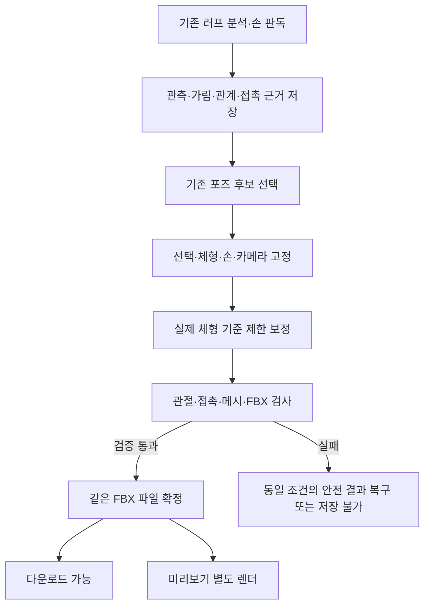

# 자동 보정 흐름을 유지하는 Refine v3 재설계

작성·최신 원격 재확인: 2026-10-22 · 설계 revision: 3 · 상태: **검토용 설계 초안, 구현·배포·기능 활성화 없음**

## 1. 최종 목표와 이번 결정

**사용자가 선택한 포즈를 같은 인물의 러프에 더 가깝게 보정하고, 최종 출력 캐릭터에서 관절 뒤틀림과 신체 관통이 없는 결과를 제공한다.**

여기서 “더 비슷하게”는 선택한 후보 B0의 동작·출처를 유지하면서 러프의 관측된 자세에 가까워지는 것이다. 다른 후보로 몰래 교체하거나, 체형·카메라를 바꿔 점수만 낮추는 것은 제외한다. 단일 러프에서 가려진 부위의 정답 3D를 복원했다고 주장하지 않는다.

기존 자동 실행을 유지한다. 사용자에게 새 보정 버튼, 관절 지정, 체형 선행 선택, 추가 승인 단계를 요구하지 않는다. 현재 존재하는 후보 선택과 저장 전 확인을 그대로 사용한다.

결정은 **v3의 증거·제약·검사·복구 구조를 재사용하고, 실제 출력 체형을 반영하는 계산 경로와 최종 메시 검증을 새로 구현**하는 것이다. 기존 v3 전체를 운영에 붙이거나 안전 기준을 완화해 채택률을 높이지 않는다.

이 문서는 기존 자동 흐름, VLM 분석 재사용, 가림·신체 관계·접촉·지지 활용에 관한 대화를 통합한 구현 기준안이다. 수치 목표·새 계약·새 모듈명은 별도 표시가 없는 한 제안이며 현재 구현 사실이 아니다.

### 1.1 핵심 설계 결정

**기존 VLM 결과로 무엇을 보존할지 읽고, 실제 선택 체형의 기하로 어떻게 움직일지 계산하고, 내보낼 FBX 자체로 안전을 검증한다.**

| 사용자 관점 | 설계 결정 |
|---|---|
| 고른 포즈가 러프와 더 비슷해짐 | 같은 B0·검색 카메라에서 관측된 사지와 검증된 관계를 실제 target 체형 기준으로 보정 |
| 손으로 짚은 곳·몸의 앞뒤 관계가 유지됨 | VLM은 관계 가설을 제공. 좌우·소유권·기하와 일치할 때만 제한된 조건으로 승격 |
| 관절이 뒤집히거나 몸을 뚫지 않음 | 관절 제약, 접촉과 관통 구분, 실제 shape/손 적용 메시와 재import FBX 검사 |
| 이전처럼 자동으로 진행됨 | 기존 후보 선택 → 저장 전 확인에서 자동 실행. 새 수동 지정·확인 단계 없음 |
| 후보와 저장이 빨리 준비됨 | 후보는 기존 정적 썸네일, VLM 재호출 0회 추가, 선택한 후보만 계산, 검증된 FBX는 렌더 대기 없이 저장 |
| 손·체형을 바꿔도 결과가 섞이지 않음 | 관측/보정/최종 artifact별 캐시와 revision 분리. 이미 받은 파일은 유지 |

최우선 순서는 **입력 귀속·파일 일치 → 관절·메시 안전 → 선택 동작·확인된 접촉 보존 → 러프 유사도 → 시간 내 최선 결과**다. 보정률을 올리기 위해 이 순서를 뒤집지 않는다.

## 2. 확인한 원격 최신 기준

| 대상 | 조회한 원격 기준 | 확인 범위 |
|---|---|---|
| 추론 서버 develop | `7a3713f7cbd1e78925f6e78704f5ff706b96bfa2` | 분석·동적 검색·refine·카메라·충돌·Converter·scene worker 소스 |
| 추론 서버 main | `5317e972c603d2dec6044e3ff99e7adb8ee578c7` | 아래 핵심 refine/파이프라인 파일의 develop 대비 차이 없음 확인 |
| BFF develop | `8cc692d638de1d08844260b9530f60e087bf8ad6` | 보정 허용 판정·보정 호출·보관·캐시·scene 계약 |
| 클라이언트 develop | `234fb196ff41fdec2ba15e911e675783708ba21e` | 앱/바 공통 자동 보정 훅·저장 전 확인 경로 |

2026-10-22 서버 `git fetch origin develop main` 재확인에서도 위 SHA가 유지됐다. BFF/클라이언트는 앞선 설계 시점에 확인한 고정 snapshot이며 이번 재확인은 서버에 한정한다. 이는 원격 브랜치의 코드 확인이다. 운영 컨테이너 이미지·환경변수·설치 앱 버전과 일치하는지 검증한 결과가 아니다. 오래된 `PIPELINE_OVERVIEW.md`의 4카메라 설명보다 해당 commit의 실제 코드를 우선했다.

별도 워크트리: `/private/tmp/standin-refine-v3-design-20261022`.
브랜치: `codex/refine-v3-auto-flow-design-20261022`.
기존 `/Users/dowon/dev/Standin-server`의 미커밋 코드·로컬 실험·자산은 수정하지 않는다.

### 2.1 현재 호출 순서: “자동”과 “선택”의 구분

```text
캡처/업로드
  → POST /analyze
  → 인물 관측·검색·후보별 카메라·보정 허용 정보
  → 기존 후보 선택
  → 기존 저장 전 확인 화면 진입
  → 앱/바 공통 훅이 적격한 선택 후보를 자동 보정
  → BFF가 보정 BVH를 보관하거나 원본을 유지
  → 기존 체형·손·출력 범위를 적용한 최종 FBX 검수
  → 확인한 동일 파일 저장
```



서버 `/analyze` 안에서 모든 Top5를 새로 보정하는 구조가 아니다. `/refine`은 선택한 후보 1개를 받는 별도 endpoint다. 클라이언트 `useSelectionReview → useRefineSelection`이 현재 선택에 대해 자동 호출하며, 인물 간 동시 호출 상한은 이미 3이다. 이번 설계도 이 호출 시점과 앱/바 공통 경로를 유지한다.

“사용자가 선택한 체형을 반영”한다는 말은 새 체형 선택 단계를 추가한다는 뜻이 아니다. BFF에 이미 저장된 체형·수치·손·범위 snapshot이 있으면 사용하고, 없으면 기존 제품 규칙이 결정한 자동/기본 체형을 사용한다. 그마저 미확정이면 source 보정만 수행하고 실제 체형의 안전 인증은 보류한다.

### 2.2 코드에서 확인한 현재 기능과 경계

| 위치 | 현재 사실 | 설계에서 지킬 것 |
|---|---|---|
| `src/fullbody_routing.py` | 기하·의미 검색은 이미 worker 2개로 병렬 실행 | 병렬화 자체를 새 성과로 보고하지 않음 |
| `src/camera_search.py` | 117개 고정 카메라: yaw 13종 × pitch 3종 × 거리 3종 | 검색 카메라 유지. 정적 45도 썸네일 8종으로 보정 카메라를 치환하지 않음 |
| `src/dynamic_refine.py` | 검증된 원본 라이브러리 hit와 관측·source hash에만 보정 binding 생성 | near·mirror·생성·의미 참고 후보를 일괄 보정 허용하지 않음 |
| `src/pipeline.py::_apply_refine_policy` | 관측·귀속·coverage·사지 권한, 하체 관측 여부를 검사 | 거리/순위가 나쁘다는 이유만으로 v2 보정을 새로 차단하지 않음 |
| `api/models.py::RefineRequest` | pose_id, keypoints, scores, 정책 lineage, 선택적 camera를 받음. target 체형 입력은 없음 | target-aware 보정은 새로운 내부 계약이 필요함 |
| `api/app.py::refine` | source 변경·격리·정책·얽힘 set 검사 후 v2.5.3 호출 | 실패/미지원은 검증된 기존 결과로 복구. set을 독립 인물처럼 풀지 않음 |
| `api/candidate_presentation.py::refine_in_camera` | 검색 카메라로 정렬해 solve 후 회전을 원래 BVH 공간으로 복원 | 정렬 공간·source 공간을 분리하고 회전을 중복 적용하지 않음 |
| `src/refine_projection.py` | 요청별 ContextVar에 고정 투영 저장 | 전역 카메라/CFG를 바꾸는 병렬화 금지 |
| `src/refine.py`, `src/refine_v2.py` | 현재 v2.5.3, 하체 보정 기본 on, 몸통 별도 기본 off, 수치 deadline 기본 5초 | v3 설계만으로 기존 flag를 변경하지 않음 |
| `src/refine_selector.py`, `src/collision.py` | 독립 재파싱·비악화·관절/충돌 검사. 충돌은 주로 골격·캡슐·표면 근사 | 통과를 최종 skin 메시의 무관통 인증으로 바꾸지 않음 |
| BFF `src/refine/service.ts` | 보정 결과를 job/person/candidate로 재사용. BVH와 썸네일 실패를 분리 | target/version을 추가하면 기존 캐시 식별자도 보완해야 함 |
| `converter_api/app.py`, `converter/convert.py` | 실제 character/shape/hands를 받아 변환하며 HTTP 출력은 rigged_rest | 평가 대상은 이 출력. source FK에 체형 수치만 대입해 같다고 가정하지 않음 |
| `src/scene_refinement/` | 별도 default-off v4 장면 worker | 단일 선택 포즈 refine v3와 다른 기능. 장면 재선택·방향 변경을 몰래 가져오지 않음 |

## 3. 기존 로컬 v3에서 배운 점

9/27 로컬 기록은 운영과 분리된 실험이다. 기록된 130→160→166 테스트는 누적 검증 수이며 이번에 재실행한 결과가 아니다.

| 단계 | 구현/관측 결과 | 이번 판단 |
|---|---|---|
| 초기 `experiments/refine_v3/` | 증거 고정·잠금·접촉·독립 검사 구현. 현재 BVH로 재평가한 18건의 최종 채택 0건 | 검사 구조는 재사용, solver 성능은 입증되지 않음 |
| `refine_v3_expansion/` | S0 카메라/잠금, S1 가슴·척추, S2 쇄골, S3 골반. 기하 4/18 통과 | 4건 중 1건은 잠금 기준 교정 효과. 골반 3회 모두 거절 |
| `refine_v3_feasible/` | 관절 조합별 제약 최적화. source 기하 10/18 통과, 평균 NME 15.413%→14.700% | 중복·가림 문제를 포함한 개발 입력. 서비스 승인/메시 검사 완료 0건 |
| 최종 FBX 비교 | source 오차가 개선돼도 한 사례의 실제 FBX endpoint 오차가 50.53%→51.65% 악화 | 실제 체형·retarget 결과를 보정 목표와 최종 검사에 넣어야 함 |
| 속도 | expansion p95 3.697초, feasible은 이전 계산을 제외하고 추가 p95 약 4.908초 | 기존 실험을 연결하는 것만으로 제품 지연 목표를 달성할 수 없음 |

원장 37행을 유지하고 평가 가능 18행·제외 19행을 분리한다. 중복 관측 2행을 독립 인물 2명의 성공으로 세지 않는다. 기하 통과 건수, 실제 메시 안전, 작가 활용성을 각각 보고한다.

## 4. 재활용과 신규 구현의 경계

| 구분 | 가져올 부분 | 보완/검증 |
|---|---|---|
| 재활용 | v3 Evidence의 immutable 입력·관측·source hash 구조 | 최신 117-camera binding, 정책·체형 revision을 포함하는 새 버전으로 adapter 작성 |
| 재활용 | B0/F25/단계 snapshot 분리와 local/world/endpoint 잠금 | source·target 공간을 혼합하지 않는 회귀 추가 |
| 재활용 | SO(3) 제어, rig별 권한, 부모 영향 그래프, 누적 회전 예산 | 실제 target rest frame과 매핑을 인증. 예전 허용 각도를 제품 확정값으로 복사하지 않음 |
| 재활용 | 독립 검사기, 직렬화 후 재검사, 정확한 복구 | 기존 source 검사와 새 target/mesh 검사를 함께 통과해야 채택 |
| 재활용 | 비교 화면·전체 원장·rollback manifest | 동일 카메라의 B0/F25/v3/실제 채택 결과와 제외 사유 표시 |
| 조건부 재사용 | feasible의 FK 공유·제약식·조합 탐색 | 모든 조합을 매번 푸는 부분은 교체. 최신 투영과 데이터 타입으로 동등성 확인 |
| 신규 | 실제 체형·수치·손에 대응하는 TargetProfile/빠른 retarget-FK adapter | 실제 Converter 재import와의 일치 검증이 선행 |
| 신규 | target-aware 목적함수와 관절별 swing/twist 제약 | 낮은 평균 오차가 손·발 악화/뒤틀림을 숨기지 못하게 함 |
| 신규 | 최종 메시의 관통·접힘 검사와 검증 상태 모델 | 캡슐 통과와 skin 통과를 분리하고 검사 불가를 성공으로 간주하지 않음 |
| 신규 | 버전·체형 revision을 포함하는 artifact/cache identity | body/hand 변경, 동시 요청, 배포 버전 변경에 안전해야 함 |
| 보존 | 기존 v3 세 디렉터리와 보고서 | 동결 비교군으로 유지하고 원본 보고서/원장/FBX를 덮어쓰지 않음 |

로컬 실험 파일이 최신 원격에 모두 존재하는 것은 아니다. 파일이 있다는 이유로 운영 모듈로 간주하지 않으며, 재사용 시 코드 해시·의존성·계약 테스트를 함께 이전한다.

## 5. 제안하는 자동 실행 경로

```text
기존 후보 선택 → 기존 확인 화면 진입
  └─ BFF: 선택 후보/관측/카메라/기존 체형·손 revision 고정
       ├─ source baseline F25 확보 또는 정확히 같은 context의 캐시 재사용
       ├─ TargetProfile 지원 여부 확인
       │    ├─ 지원: 실제 체형 FK 기준으로 제한된 v3 최적화
       │    └─ 미지원: F25 유지 + target 검증 미완료 기록
       ├─ 독립 source/target 검사 → 채택 또는 F25 복구
       └─ 기존 Converter 경로에서 최종 체형·손·범위 적용
            → full-body 메시 검사 → 출력 범위 적용/FBX export
            → FBX 재import 검사 → artifact 확정
            → 같은 artifact의 미리보기와 저장
```

새 체형을 사용자가 먼저 고르게 하지 않는다. 체형 확정이 늦으면 기존 source 보정을 먼저 완료하고, 이미 존재하는 최종 체형 적용 단계에서 target 검증/지원되는 제한 보정을 이어간다. 동일 요청의 baseline을 다시 풀지 않는다.

후보 썸네일은 현재 저장된 정적 이미지를 유지한다. Top5 모두를 target 메시로 변환·렌더하거나 보정을 위해 썸네일 로딩을 지연시키지 않는다. 현재 존재하는 미리보기 지연 생성 경로도 유지한다.

### 5.1 변경/취소/파일의 의미

- 포즈 선택이 바뀌면 새 B0다. 이전 응답은 job/person/candidate/context를 재확인하고 폐기한다.
- 체형·수치가 바뀌면 해당 TargetProfile/target 결과/최종 검수 영수증만 무효화한다. 관측과 source baseline이 동일하면 재사용한다.
- 손만 바뀌면 기본적으로 손 적용과 손–몸/손–손 메시 검사를 갱신한다. 근접 영향이 확인된 경우에만 허용 팔을 재보정하며 전신을 자동으로 다시 풀지 않는다.
- 이미 저장한 파일은 immutable이다. 이후 체형/손 변경은 새 artifact와 새 검수를 만들며 내려받은 파일을 바꾸지 않는다.
- HTTP 취소가 수치 worker나 Converter의 즉시 중단을 보장하지 않는다. 결과 채택은 revision 검사로 막고, 실제 연산 중단은 별도 bounded worker/cancellation token 계약으로 구현한다.

## 6. 입력과 TargetProfile 계약

최초에는 공개 `/refine`의 필수 입력을 늘리지 않고 격리 실험의 내부 sidecar로 검증한다. 실제 연결 단계에는 BFF·추론·Converter가 계약 버전을 협상해야 한다. 아래는 **신규 내부 계약 제안**이다.

```text
RefineContext
  job/person/candidate + 선택 source BVH SHA + 관측/ownership/visibility SHA
  RefineEvidence version/SHA/status + observation transform version
  기존 refine_allowed/refinable_limbs/lower_body_observed
  검색 camera version/rotation/projection/distance/observed mask/query SHA
  선택 revision + 기존 body/shape/hand/scope revision
  solver/selector/retarget/mesh-policy version

TargetProfile
  character/body asset SHA + shape recipe/source SHA + rig/rest/map version
  단위/좌표계/관절 frame + bone lengths + 유효 joint/DOF/제한
  현재 hand preset/revision + 검증된 collision regions/support/contact
  profile 지원 범위와 Converter 동등성 검증 버전
```

클라이언트가 임의의 관절·파일 경로·소유권·검증 완료 값을 보내도록 하지 않는다. BFF에 보관된 선택과 registry에서 profile을 해석하고, hash/revision 불일치는 재확인한다. 캐시의 소유권 범위도 기존 설치/사용자/job 계약을 유지한다.

TargetProfile은 source 본 길이를 바꾸는 기능이 아니다. source BVH hierarchy/offset/translation은 보존하고, 실제 retarget·체형 변형의 결과를 별도 target 공간에서 계산한다. 단순한 본 길이 교체가 실제 Converter와 같다고 간주하지 않는다. rigged_rest의 rest 재작성과 손 처리도 동등성 비교에 포함한다.

빠른 adapter의 오차 범위보다 작은 개선은 확정 이득으로 세지 않는다. 최종 FBX를 재import한 관절·endpoint·부위 관계로 실제 이득과 비악화를 다시 검사하며, adapter만 통과한 후보를 최종 승인하지 않는다. 미검증 체형 수치/리그/retarget 버전은 지원 범위 밖으로 처리하고, 적은 수의 체형 샘플 검수로 모든 연속 수치 조합의 안전을 보장하지 않는다.

### 6.1 VLM 호출 계약: 기존 호출에 추가 정보를 함께 받는다

현재 `read_hands`는 기본 분석과 별도 호출이며 `VLM_HAND_SHAPES=1`일 때만 수행한다(코드 기본값 0). 숨은 손·실패는 `relaxed` 프리셋으로 돌아가고, 머리만 출력하는 인물은 요청에서 제외된다. 실제 손가락 적용은 Converter의 프리셋/리그 계산이다.

**“항상 총 2회”는 현재 시스템 전체의 계약이 아니다.** `tag_people`, 조건부 `describe_people`와 `_review_pose_sides`, skeleton repair, body review, provider 재시도가 추가될 수 있다. 기본 분석+손 판독만 실행되는 경로가 2회다. 이번 목표는 동일 입력·동일 기존 설정 대비 **리파인용 신규 논리 호출 0회, solver 내부 VLM 호출 0회**다. 논리 호출·HTTP attempts·이미지/토큰 비용을 각각 계측한다.

| 기존 호출 | 추가할 선택적 응답 | 설계상 책임 |
|---|---|---|
| 기본 `analyze` | 신체 부위별 가시성, 명확한 가림 순서, 동작 보존 관계 | 기존 shot/count/box와 별도 `refine_observations` 필드. 기존 제어 결과의 정확도·지연 회귀 평가 필수 |
| 손 `read_hands` | 기존 좌우 손 프리셋 + 접촉 대상 region·손바닥/손등·지지 가설, 보이는 발의 지지 근거 | 기존 인물 목록을 재사용하는 선택적 `refine_contacts`. 좌표·힘·3D 접촉점 생성 금지 |
| 이미 실행된 자세 설명·좌우 검수 | 검수된 `pose_relations`, `held_object_hands` | 기존 결과를 정규화해 재사용. 이를 얻으려고 새 설명/검수 호출을 예약하지 않음 |

손 판독이 꺼진 경로에서는 기본 분석의 가림·관계만 쓰고 접촉은 unknown이다. 머리 전용 작업에 손 호출을 새로 만들지 않는다. 손 판독의 부가 발 정보가 손 정확도를 떨어뜨리면 해당 부가 필드는 제외한다. 실패 시 추가 재질문을 붙이지 않는다.

배열 index만으로 인물을 합치지 않는다. 첫 분석 slot → 기존 reconcile 결과의 person ID → 손 요청 subset 매핑을 저장하고, `image_digest/crop_transform/slot_map_version`을 묶는다. 새 부가 필드의 인물 ID 집합·중복·좌우·scope를 검증한다. subset의 0번을 전체 0번으로 오인하거나 검출기만 찾은 사람에게 이웃 VLM 결과를 복사하지 않는다. ID 재명명/인원 불일치가 있으면 해당 부가 묶음을 폐기한다.

기본 필드가 유효하고 부가 필드만 잘못됐으면 기존 분석은 살리고 부가 필드만 버린다. 응답 전체가 잘렸거나 JSON 자체가 깨지면 복구 가능한 필드가 있다고 가정하지 않는다. provider schema는 선택 필드·배열 상한을 명시하고, 응답 크기와 기존 분석 정확도 비악화를 shadow 승격 조건으로 둔다. 프롬프트 확장이 routing/인원수 결과를 바꾸면 배포하지 않는다.

### 6.2 데이터 계약: 관측, 가설, 계산으로 확인한 제약을 구분

아래 타입/필드명은 신규 제안이다. 검색 taxonomy나 기존 Controlled Vocabulary에 섞지 않는다.

```text
RefineEvidence.v1
  provenance: image_digest, observation_revision, slot_map_version,
              provider/model/prompt/schema version, logical_call_id, source SHA
  person_id, body_scope, status: absent | valid | partial | unavailable
  visibility[]:
    region: known body region + anatomical side
    state: visible | occluded | out_of_frame | ambiguous
    evidence: direct_visible | inferred | unknown
    confidence: high | low | unknown
  relations[]:
    subject_region, object_region
    kind: above | below | in_front_of | behind | near | bent | extended
    frame: image | camera_depth | anatomical
    side_certainty, evidence, confidence
  contacts[]:
    effector_region: left/right palm | hand_back | sole | knee | pelvis
    target: self_region | ground | external_object | other_person | unknown
    target_ref, kind: touching | grasping | supporting | unknown
    side_certainty, chain_visible, evidence, confidence
  preserve[]: whitelisted relation IDs; no free-text executable constraint

ResolvedConstraints.v1                 # 서버 계산 결과. VLM 응답이 아님
  evidence_sha, target_profile_sha, observation_sha
  each: admitted | soft | diagnostic_only | rejected
        reason, region_pair, source_evidence_ids,
        fixed anchor (if measurable), tolerance_profile, verification_method
```

`confidence=high`는 모델의 자기 보고이며 확률/정답 인증이 아니다. raw 응답과 해석 결과를 분리하고 원본 러프·자유 서술을 일반 운영 로그에 남기지 않는다. 진단에는 해시·enum·사유·계산 값만 남기고 이미지 보관은 기존 접근/보존 규칙을 따른다.

초기 응답량 상한 제안은 인물당 부위 가시성 16개, 관계 8개, 접촉 6개다. 제한을 초과한 관계를 임의로 잘라 신뢰가 높은 척하지 말고 `partial`로 기록한다. 1/2/4/8인 컷의 토큰·누락·latency를 비교해 상한을 동결한다. 인물 간 접촉은 두 끝의 ID가 모두 유효해야 기록할 수 있다.

### 6.3 근거를 보정 조건으로 바꾸는 규칙

| 입력 | 보정에서 사용할 방식 | 금지/충돌 처리 |
|---|---|---|
| 포즈 모델이 보지 못한 부위를 VLM이 visible이라고 함 | 진단만 남김 | 관절 좌표 생성·observed mask 확대·refine 권한 획득 금지 |
| 기존 관측과 VLM의 가림 판독이 충돌 | 관계를 ambiguous로 낮추고 보수적 branch 비교 | 오류 감소를 위해 관측 점을 임의 삭제하지 않음. VLM 단독으로 기존 평가 마스크 변경 금지 |
| 팔/다리의 좌우가 불확실함 | 해당 방향 관계/접촉을 미적용 | 화면 왼쪽을 인물 왼쪽으로 치환 금지 |
| 명확한 2D 위/아래·굽힘 관계 | 같은 좌표계의 관측이 뒷받침할 때 bounded soft loss | 거리 단위·체형 scale·camera frame 혼용 금지 |
| 가림 순서에 따른 앞뒤 관계 | 후보의 현재 깊이 순서와 양립하는 경우 작은 tie-break/보존 제약 | VLM 가설만으로 팔을 몸 뒤로 넘기거나 depth branch를 뒤집지 않음 |
| 같은 몸의 손–허벅지 등 접촉 | 좌우·연결·region·거리의 복합 확인 뒤 표면 gap 보존 | 접촉은 관통 면제 사유가 아님 |
| 바닥 지지 | 기존 신뢰 가능한 바닥/anchor가 있을 때 drift 제한 | VLM만으로 바닥 높이·3D normal·하중·무게중심 안정성 인증 금지 |
| 물체/다른 인물과 접촉 | 이번 v3에서는 의미 보존·진단. 해당 팔의 큰 이동을 억제 | 객체/상대 메시·scene transform 없이 새 3D contact target 생성 금지 |

VLM과 기존 독립 좌우 검수 중 하나라도 충돌하면 해당 관계를 기권 처리한다. 여러 번 같은 모델이 동의한 것을 독립 기하 증명으로 세지 않는다. 잘못된 접촉은 point fitting보다 위험하므로 v3 첫 승격에서는 새 접촉을 멀리서 만드는 것보다 **기존 후보에 이미 있고 러프와도 일치하는 접촉의 보존**을 우선한다.

접촉이 가까운 안전 범위에 있지만 떨어져 있는 경우의 작은 gap 보정은 별도 phase에서 연다. 기본 preset·근접 region·trust budget·독립 메시 검사가 지원되는 동일 인물 접촉만 대상으로 한다. 미지원 물체/상대 인물은 가정한 표면으로 끌어당기지 않는다.

### 6.4 실제 체형의 접촉점과 지지점

손목 좌표는 손바닥 표면이 아니다. 프리셋을 적용한 target 손의 palm/hand_back patch와 상대 신체 region을 사용한다. `TargetProfile`에 patch·법선·rig mapping의 검증 버전을 추가한다. 손가락 끝이 중요하지만 preset으로 표현되지 않는 접촉은 진단 또는 기존 결과 유지로 처리한다.

기하 확인 시 한 번 정한 target surface anchor의 triangle ID와 barycentric 좌표를 저장하고, 반복마다 최근접점을 새로 골라 손이 몸 표면을 미끄러지며 점수를 속이지 못하게 한다. 변형된 표면에서 anchor를 재평가하며 topology/shape 변경 시 재생성한다. 발 지지점도 고정한다. 정상적인 닿음은 양의 작은 gap/허용 skin tolerance, 내부 깊이는 별도 hard 위반으로 검사한다.

이때 solver loop에는 인증된 경량 skin/patch 평가기가 필요하다. TargetFK의 관절 위치만으로 손바닥 표면·법선을 대신하지 않는다. pose-dependent modifier를 경량 평가기로 재현하지 못하는 profile은 contact solve를 끄고 최종 메시 검사만 수행한다.

접촉 손의 위치·법선이 동시에 양립하지 않으면 팔을 과회전하거나 손 프리셋을 몰래 교체하지 않는다. 손목 직접 회전·손가락 IK는 첫 승격 범위 밖이다. 현재 preset으로 가능한 작은 팔 보정까지만 허용하고 실패 사유를 남긴다.

### 6.5 분석과 보정 사이의 생명주기

1. 기존 분석 응답에 부가 근거를 함께 받고 inference→BFF에 버전/해시를 보관한다. 클라이언트는 임의 근거나 `verified=true`를 작성하지 않는다.
2. 후보 목록은 기존 검색/정적 썸네일 경로를 사용한다. 새로운 부가 검수 때문에 별도 대기 barrier를 만들지 않는다. 다만 같은 응답에 필드를 더하면 그 호출 자체가 느려질 수 있으므로 실제 latency를 측정한다.
3. 사용자가 후보를 선택해 기존 확인 화면에 진입하면 BFF가 당시의 근거·선택·체형·손을 snapshot으로 고정한다. 기존 기본 손→자동 추천 손 갱신이 발생하면 손 revision도 함께 바뀐다.
4. solver는 이 snapshot만 읽는다. 늦게 도착한 근거가 이미 실행 중인 최적화/완성 파일을 변경하지 않는다. 다음 명시적인 선택·체형·손 revision에서만 새 snapshot을 사용한다.
5. 근거가 없거나 stale이면 VLM 없이 target 기하 경로로 실행한다. 해당 경로도 미지원이면 현재 검증된 F25/B0 경로를 사용한다. 부가 근거를 기다리기 위해 새로운 VLM 호출을 만들지 않는다.

### 6.6 VLM 효과를 따로 증명한다

기존 F25, target-only, target+visibility, target+relations, target+contacts를 같은 입력으로 비교한다. VLM을 넣고도 이득이 없는 필드는 제거한다. 가림/좌우/접촉 정답은 별도 사람 검수로 만들고 unknown도 정답으로 허용한다. coverage, 기권률, 채택된 관계의 오류율, 잘못된 손/팔 이동, 모호한 입력의 안전 복구를 함께 공개한다.

프롬프트 확장 전후의 기존 인원수·shot·scope·손 preset 정확도를 paired 비교한다. 추가 정보가 잘 나와도 기존 분석/손 선택이 나빠지면 승격하지 않는다. 고의 오류 주입(좌우 반전·잘못된 접촉·가짜 high confidence·사람 ID 이동)에서도 잘못된 보정이 최종 FBX로 승인되지 않아야 한다.


### 6.7 운영 가림 조사 반영: 관절별 출처와 부분 관측 보정

2026-10-22 읽기 전용 조사에서 운영 실행 이미지 `5317e972c603d2dec6044e3ff99e7adb8ee578c7`, task revision 39, running/desired 1, HEALTHY를 확인했다. 실제 digest는 `sha256:08e19643d4f7a521ebe022c5ce6614fb71b100662d670f3cff55573c0ccc9354`로 ECR의 해당 SHA 태그와 일치한다. 운영은 humanart-m, fullbody, Gemini, refine-enabled 구성이며, 이 절의 관련 소스는 현재 develop과 같다. 이것은 이후 배포까지 보장하는 영구 상태가 아닌 조사 시점 기록이다.

현재 `skeleton_repair`에는 주변 연결을 보고 `occluded_estimated` 좌표를 제안하는 기존 VLM 경로가 있다. 새 v3 의미 분석이 좌표를 생성하지 않는다는 원칙과 이 기존 경로를 구분한다. 현재 보완 슬롯 전체는 `vlm_repair`가 되어 자동 보정에서 제외된다. 양어깨·골반과 완전한 사지가 부족한 `upper_only`/`sparse`도 보정 금지다. 일부 관절만 가려져도 보이는 팔의 활용 기회를 잃을 수 있다.

#### A. 관절별 출처 보존 — 첫 구현 필수

`JointObservation.v1`에는 person/chain ID, original coordinate/score, revised coordinate/score, `full_image | crop_retry | rescue | vlm_repair` source, `direct_observed | model_inferred | occluded_estimated | absent | unknown` visibility, 변경 이유·parent observation SHA를 저장한다. 모델 score만으로 direct_observed를 확정하지 않는다. 원본과 보완본을 덮어쓰지 않으며 서로 다른 관절의 인물 소유권을 다시 검사한다.

기존 전신 자격 심사는 그대로 남긴다. 신규 `regional_refine` 정책에서만 원래 검증된 chain을 재평가하고 허용한다. 다리를 보완했다는 이유로 원래 양팔이 모두 추정치가 되는 것을 막되, source 문자열 하나를 full_image로 바꿔 기존 gate를 우회하지 않는다. VLM 추정점은 hard 좌표 target·관측성 증명·정답 평가에 사용하지 않는다.

#### B. 골반 없는 상체 — 첫 부분 보정 대상

양어깨와 최소 한 팔의 관측·소유권이 검증되면, 어깨 중심/폭과 선택 후보의 검증된 투영을 기준으로 팔만 움직이는 별도 경로를 만든다. `partial_pose.shoulder_frame`을 재사용할 수 있지만 검색의 기존 피처·인덱스는 바꾸지 않는다. normalize/scale은 baseline에서 고정하고 숨은 골반을 생성하지 않는다. root·몸통·하체·비활성 chain은 고정한다.

기존 `dynamic_refine_candidates`는 양골반을 요구하므로 새로운 부분 관측 binding이 필요하다. 선택 원본 BVH hash, visible mask, source lineage, camera/projection, shoulder anchor SHA, 정책 버전을 검증하고 API/BFF가 해당 capability를 지원할 때만 사용한다. 단순 display camera나 semantic/near/reference 후보로는 허용하지 않는다. 완전 측면처럼 어깨 폭이 거의 0이거나 카메라/scale이 식별 불가능하면 보정하지 않는다.

#### C. 팔꿈치 결측·손목 관측 — 두 번째 부분 보정 단계

검증된 어깨·손목, 실제 팔 길이, 선택 포즈의 굽힘 평면/pole, 허용 swing/twist로 endpoint 손실을 최소화한다. 숨은 팔꿈치를 새 정답으로 채우지 않는다. 서로 다른 가능한 3D 해 중 B0에서 최소로 변하고 같은 depth/pole branch를 유지하는 해만 후보로 삼는다. VLM 관계는 근거가 맞을 때 보존 보조항으로만 쓴다.

관측 Jacobian의 유효 방향만 열고 null-space 회전은 고정/강한 prior로 억제한다. 안전한 소수 후보를 같은 시간 예산으로 비교하며, 모호성이 남으면 변화량을 줄이거나 B0/P를 유지한다. 팔 전체가 가렸거나 endpoint가 없으면 유사도 개선을 주장하지 않고 기존 자세를 보존한다. 이 단계는 B의 실제 출력 검증 후 별도 flag/PR로 연다.

#### D. 현재 확인한 것과 새로 증명할 것

운영과 같은 코드의 합성 mask 7종에서 손목 결측은 해당 팔 제외, 무릎/발목만 결측은 양팔 허용, 골반까지 결측은 upper_only로 금지되는 것을 확인했다. 기존 합성 테스트 2개에서 하체 동결·팔 보정을 확인했다. 첫 테스트 fixture는 observability gate를 끄므로 운영 채택률/실제 러프 품질의 근거로 확대하지 않는다.

구현 완료 기준은 (1) 관측 chain의 실제 target FBX 오차 개선, (2) 숨은 chain의 불필요한 움직임/branch flip 없음, (3) 실제 메시 신규 관통 없음, (4) 좌우·인물 provenance 오염 없음이다. VLM이 만든 점에 맞춘 결과를 같은 점으로 채점하지 않는다. 완전 관측 이미지의 마스킹 실험과 실제 가림 holdout을 함께 쓰며, 가린 부위 정답이 없는 사례는 복원 정확도를 unknown으로 보고한다.

상세 운영 조사와 원시 합성 결과는 동봉한 `REFINE_V3_OCCLUSION_AUDIT_2026-10-22.md` 및 그 참조 파일을 따른다. 이 절은 기존 자격을 일괄 완화하는 대신 **명시적인 새 부분 관측 정책**을 추가하는 설계다.

## 7. 러프에 가까워지게 만드는 보정

### 7.1 고정할 기준

- **B0:** 사용자가 고른 원본 후보. 출처, 동작, 총 이동/회전 예산의 기준.
- **F25:** 같은 context에서 기존 selector까지 통과한 v2.5 최종 결과. 비악화/복구 기준.
- **P:** 이번 단계 직전까지 통과한 결과. 후속 단계가 실패하면 이 결과로 복구.
- 현재 경로의 권한 또는 §6.7에서 별도 인증한 regional 권한을 적용한다. 해당 정책상 금지된 부위는 B0 기준, F25에서 합법적으로 변했으나 이번 단계에서는 고정인 부위는 P 기준으로 잠근다.
- 검색 카메라·crop 변환·공통 원점·평가 scale을 고정한다. 반복마다 재정규화/auto-fit하거나 camera yaw를 바꿔 개선처럼 보이게 하지 않는다.

### 7.2 목표 함수 제안

`target 관절 = 검증된 TargetFK(선택 체형, retarget 규약, source 회전)`으로 계산한다.

```text
관측된 target 관절의 러프 투영 오차(robust loss)
 + 관측된 뼈 방향 오차
 + 손/발 endpoint 및 양손·양다리 관계 오차
 + 검증된 지지/접촉 보존
 + B0/P에서 벗어나는 회전·동작 변화 비용
 + 약하게 관측되는 축, 특히 twist의 변화 억제
```

가중치와 최소 이득은 개발군에서 정하고 동결한다. 소스·target·부위별 지표를 독립 검사하며, 총 평균 개선만으로 손목 하나의 악화나 다리 뒤집힘을 허용하지 않는다. 러프의 비율 과장이 실제 체형과 양립하지 않으면 정확 일치보다 해부학적 안전과 선택한 동작 보존을 우선한다.

새 v3 solver는 숨은 관절을 hard 목표값으로 생성하지 않는다. 기존 skeleton repair가 제안한 좌표는 §6.7의 별도 provenance로 보존한다. 관측 점수만으로 visibility가 인증됐다고 가정하지 않고 기존 귀속·coverage와 검수된 가림 근거를 따른다. 의미 검색·생성·mirror/near 참고 후보의 보정 금지를 이 설계에서 해제하지 않는다.

### 7.3 움직일 부위와 순서

1. **팔·다리 + target FK부터:** 새 부모 관절을 열기 전에 실제 체형 기준의 이득을 분리한다.
2. **가슴·척추:** 제한된 굽힘/측굴과 관측된 팔을 공동 보정. frozen 자식과 충돌하면 실행하지 않는다.
3. **쇄골:** 지원 rig에서 어깨 시작점과 허용 팔을 공동 보정. 단독 효과와 몸통 결합 효과를 분리 측정한다.
4. **골반:** 지지·관측된 양다리·target 골반 메시 검증이 준비된 모델만 별도 opt-in.

head-only에는 사지/손 단계를 추가하지 않는다. 반신·가림의 숨은 하체는 기본 자세를 보존한다. 목·머리 직접 회전, 손가락 IK, root 이동, 임의 root yaw, 인물 간 상호작용·소품의 새 3D 접촉 생성은 이번 단일 포즈 v3의 확장 대상에서 제외한다. 이미 읽은 소품/관계 정보는 동작 보존 진단에 활용한다.

### 7.4 수치 solver의 구체적인 구성

**첫 구현의 주 solver는 제한된 사지 DOF에 대한 damped Gauss–Newton / trust-region least-squares + 독립 hard gate**로 제안한다. 손·발 접촉 같은 비선형 제약이 활성화된 branch는 기존 feasible의 SLSQP 구현을 비교군/제한된 대안으로 재사용한다. solver 이름을 바꾼 것만으로 속도 향상을 가정하지 않고 동일 wall-clock 예산에서 선택한다.

변수는 허용 관절의 rest frame 회전 증분이다. target 체형·카메라·root·bone length·손 프리셋은 고정한다. Jacobian으로 투영에 영향을 거의 주지 않는 축은 더 강하게 정규화하고, rank/관측성이 부족한 twist는 잠근다. source 관절 이름과 target 관절의 대응은 인증된 rig map을 사용한다.

```text
최소화 L = L_observed_2D + L_bone_direction + L_endpoints
         + L_admitted_relations + L_admitted_contacts
         + L_distance_to_selected_pose + L_unobservable_rotation
제약     = 기존 부위 권한·잠금·총 회전 예산
         + profile별 swing/twist/hinge/pole 제한
         + 확인된 contact/support drift 제한
         + proxy 충돌 비허용 범위
```

hard 안전 조건은 가중치가 큰 penalty로만 구현하지 않는다. trial step은 feasible 검사 후 채택하고, 실패하면 step을 줄이거나 폐기한다. exact mesh 검사는 마지막으로 미룰 수 있지만 proxy만으로 최종 채택하지 않는다. 수렴 플래그는 성공 증거가 아니다.

1. 입력·권한·profile·camera·evidence SHA 확인 → 유효한 동일 context 캐시 조회.
2. 현재 F25 기준선을 한 번 확보하고 source/target 상태 기록. baseline부터 hard 위반이면 성공 기준으로 취급하지 않음.
3. 사지부터 기존 F25 seed와 필요한 경우 B0 seed를 제한 비교. 접촉/깊이 branch를 VLM의 말만으로 새로 열지 않음.
4. 관측 chain의 endpoint/방향을 먼저 맞추고, 허용된 관계·기존 접촉을 더해 작은 joint solve. 이전 snapshot P의 허용 범위를 벗어나면 복구.
5. 잔차가 부모 관절로 설명되고 자식 잠금·기하가 허용하는 경우에만 가슴/쇄골 branch 실행. 첫 승격에서는 골반 off.
6. 유효 후보마다 직렬화와 독립 기하 재검사. 비교 pool에 B0/F25/P를 유지하고 **관측 평균 이득 + 부위별 비악화 + 동작 보존**으로 finalist를 고름.
7. finalist에 실제 Converter/메시/FBX 재import 검증. 실패하면 이미 확인한 안전 baseline 또는 제한된 차순위만 검사. 무제한 재시도 없음.
8. 전체 예산 내 검증된 후보 중 최소 변경으로 이득을 낸 결과를 확정. 안전한 결과가 없으면 내부 blocked/unverified 구분.

`L_observed_2D`의 평가 관절 집합과 normalization은 F25/v3 비교에서 고정한다. 최적화의 robust weight와 평가 마스크를 구분한다. 최악 부위 오차·endpoint 이동·depth/pole branch를 별도 검사하고, 허용 수치 오차 epsilon은 target adapter 오차 및 개발군으로 동결한다. 임의의 단일 평균 점수나 과도한 “모든 픽셀이 무조건 개선” 조건으로 성공을 판단하지 않는다.

가슴/쇄골을 더 열어 얻은 이득은 실제 target FBX와 별도 ablation에서 확인한 후 활성화한다. 러프의 과장된 비율을 맞추려고 사용자의 체형을 자동 변경하지 않는다.

### 7.5 지원 범위와 기대 동작

| 입력 사례 | v3의 동작 |
|---|---|
| 잘 보이는 전신, 일반 체형 | 기존 후보·카메라 유지 → 실제 체형 사지 보정 → 메시 검증 |
| 반신, 하체 가림 | 기존 적격 상체 경로 유지. 골반 없는 상체는 §6.7의 신규 regional 계약 인증 후 팔만 허용. 숨은 하체 target을 만들지 않음 |
| 손을 허벅지 위에 둔 자세 | 확인된 palm–thigh patch 접촉을 보존하며 팔을 보정, penetration 검사 유지 |
| 팔이 몸 뒤에 가려짐 | 해석은 진단/기존 깊이 순서 보존. 불확실한 팔을 앞으로 꺼내지 않음 |
| 몸을 지탱하는 손·발 | 확인 가능한 anchor만 고정. 바닥 정보가 없으면 물리적 안정성 인증 없이 기존 지지 관계 보존 |
| 머리/어깨 중심 제한 출력 | scope가 허용하는 기존 경로만 사용. 손·숨은 사지 solve를 추가하지 않음 |
| 소품을 잡거나 다른 인물과 맞닿음 | 기존 의미·선택 동작 보존, 실제 소품/scene 기하를 쓰는 최적화는 별도 장면 기능 |
| 사용자가 손 프리셋을 바꿈 | 사용자의 preset을 우선해 영향 범위만 재검사. VLM 자동 손으로 되돌리지 않음 |
| 의미/생성/near/mirror 참고 후보 | 기존 refine eligibility 유지. v3 부가 정보로 권한을 확대하지 않음 |

## 8. 관절 뒤틀림과 관통 방지

### 8.1 관절 안전

- 관절별 rest frame에 대해 swing cone과 twist를 분리한다. 팔꿈치/무릎의 굽힘 방향, 허용 회전축, pole 방향과 관측 불가 twist를 검사한다.
- 모든 관절에 동일 XYZ 자유도/각도 범위를 부여하지 않는다. source/target rig별 profile을 사용하고 미지원 frame은 동결한다.
- 손 프리셋·손목/발 방향과 기존 지지점을 보존한다. 부모 회전의 descendant 영향을 world 공간에서도 확인한다.
- 내부 제어는 SO(3) 또는 검증된 최소 자유도 제어로 비교한다. Euler 값을 단순 평균해 안전하다고 간주하지 않고, 새 blend/backtracking은 재직렬화한 결과까지 검사한다. 기존 v2.5 blend를 바꾸는 작업은 별도 회귀 범위다.
- hierarchy/offset/translation, finite 값, 단위, 직교성, determinant, 총 trust budget을 source와 target에서 확인한다.

### 8.2 충돌 검사 두 단계

| 단계 | 목적 | 통과의 의미 |
|---|---|---|
| solve 중 저비용 proxy | 캡슐·관절/신체 region의 거리로 명백한 신규 관통 후보를 빠르게 제외 | 탐색용 근사 통과. 메시 무관통 인증 아님 |
| 최종 target mesh | 실제 shape·손 적용 후 신체 region 간 삼각형 교차, 내부 포함/깊이, 표면 접힘 등을 검사 | 검사한 artifact/profile/정책 범위의 메시 안전 판정 |

최종 검사는 BVH/AABB 계층 같은 공간 가속 구조로 가까운 region만 좁히되, 삼각형 교차만으로 완전히 내부에 들어간 손을 놓치지 않도록 유효한 폐곡면의 내부 포함/깊이 검사도 필요하다. 여기서 BVH 공간 계층은 포즈 파일 형식 BVH와 별개다.

이웃 삼각형·봉제선·중복 표면의 처리와 몸통/팔/손/다리 region 매핑을 profile에 명시한다. 의도된 손–허벅지 접촉은 확인된 region과 허용 gap으로 제한하며, 접촉 region 전체를 충돌 검사에서 제외하지 않는다. 피부·의상·머리카락을 같은 규칙으로 무차별 검사하지 않는다.

머리/반신 출력의 잘라낸 단면이 open mesh가 되므로, 필요한 신체 안전 검사는 먼저 온전한 최종 posed mesh에서 수행하고 framing 뒤에는 잔존 region 및 export 무결성을 다시 검사한다. watertight 여부·법선·region 매핑이 불명확하면 signed depth 검사를 통과로 꾸미지 않는다.

### 8.3 정확 복구와 “관통 없음”의 기준

현재 검사는 “원본보다 관통이 더 나빠지지 않음”을 허용할 수 있다. 이것만으로 사용자의 “관통 없음” 목표를 달성했다고 하지 않는다.

- v3 결과가 실패하면 같은 context의 검증된 F25/P로 정확 복구한다. 복구본도 현재 체형·손의 메시 검사를 통과해야 `mesh_validated`로 표시한다.
- 원본/F25부터 관통이 남아 있으면 v3 성공으로 세지 않는다. 지원된 안전 복구본이 없다면 기존 최종 확인 화면에서 원인과 저장 불가를 처리하는 strict 경로를 설계한다. 새 선택 단계를 강제하지는 않는다.
- 검사 미지원/시간 초과는 `mesh_unverified`, 검출된 hard 위반은 `validation_blocked`로 구분한다. **이 이름은 내부 상태 제안**이며 기존 API 오류 코드를 임의로 바꾸지 않는다.
- 실험/그림 비교용 source 개선본을 그대로 제품 FBX로 승인하지 않는다. 모든 자세·체형에 대한 절대적인 무관통 보장은 주장하지 않고, 검증된 지원 범위와 검사 불가를 명시한다.

## 9. 성능 최적화 계획

### 9.1 이미 있는 최적화와 새로 할 최적화

현재 기하/의미 검색 병렬화, 일부 VLM 작업 겹침, 클라이언트 최대 3인 병렬 refine, BFF 결과 재사용, 정적 썸네일, 미리보기 지연 생성을 보존한다. 이미 구현된 것을 신규 개선치에 합산하지 않는다.

| 우선순위 | 제안 | 기대 효과 | 반드시 비교할 것 |
|---|---|---|---|
| P0 | parse/hierarchy/rest map/profile을 immutable hash로 재사용 | 반복 파싱·프로필 읽기 감소 | 단일 요청/다른 자산 간 값 오염 0 |
| P0 | 한 회전 상태의 FK·투영·Jacobian·공통 metric 공유 | 목적함수와 제약식의 중복 FK 감소 | 독립 파일 감사기와 수치 일치 |
| P0 | TargetFK를 최적화 loop에 사용하고 Blender는 최종 후보에만 실행 | 반복 export/render 제거 | 실제 Converter/재import와의 오차 범위 |
| P0 | 불가능한 부모 축 사전 제거, 관측된 chain만 solve | 변수·실패 조합 감소 | 기존 허용 권한/관측 마스크 유지 |
| P1 | baseline warm start, 안전한 소수의 관절 조합만 선택 | 모든 조합 전수 탐색을 줄임 | 실패군/정상군 품질 비악화 |
| P1 | analytic/block-sparse Jacobian 후보 | 유한차분 FK 횟수 감소 | finite difference와의 방향·크기 일치 |
| P1 | 근접 region broad phase와 profile별 가속 구조 캐시 | 최종 mesh 검사 비용 감소 | 누락되는 관통/내부 포함 사례 0 |
| P1 | 동일 context 요청 single-flight + 완성 artifact 재사용 | 중복 보정/변환 제거 | 중복 요청·다중 replica·lease 만료 |
| P2 | 인물별 계산을 서버 자원 한도 안에서 병렬화 | 다인 컷 대기 감소 | 전체 p95·메모리·timeout·취소·공정성 |

analytic Jacobian/least-squares의 희소성 사용과 SLSQP 비교는 실험 대상이다. 이 방법들이 현재 코드에 이미 적용됐거나 특정 배수 빨라진다고 주장하지 않는다. SciPy 버전별 API를 확인하고 NumPy-only 기존 경로는 유지한다. float32 양자화로 수치 미분이 사라졌던 이력이 있으므로 제어 변수 단위와 미분 보폭을 명시하고 검사한다.

### 9.2 병렬 실행의 주의점

- source policy·camera ContextVar·rig snapshot은 요청별 격리한다. 새 thread에 ContextVar가 자동 전달된다고 가정하지 말고 명시 입력 또는 검증된 context 전달을 사용한다.
- Python FK가 CPU bound이면 thread 수 증가가 곧 속도 향상이 아니다. 실제 vCPU/BLAS thread/메모리 한도를 포함해 thread/process/벡터화를 비교한다.
- 기존 앱 3인 병렬 × 서버 내부 search worker × 새 solver worker를 무작정 곱하지 않는다. 프로세스/서비스 단위 전역 semaphore와 queue/admission budget을 둔다.
- 캐시 hit가 아니라 실행 중인 중간 후보를 공유하지 않는다. 다중 replica single-flight가 필요하면 lease/fencing과 artifact 원자 확정을 별도로 설계한다.
- 손 결과·체형 결과를 기다리지 않아도 되는 계산은 겹칠 수 있지만, 최종 손/체형 검사를 생략한 상태로 파일을 승인하지 않는다.

### 9.3 시간 예산과 측정

현재 `/refine`의 기본 5초는 수치 계산에 전달되는 cooperative deadline이다. 파일 준비·전송·선택적 썸네일·최종 Converter까지 포함한 요청 전체의 hard 5초 보장이 아니다.

설계 목표는 기존 실험의 **cache-off 수치 경로 p95≤3초, 최대 5초 내 검증된 결과/복구 확보**를 기준으로 재측정하는 것이다. 전체 사용자 대기시간 목표는 Converter 포함 baseline을 측정한 뒤 별도로 동결한다. 이를 달성했다고 보고하지 않는다.

수치 예산은 F25, target solve, 독립 감사·직렬화가 공유한다. 마지막 검증 예약 0.5초는 초기 제안이며 검증된 artifact를 만들 시간이 없으면 새 단계를 시작하지 않는다. 단계마다 새 5초를 부여하거나 이전 계산을 시간에서 빼지 않는다. 더 강한 중단 보장이 필요하면 bounded process worker를 별도 검증한다.

`queue / source_parse / profile_resolve / baseline / target_FK / solve / source_audit / target_audit / convert / mesh_audit / export_reimport / preview / transfer`를 나눠 p50/p95/p99, cache hit/miss, 1/2/4/8인 컷, cold/warm, 오류/복구를 보고한다. 이미지가 준비된 시간과 FBX 검증·저장 가능 시간도 분리한다.

## 10. 캐시·최종 파일·미리보기 계약

현재 BFF의 job/person/candidate 캐시는 source 보정 결과에 맞춰져 있다. target-aware 결과를 같은 key로 덮어쓰면 체형 변경 후 예전 보정이 잘못 재사용될 수 있다.

새 내부 `context_fingerprint`에는 최소 source SHA, 관측/마스크/소유권, RefineEvidence schema/SHA/해석정책/없음 상태, camera, 정책/solver/selector 버전, body/shape/rig/retarget/profile 버전, hand revision, 검증 정책을 포함한다. source baseline 캐시와 target/final artifact 캐시는 분리하고, 공개 candidate ID를 바꾸지 않아도 내부 DB/artifact identity를 구분하도록 BFF와 협의한다.

내부 상태를 `geometry_ready → converting → artifact_validated → preview_ready|preview_failed`로 분리한다. 다운로드 자격은 `artifact_validated`와 현재 선택 revision에 바인딩하고 이미지 렌더 완료에는 묶지 않는다. 이 상태명은 구현 제안이며 현재 API에 이미 존재한다는 뜻이 아니다.

직렬화·변환·재import 검사를 마친 최종 bytes에 SHA를 부여한다. preview receipt와 다운로드는 그 artifact/revision을 고정한다. 미리보기 이미지가 늦거나 실패해도 이미 검증된 FBX bytes를 다시 만들지 않는다. 반대로 이미지가 나왔다는 이유로 메시 검증을 생략하지 않는다.

기존 `refined=false`의 원본 유지 의미는 보존한다. `refined=true`와 `mesh_validated`는 다른 축이다. 초기 shadow 진단은 기존 diagnostics에 격리하고, 제품 상태/거절 코드를 노출할 때에는 additive 계약과 capabilities 협상으로 구버전 앱을 보호한다.

## 11. 평가와 완료 기준

모든 비교는 같은 선택 후보·관측·카메라·체형·손·범위를 사용한다. 기존 v3의 잘 나온 그림만 고르지 않고 F25/새 solver/실제 최종 선택을 함께 평가한다. 새 작품 holdout과 실패 대조군을 개발 입력에서 분리한다.

| 축 | 검사/지표 | 통과 조건 |
|---|---|---|
| 입력 | 인물 귀속·중복·가림·관측 마스크 | 잘못된 입력에 맞춘 결과를 성공으로 세지 않음 |
| 동작/러프 일치 | target 관절·endpoint·방향·손/발 관계, 작가 blind·수정 시간 | 개선을 지표별로 공개. 평균 개선이 특정 부위 악화를 숨기지 않음 |
| 관절 | swing/twist·굽힘/pole·잠금/anchor·총 budget·support | 확인된 신규 hard 위반 0건. 미지원은 건너뜀 |
| 실제 출력 | shape/hand 적용 뒤 full mesh와 재import FBX | 지원 envelope에서 새 관통/접힘 0건, 남은 기존 관통도 성공에서 제외 |
| 파일 | 선택 revision·hash·preview/save identity | 옛 결과 채택/검수-저장 파일 불일치 0건 |
| 복구 | off/timeout/오류/미지원/파일 변경 | 같은 context의 F25/P로 bytes/hash 정확 복구. 복구본 미검증은 따로 표시 |
| 성능 | cache-off 반복·다인 부하·cold/warm 전체 측정 | 품질/안전 기준을 줄이지 않고 동결한 예산 충족 |
| UX | 앱/바·체형/손 변경·복귀·늦은 응답 | 새 수동 단계 없음, 취소된 결과가 선택/저장을 덮어쓰지 않음 |

필수 fixture: 서로 다른 Euler 순서/rig frame, 좌우 비대칭과 mirror 별도 자산, 정사영/원근 near-plane, 팔꿈치/무릎 뒤집힘, 소스는 개선되지만 target endpoint가 나빠지는 체형, 팔–몸/손–허벅지/양다리 관통, 내부 포함·의도된 접촉·open mesh, 숨은 다리/중복 인물, 체형·손 revision 변경 중 응답, profile/파일 hash mismatch, 동시 요청과 복구.

활용 가능 증가율은 새 blind 평가 전 목표로만 둔다. 기존 4/18·10/18과 직접 합산하지 않는다. 컷 단위 paired 비교와 불확실성을 보고하며, zero-regression은 관측한 표본의 결과임을 명시한다.

## 12. 구현 순서와 분리할 작업

| 단계 | 후속 작업 위치 제안 | 완료선 |
|---|---|---|
| D0 · 현재 설계 | 이 문서 + pinned 소스 근거 | 사용자 아이디어 반영, 목표/비목표·단계 합의 |
| T0 · 기준선 | 별도 평가 워크트리 | 현재 F25 전체 지연/실제 출력/실패군 고정. 기존 흐름 회귀 |
| T0b · VLM 근거 | 기존 두 프롬프트·부가 evidence adapter | 호출 추가 없이 bounded schema·인물/좌우 매핑·기권, 기존 분석/손 정확도 비악화 |
| T1 · target adapter | `experiments/refine_v3_target/` + Converter 검증 워크트리 | profile/TargetFK와 실제 retarget/FBX 재import 동등성 |
| T2 · 사지 solver | 별도 solver 워크트리 | 새 부모 관절 없이 target 목표의 품질·안전 이득 입증 |
| T2b · 부분 관측 | 관절 provenance·regional 정책·부분 camera binding | 먼저 골반 없는 팔 보정, 이후 elbow-missing endpoint. 기존 gate 우회 없이 실제 target 검사 |
| T3 · mesh 안전 | 별도 Converter/QA 워크트리 | proxy와 실제 mesh 판정 분리, 지원 모델 envelope 검수 |
| T3b · 관계·접촉 | evidence→constraint adapter | target-only 대비 blind 이득, 오류 주입·부위별 비악화. 가림→관계→접촉 순서 |
| T4 · 속도/확장 | profile별 solver 실험 | 캐시/FK/Jacobian/병렬화 ablation. 가슴·쇄골 순차 검증 |
| T5 · 연동 | 추론→BFF→클라이언트 각각 계약 PR | 자동 호출 유지, cache/receipt/상태/취소를 양쪽 검증 |
| T6 · 승격 | opt-in/shadow 및 Staging | 실제 러프·설치 앱·내보낸 FBX·blind·부하 검증 후 제한 활성화 |

설계 작성 시점에는 D0만 완료됐으며, revision 3을 기준으로 사용자가 별도 세션의 구현 착수를 요청했다. 기능 구현·검증·배포 완료를 뜻하지 않는다. 아래 실행 지침에 따라 격리 워크트리에서 진행한다. 추론은 담당 팀원, BFF/클라이언트는 사용자 측, Converter/리그/메시 QA는 공동 경계로 정한다. 골반·다인 장면·생성 후보 권한 확대는 별도 판단이다.

off/shadow/지원 profile 제한→제한 opt-in→승격 순서로 제안한다. off에서는 기존 F25 동작·파일·응답 호환을 유지하고 shadow 결과가 실제 내보내기를 바꾸지 않게 한다. rollback은 feature off 후 해당 context의 기존 검증 경로로 복구하며 원본 BVH/FBX/DB/과거 보고서를 삭제하지 않는다.

## 13. 구현 착수 기준과 남은 결정

1. 해결하려는 실패가 관측/귀속, 시작 포즈 구조, source→target 체형 차이, 관절 자유도, 메시 안전 중 어디인가?
2. 사용자에게 새 행동을 요구하는가? 기존 후보 선택/자동 보정/최종 확인 안에서 가능한가?
3. 관측되지 않은 깊이나 접촉을 가정하는가? 그 가정이 틀리면 검출·복구할 수 있는가?
4. 최종 target FBX에서 이득을 측정하는가? source 수치/카메라 변경만의 이득은 아닌가?
5. 독립 검사·시간 예산·지원 범위·원본 복구를 그대로 유지할 수 있는가?

아키텍처·기존 흐름 유지·VLM 추가 호출 0회·실제 체형/FBX 검증은 이 문서의 결정이다. 가중치, 정확한 twist/충돌 허용값, full mesh 검사 지원 모델, 수치/전체 준비시간 SLO는 baseline과 holdout 준비 후 확정한다. TargetFK 구현은 실제 Converter와 공유 가능한 순수 변환 코어 추출을 우선하고, 불가능한 modifier/rig는 미지원으로 제한한다. 공개 계약과 운영 flag는 그 전까지 변경하지 않는다.

### 13.1 구현 착수 순서와 팀 경계

1. **계약 PR:** optional evidence·profile·context fingerprint·상태/오류 계약을 먼저 확정한다. 추론/BFF/Converter/클라이언트가 같은 fixture를 사용한다.
2. **계산 기반 PR:** Converter의 실제 retarget/morph/skin 결과를 재현하는 TargetFK + region/anchor registry. 인증 전에는 target-aware 제품 결과를 내지 않는다.
3. **안전 기반 PR:** 최종 메시/재import 검사와 immutable artifact receipt를 먼저 준비한다.
4. **solver PR:** 기존 F25와 target-only 사지 보정을 비교. 다음 PR에서 visibility/relations, 그다음 contact를 순차 추가한다.
5. **제품 연결 PR:** BFF snapshot/캐시/늦은 응답 폐기, 앱/바 공통 훅, FBX-ready 즉시 저장. 새 상태를 모르는 클라이언트는 기존 계약으로 동작한다.
6. **확장/승격 PR:** 실제 최종 출력 blind·부하 평가를 통과한 profile만 활성화. 부모 관절은 별도 ablation과 flag로 연다.

추론 팀원: VLM evidence 정규화·refine 권한·solver·source 감사. 사용자 측 BFF/클라이언트: snapshot/계약/저장 자격·UI 상태. Converter 공동: profile/FK/mesh/FBX 검증. 팀 경계를 넘는 핵심 공유 파일은 계약 PR에서 먼저 정한다. 위 목록은 구현 분할 기준이다. 새 구현 세션은 개별 워크트리의 결과를 통합 검증하고 PR로 제출한다. 승인 없는 main 머지·운영 배포는 하지 않는다.

### 13.2 출시 전 비교 표

최소 보고 열: `cut/person/candidate/context SHA`, B0/F25/target-only/+visibility/+relations/+contacts, 최종 채택 stage, 관측/endpoint/관계 오차, twist/관통/접촉 drift, VLM 기권·오류, 실제 FBX 검증 상태, 전체 지연, 채택/복구/거절 사유.

- 작가/작품 단위로 개발·holdout을 나눠 같은 컷의 인물/변형본이 양쪽에 섞이지 않게 한다.
- 5종 출력 범위(full/half/bust/shoulder_head/head)와 지원 체형·shape 경계값·손 preset을 구분한다. 5종 범위 지원이 모든 체형/연속 수치의 자동 인증을 뜻하지 않는다.
- 잘 된 그림만이 아니라 오검출·중복 인물·좌우 혼동·숨은 손·과장 비율·원본 관통·바닥 불명·미지원 rig를 포함한다.
- 기본 분석 및 손 정확도, 최종 target 유사도, 신규 hard 위반, 파일 일치, cache-off p95를 각각 보고한다. 전체 품질은 실제 최종 채택 파일로 판단한다.
- 초기 목표인 수치 p95≤3초/공유 5초 예산과 전체 FBX-ready 지연을 혼동하지 않는다. 품질/속도 목표는 측정 결과가 아니며 baseline 확보 후 제품 SLO를 동결한다.
- 기존 VLM 호출 대비 부가 논리 호출 0을 trace로 확인한다. 새 prompt 때문에 토큰·attempts·시간이 늘면 별도 비용으로 공개한다.
- off/shadow/target-only/evidence-enabled/contacts-enabled/parent-enabled를 독립적으로 되돌릴 수 있도록 제안한다. 기존 운영 flag와 충돌하지 않는 실제 이름은 구현 계약 PR에서 결정한다.

## 부록 A. 근거와 읽을 코드

### 원격 서버 commit 고정 링크

- [분석과 보정 정책](https://github.com/04JUNG/Standin-server/blob/7a3713f7cbd1e78925f6e78704f5ff706b96bfa2/src/pipeline.py), [적격 동적 후보 binding](https://github.com/04JUNG/Standin-server/blob/7a3713f7cbd1e78925f6e78704f5ff706b96bfa2/src/dynamic_refine.py)
- [현재 /refine](https://github.com/04JUNG/Standin-server/blob/7a3713f7cbd1e78925f6e78704f5ff706b96bfa2/api/app.py), [요청 계약](https://github.com/04JUNG/Standin-server/blob/7a3713f7cbd1e78925f6e78704f5ff706b96bfa2/api/models.py), [기본 설정](https://github.com/04JUNG/Standin-server/blob/7a3713f7cbd1e78925f6e78704f5ff706b96bfa2/src/config.py)
- [117 카메라](https://github.com/04JUNG/Standin-server/blob/7a3713f7cbd1e78925f6e78704f5ff706b96bfa2/src/camera_search.py), [카메라 정렬/복원](https://github.com/04JUNG/Standin-server/blob/7a3713f7cbd1e78925f6e78704f5ff706b96bfa2/api/candidate_presentation.py), [요청별 투영](https://github.com/04JUNG/Standin-server/blob/7a3713f7cbd1e78925f6e78704f5ff706b96bfa2/src/refine_projection.py)
- [독립 selector](https://github.com/04JUNG/Standin-server/blob/7a3713f7cbd1e78925f6e78704f5ff706b96bfa2/src/refine_selector.py), [현재 충돌 근사](https://github.com/04JUNG/Standin-server/blob/7a3713f7cbd1e78925f6e78704f5ff706b96bfa2/src/collision.py), [실제 Converter](https://github.com/04JUNG/Standin-server/blob/7a3713f7cbd1e78925f6e78704f5ff706b96bfa2/converter_api/app.py)
- [앱/바 공통 자동 호출](https://github.com/04JUNG/Standin-client/blob/234fb196ff41fdec2ba15e911e675783708ba21e/src/features/pose-viewer/hooks/useRefineSelection.ts), [확인 화면 연결](https://github.com/04JUNG/Standin-client/blob/234fb196ff41fdec2ba15e911e675783708ba21e/src/features/pose-viewer/hooks/useSelectionReview.ts)
- [BFF 후보 허용 판정](https://github.com/04JUNG/Standin-app-server/blob/8cc692d638de1d08844260b9530f60e087bf8ad6/src/refine/eligibility.ts), [BFF 보정/캐시](https://github.com/04JUNG/Standin-app-server/blob/8cc692d638de1d08844260b9530f60e087bf8ad6/src/refine/service.ts)

### 로컬 실험 근거

아래 파일은 기존 로컬 산출물이다. 원격 commit에 포함된 것으로 간주하지 않으며 실제 이미지/FBX·러프는 이 문서와 함께 업로드하지 않았다.

- [v3 전략](/Users/dowon/dev/Standin-server/docs/REFINE_V3_STRATEGY_2026-09-26.md)
- [초기 구현](/Users/dowon/dev/Standin-server/artifacts/refine_v3_implementation/IMPLEMENTATION_REPORT.md), [실제 러프 재평가](/Users/dowon/dev/Standin-server/artifacts/refine_v3_real_review_20260927/REPORT.md)
- [관절 확장 결과](/Users/dowon/dev/Standin-server/artifacts/refine_v3_expansion_20260927/REPORT.md), [추가 최적화 결과](/Users/dowon/dev/Standin-server/artifacts/refine_v3_feasible_20260927/REPORT.md)

### VLM과 손 경로의 코드 근거

- [손 판독·부가 호출·기본 분석](https://github.com/04JUNG/Standin-server/blob/7a3713f7cbd1e78925f6e78704f5ff706b96bfa2/src/vlm/client.py)
- [기존 손 프롬프트](https://github.com/04JUNG/Standin-server/blob/7a3713f7cbd1e78925f6e78704f5ff706b96bfa2/src/vlm/prompts.py), [손 기본값·후보 해석](https://github.com/04JUNG/Standin-server/blob/7a3713f7cbd1e78925f6e78704f5ff706b96bfa2/src/hand_shapes.py)
- [기존 의미 관계와 좌우 충돌 처리](https://github.com/04JUNG/Standin-server/blob/7a3713f7cbd1e78925f6e78704f5ff706b96bfa2/src/pose_relations.py), [손 라이브러리](https://github.com/04JUNG/Standin-server/blob/7a3713f7cbd1e78925f6e78704f5ff706b96bfa2/converter/hand_library.py)

### 외부 구현 참고

- [SciPy least_squares 공식 문서](https://docs.scipy.org/doc/scipy-1.16.2/reference/generated/scipy.optimize.least_squares.html): Jacobian·sparsity·수치 미분 옵션의 참고. 설치된 버전의 지원 여부를 별도 확인한다.
- [SciPy SLSQP 공식 문서](https://docs.scipy.org/doc/scipy-1.16.2/reference/optimize.minimize-slsqp.html): 제약 최적화·수치 미분 옵션의 참고. hard 제약의 최종 만족은 solver 성공 flag가 아니라 독립 검사로 판정한다.

- [Pose Priors from Language Models, CVPR 2025](https://openaccess.thecvf.com/content/CVPR2025/papers/Subramanian_Pose_Priors_from_Language_Models_CVPR_2025_paper.pdf): 멀티모달 모델의 접촉 해석을 포즈 최적화 조건으로 활용한 연구. 이 설계의 참고이며 웹툰 러프/선택 포즈/우리 체형에서 효과가 입증됐다는 뜻은 아니다.
- [Gemini Structured outputs 공식 문서](https://ai.google.dev/gemini-api/docs/generate-content/structured-output?hl=en): JSON 형식 일치와 값의 의미적 정확성은 별개다. schema 검증 이후 인물·좌우·기하 검증이 필요하다.

위 문서는 API·방법의 참고 근거이며 Standin에서의 품질/성능 개선을 증명하지 않는다. 이번 작업에서는 실제 보정·렌더·E2E·부하 테스트를 새로 실행하지 않았다.
