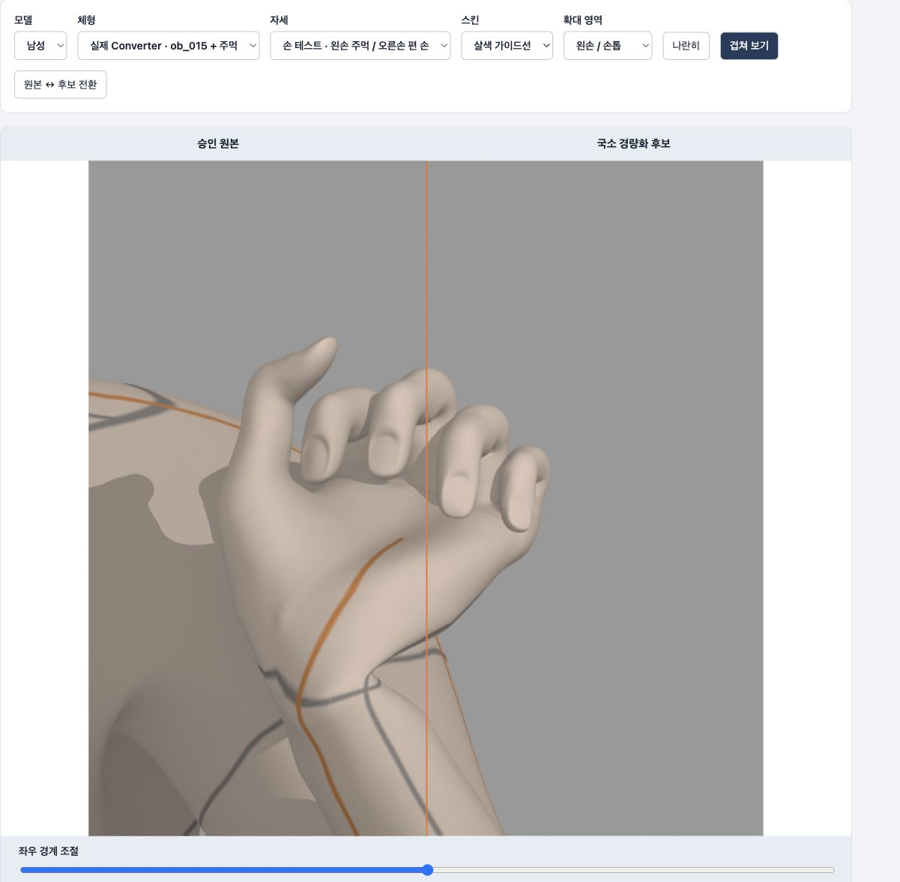

# Male whole-mesh target with the repaired fist preserved

The selected male authoring mesh and actual final FBXs have **93,000 vertices**:
38 fewer than the user's previous 93,038-vertex budget, and 12,791 fewer than
the fist-repaired v4 model. This supersedes the male selection in
[HANDS_BODY_V4.md](HANDS_BODY_V4.md). The female selection is unchanged.

| Male source region | Fist-repaired v4 | Selected v5 | Change |
| --- | ---: | ---: | ---: |
| Torso | 10,017 | 4,305 | -5,712 |
| Arms | 11,134 | 6,256 | -4,878 |
| Legs | 5,876 | 3,675 | -2,201 |
| **Torso + arms + legs** | **27,027** | **14,236** | **-12,791 (47.33%)** |
| Hands | 51,058 | 51,058 | 0 |
| Feet | 25,667 | 25,667 | 0 |
| Head + neck | 2,039 | 2,039 | 0 |
| **Entire mesh** | **105,791** | **93,000** | **-12,791 (12.09%)** |

Regions are disjoint reporting categories. New body vertices are classified by
the largest immutable original-region correspondence mass; all source triangle
corners of a new point belong to body regions. Anatomical segmentation is not
implied. The original approved mesh has 139,474 vertices. The small 38-vertex
overall improvement over v3 is intentional: restored hands consume the savings
from much more aggressive body reduction.

## Topology and protection

All 53,578 original points with total Hand-bone weight >0.01, including 2,520
points reported as dominant-arm wrist blends, retain exact source identity and
incident face connectivity. The v4 non-body graph is frozen too. This preserves
the topology-dependent Converter fist smoothing and its root support.

Body topology is rebuilt using progressive multi-frame quadric collapses and
projection onto actual original body triangles. Every new point has a fixed,
normalized, nonnegative, at-most-three-source-point barycentric map with zero
offset. BODY/PSD channels, numeric control evaluation, normals, UVs and skin
weights use the same correspondence. All original control math remains at source
resolution; only the physical deformation/export mesh is reduced. There is no
final-FBX decimation or hidden original-resolution mesh.

The **body protection strategy changes** from v4's broad joint neighbourhoods
and frozen faces to exact body UV seams and small joint anchors, while keeping
the entire hand/non-body graph frozen. With the old body's incident-face bands,
the tested topology had a 93,711-vertex floor. Body face connectivity is therefore
allowed to change; this is not described as retaining every old protected face.
84,327 source points remain exact, including 5,563 in body reporting regions.
The numeric error thresholds below are unchanged.

The planner evaluates 38 original pose/shape fields, three measured original
Converter final pose fields, 20 geometry-output/reference fields and Basis
(62 fields). Cost uses pose fields, with bulk/fat fields weighted 1.05 and actual
Converter fields weighted 1.15; normalization is 0.5, maximum edge length 0.08m
and surface cost ratio 1.02.
Orientation, topology, seams, frozen graph and paired geometry-reference winding
checks constrain accepted changes. These heuristics are not an error guarantee;
actual authoring and exported-file checks determine acceptance.

## Validation

All nine approved male presets and a large custom pass: **10/10 cases, 38 poses**.
Neutral geometry/height/floor, real FBX round trips, bones and mapped weights are
checked. The body-only source-to-candidate sampled surface p99 limit remains
0.5mm; worst measured p99 is **0.497540mm** (bulk/sit). Maximum sampled
body distance reaches 0.901781mm, so p99 is not a maximum-distance guarantee.
Protected authoring-point error is zero. Largest mapped authoring p99 is
0.030801mm. Neutral finger matrix-basis error is zero; evaluated neutral hand
surface differs by 0.000241mm floating-point error.

The actual Converter validation uses base/preset/large-custom, default/flesh-guide,
original/candidate, one fresh conversion each: **12 files, six paired comparisons**.
The unchanged pinned Linux amd64 image, Blender 5.2.0 fbe6228777e7, CPU2/4GiB,
ob_015 and real left-fist/right-open settings are used. Both sides have freshly
prepared Linux neutrals; completed-FBX, retarget and appearance caches are off.
The delivered custom recipe is snapped to the same 189.684899cm grid on both
variants. Every final file is rehashed and independently reloaded for comparison. All
12 conversions and all six final pairs pass. Body p99 is 0.414059mm base,
0.390443mm preset and 0.490982mm custom, identically in both skins. Hand,
protected-point and rig-head maxima are zero. Mapped correspondence p99 is at
most 0.023470mm; maximum sampled actual body surface distance is 2.967309mm.
The v5 gate additionally requires actual vertex count strictly below 93,038 and
hand maximum **exactly zero**. Existing correspondence p99 <=0.5mm, protected
maximum <=0.05mm and separate body surface p99 <=0.5mm remain required.

The earlier fat105 trial passed authoring but was rejected after actual Converter
custom body p99 reached 0.575188mm. Its hand maximum was already zero. The
selected planner adds the measured original Converter pose fields and rechecks
all authoring cases; the rejected trial is not delivered as a selection. Actual
final surface maxima are reported separately from the p99 gate.

This is functional validation with n=1 per combination. No new repeated
performance claim is made, and unchanged female conversions are not rerun.
The gallery contains 160 base/pose/skin renders, 40 full-body shape renders and
12 views of actual Converter finals. Images share original/candidate cameras.

## Local files and limits

New files are isolated under `/private/tmp/standin-mesh-light-v5-final-20261115`.
Selected source: `compact/male-frozen-hands-body-93000-v5-final115`.
Its manifest pins the blend, controller, source correspondence, UV and topology
plan hashes. `delivery-package` contains the three candidate neutral FBXs and
fresh local skin identities. `benchmark` contains the six actual posed candidate
FBXs and their original pairs. `delivery-manifest.json` hashes the deliverables.
Small JSON evidence is copied into this repository's `evidence/body-v5` folder.
Full worker reports stay in the hashed local benchmark; the committed audit
retains file/runtime/source identities and prepared-neutral status.
The committed planner reproduces the selected plan byte for byte (same SHA256).

The central checkout, approved originals and v3/v4 artifacts remain untouched.
No production catalog, S3, release, CSP certification or SSR2 pin is activated.
**This v5 candidate has not been imported in CSP.** The earlier disabled Open
button was a historical v4 attempt, not a v5 certification. Human surface/skin
review and CSP import remain distinct from these numeric passes.

Delivery manifest: 457 files / 1478614694 bytes;
SHA256 `d68d99286c912c53cc418193d600eacafb6498e19dc5abb5df331947a6cf185e`.
