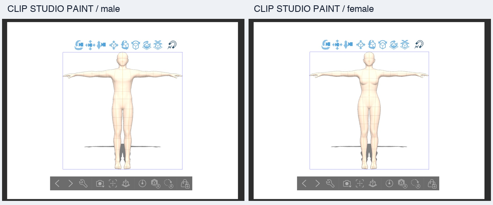

# Visible skin on both local model deliveries — 2026-11-16

The earlier direct model links selected the **geometry-only default FBX**. Those
files have no skin UVs or image binding; the comparison gallery applied its skin
in a later step. Calling those direct links colored CSP deliveries was incorrect.
The current male and female models are now backed up and delivered with visible
skin in separate files. The geometry selections remain male v5 **93,000** vertices
and female v4 **94,901** vertices.

## Backup before editing

`/private/tmp/standin-model-color-fix-20261116/backup` contains the complete selected
authoring folders, three candidate neutral FBXs per gender, local skin metadata
and associated skin resources. **57 files / 258,225,163 bytes** were copied and
source/backup SHA256 values checked before generating any corrected output.
The original v4/v5 artifact trees and their pinned manifests are unchanged.

## Correction

`scripts/character_lod/color_delivery.py` uses the existing typed FBX skin writer
to add approved skin UVs, one opaque material, a PNG texture and embedded Video
content. Each gender has base/preset/large-custom in flesh and flesh-guide:
**12 corrected FBXs**. Fallback diffuse color is the approved flesh texture's
sRGB (250,223,202), so a missing texture does not become a white material. PNG
sidecars with relative names are provided as well as embedded image bytes.
There is no geometry re-export or decimation during material attachment.

Both editable `.blend` files also have a packed flesh image, full-mesh UVs,
image-to-Base-Color node connection and a matching preview material. Vertex
positions, polygon order, shape keys, control/source properties, drivers,
weights and rig/pose matrices have identical semantic digests before editing
and after saving/reloading. Their original controllers are retained. This is a
local colored delivery, not a replacement runtime registry or a change to the
legacy geometry-only export contract.

## Verification

Every new FBX is independently imported and checked for an opaque image-bound
material, exact source image bytes and skin UV correspondence. All original
non-geometry typed FBX objects remain exact. Removing only the added UV node/link
restores the original geometry fingerprint. Independent imported comparisons
report **0 position, matrix, weight and normal error** for all 12 files.
The hand repair and reduced body geometry are therefore unchanged.

Both base flesh-guide FBXs were actually imported through **CSP File > Import >
3D data**, in separate Color-expression documents. Skin color and guide lines
are visible in both. The documents were saved as `qa/CSP-male.clip` and
`qa/CSP-female.clip`; untouched full-window screenshots and the smaller canvas
comparison are retained. Existing user documents were not edited. The earlier
v4/v5 failed picker checks are historical; this check successfully used the 3D
import route. This verifies base material display, not all-shape poseability or
an activated production skin certification. No performance improvement is claimed.

## Files

All files are under `/private/tmp/standin-model-color-fix-20261116`:

- `models/male-guide.fbx`, `models/female-guide.fbx`: flesh with guide lines.
- `models/male.fbx`, `models/female.fbx`: plain flesh.
- `models/variants/`: matching preset and large-custom exports.
- `authoring/male/model.blend`, `authoring/female/model.blend`: editable packed files.
- `backup/`, `backup-manifest.json`: pre-edit sources and restoration identities.
- `color-report.json`, `qa/`: geometry/material evidence and CSP documents/captures.

The script consumes the verified backup manifest. Reproduce into a fresh root
with the same backup tree/manifest, then run pinned Blender 5.2.0:

```bash
blender -b -t 2 --python-exit-code 1 \
  --python scripts/character_lod/color_delivery.py -- --root /new/isolated/root
```

The script generates FBX/authoring materials and independent reload checks.
CSP import/display checks are separate recorded UI actions, not inferred from
Blender success. Small JSON evidence is in `evidence/color-20261116`.


