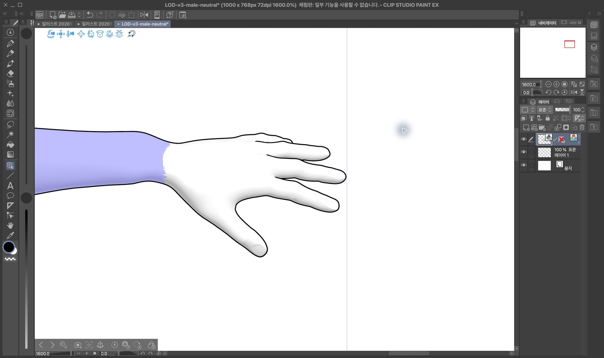
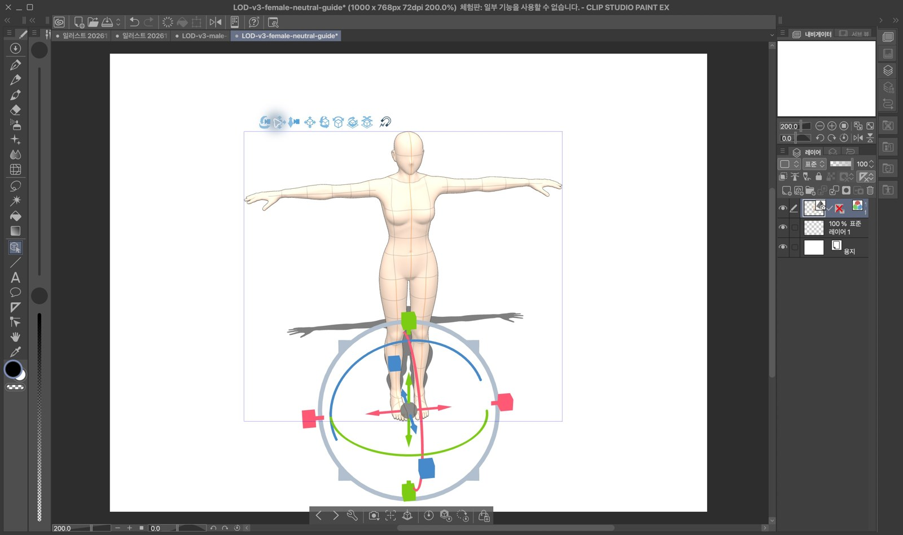
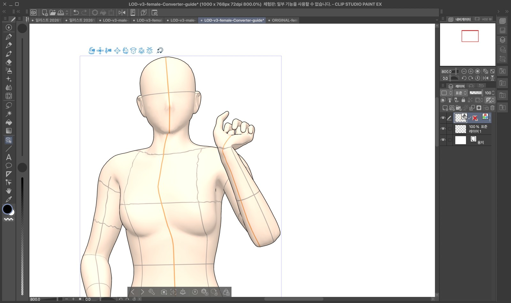
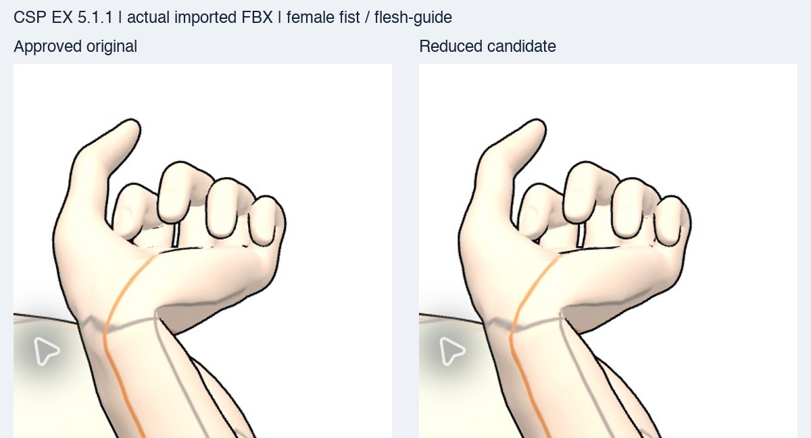

# CSP 5.1.1 manual import review — 2026-11-14

The Mac was available on the follow-up attempt. **Five actual FBX imports passed**
in macOS CLIP STUDIO PAINT EX 5.1.1 (trial mode): four new candidate cases and
one original comparison. This supersedes the earlier “Mac locked / unverified”
status for these representative imports.

| File / condition | Observed result |
| --- | --- |
| Male candidate, neutral/default | Full body loaded; left fingers extended after camera orbit and 1600% canvas detail; nail shapes visible. |
| Female candidate, neutral/flesh-guide | Flesh color and guide texture displayed; front and oblique views loaded. |
| Male candidate, actual Converter ob_015/default/fist | Full posed body and closed-left/open-right hands displayed; 800% detail rendered. |
| Female candidate, actual Converter ob_015/flesh-guide/fist | Full posed body, flesh/guide texture and hand detail displayed at 800%. |
| Female original, same actual Converter condition | Imported independently using the same 1000×768 canvas, default import view, zoom anchor and 800% detail for comparison. |

Blue joint-selection colors and transform gizmos are CSP editing overlays.

No import error, missing whole-body surface, missing texture or missing fingers
was observed in these views. The neutral left-hand problem is visibly fixed in
CSP. The female fist comparison shows small differences in finger/palm contours;
this display check does **not** clear the previously measured final-fist
correspondence hold (maximum 4.17mm across the full measured matrix).

This is representative import/display evidence, not certification of every
preset, all six skins, arbitrary CSP reposing or joint limits. Save/reopen was
not tested in trial mode. Five separate unsaved test canvases were created;
existing documents and input FBX files were preserved. The female candidate
canvas is left visible beside the original comparison tab.

Exact file paths, SHA256 values and eleven native screenshot hashes are in
[evidence/followup/csp-review.json](evidence/followup/csp-review.json). Raw PNGs
are local under `/private/tmp/standin-mesh-light-followup-20261114/csp-review/`.
The original delivery manifest remains unchanged; the new receipt references
its hash. No production asset or certification pin was changed.

