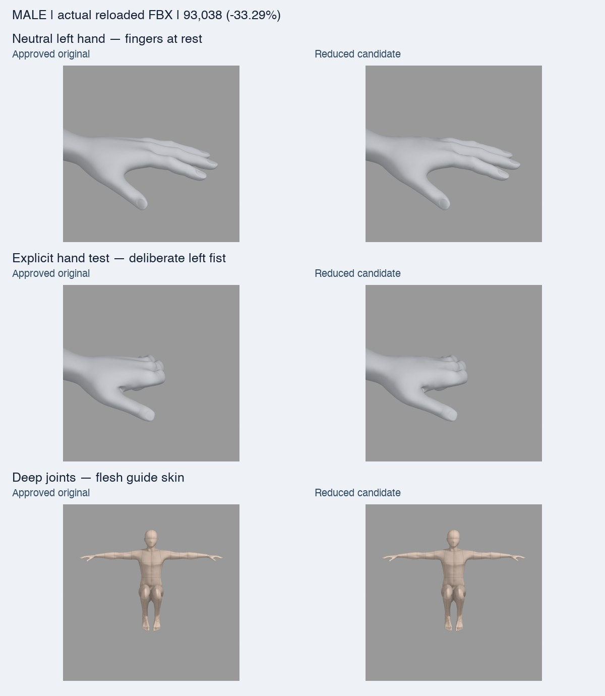
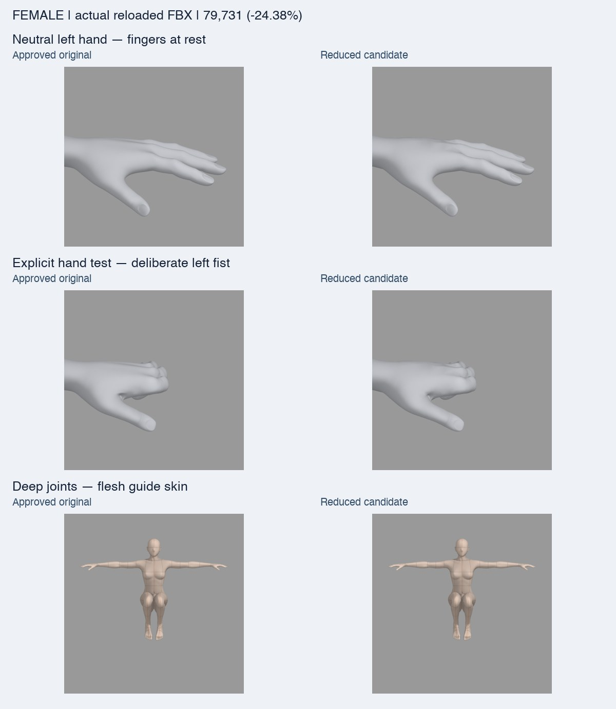
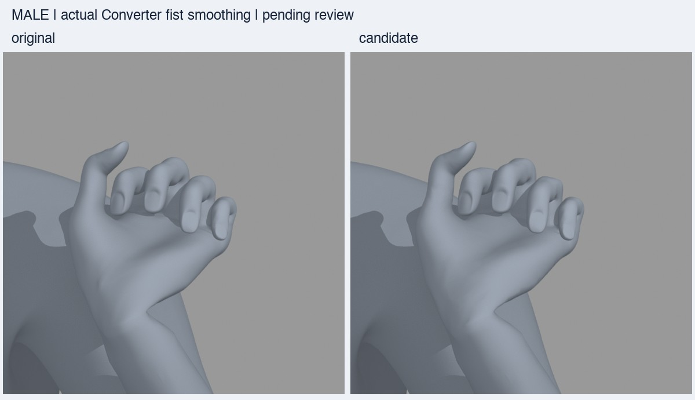
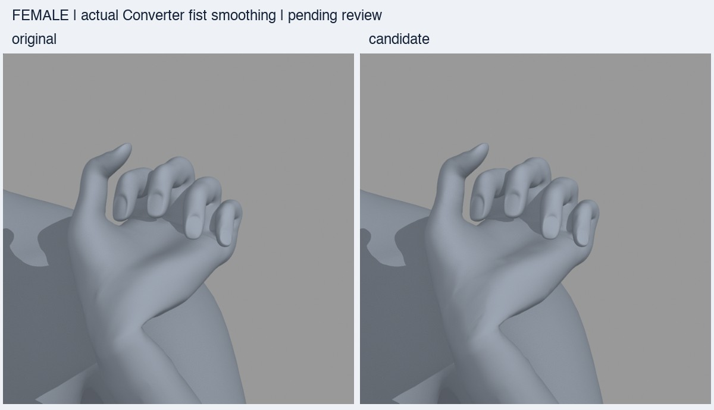

# Neutral-hand fix and stronger mesh candidates

This follow-up supersedes the first 3.64% / 3.03% candidates for review. The
original assets and the first run's binaries/evidence remain preserved.

## Correct neutral hands

The earlier review helper applied its left-fist/right-open test to **every**
pose, including `neutral`. The neutral source body was not supposed to request
that articulation. Finger edits now run only for the explicit `hands` test.
The gallery starts on a neutral pose; the test is labelled separately.

A real Blender regression checks all finger `matrix_basis` values and compares
the evaluated neutral hand surface with the neutral control computation. Both
selected candidates have exactly zero finger rotation, with only about
0.00024mm / 0.00027mm floating-point surface error. The unit test also rejects
finger edits on neutral, raised, elbow, deep, sit and cross views.

## More reduction without changing the control graph

| Model | Original | First candidate | New selected candidate | New reduction |
| --- | ---: | ---: | ---: | ---: |
| Male | 139,474 | 134,398 | 93,038 | 33.29% |
| Female | 105,430 | 102,233 | 79,731 | 24.38% |

We tested 0.15 / 0.25 / 0.30mm local eligibility levels with up to 18 isolated
vertex-star rounds. Distal phalanges/nail support, finger joints, head/neck,
important joint cores, toe ends, actual sole extrema and UV seams are protected.
The 0.30mm candidates reached 90,724 / 78,805 vertices, but one extreme case for
each exceeded the existing 0.5mm surface p99 screen slightly. Those candidates
remain unselected. The 0.25mm level is the strongest tested level that passes
all authoring-pose numeric checks; no thresholds were relaxed. The separate
actual Converter fist check below remains held.

The original graph-dependent body math is now retained as **numeric reference
data**, not a hidden second Blender mesh. A pinned copy of the original pure
control evaluator computes on that graph, then the immutable correspondence
selects the reduced mesh's points. The reduced mesh is used for neutral body
assignment, armature/PSD deformation, solver input, FBX generation and final
validation. No simplification takes place after the final FBX is complete.

This avoids the earlier problem in which changing graph adjacency changed
strong physique/muscle smoothing. All BODY keys/PSDs/weights are still mapped by
the same exact source-vertex subset. Remaining points match the original in the
current manual-pose/body comparisons; removed-point surface error is measured
separately. Full-resolution control math still has a cost and is **not** claimed
to have been reduced to the new point count. The benchmark includes that cost.

Both source and candidate authoring files use compressed blend serialization in
this run. Every candidate has a new character ID, source/controller/FBX hash,
fixed index map, UV/weight/index hashes, fresh preview correspondence and fresh
candidate neutral cache. Old SSR2 or skin certification pins are not reused.

## Checks and outputs

- All 9 male and 11 female published presets plus one large custom per gender.
- Correct neutral, raised arms, elbows, deep hips/knees, sit, crossing, explicit
  hand test; every preset includes raised-arm and seated evaluation.
- Unchanged geometry/height/floor and real FBX round-trip/rig/weight checks.
- Additional existing thresholds: retained p99 <=0.5mm, protected maximum
  <=0.05mm, sampled source-to-candidate surface p99 <=0.5mm.
- Both selected candidates pass **10/10 male and 12/12 female cases**.
- Neutral hand regression passes on the actual selected blends.
- All supported skins and actual final-FBX comparison renders are regenerated.
- Actual Converter fist comparisons are additional diagnostics, distinct from
  authoring poses; they remain held as described below.

The local follow-up assets are separate:
`/private/tmp/standin-mesh-light-followup-20261114/`.
The updated browser comparison uses that folder, with neutral selected first.
The earlier runtime approximation files and CSP checks belong to the earlier
candidates and are not presented as certification of these new assets.

The current full-controller preview path and fresh barycentric preview data
exist in the new sources. No approximate SSR2 for the new topology is activated.
There is no catalog/S3/default swap, main merge, staging/production deployment or
2.10.6 release action. Work remains on Draft PR #243 against the same frozen
develop baseline.

## Timing

A fresh 72-conversion matrix uses the same Linux amd64 image, Blender5.2.0,
CPU2/4GiB, ob_015, actual left fist/right open, base/preset/large custom,
default/flesh-guide, and three runs per condition. Both variants use genuine
prepared neutrals and no completed-FBX/retarget/appearance cache. The original
prototypes are reused byte-for-byte only after validating the same code/build/
source identity; candidate prototypes are newly generated.

Neutral body/gallery fingers are **not** the benchmark's deliberate fist/open
condition. The two purposes are now explicitly separated. This remains a local
Converter/final-validation/skin/fsync file-ready measurement, not app UI or HTTP
end-to-end latency. Final means, medians, ranges and stage results are recorded
under the follow-up evidence after the run completes.

## Follow-up reproduction and review

Use the audit, compaction, quality, packaging and rendering commands in
[REPRODUCE.md](REPRODUCE.md), with a fresh follow-up root and these build options:

```bash
blender --background --factory-startup --python-exit-code 1 \
  --python scripts/character_lod/build.py -- \
  --blend "$ORIGINALS/standin-body-0-8-0.blend" \
  --controller "$ORIGINALS/standin-body-0-8-0.py" --gender male \
  --skin-uv "$SKINS/male-base-v0-8-0-uv.json.gz" \
  --method surface --registry "$APPROVED_REGISTRY" --rounds 18 \
  --tolerance-mm .25 --span-mm 30 --out "$NEW/trials/male-250"
```

Repeat with the female filenames/UV and `--gender female`. The emitted folder
is `<gender>-surface-250um-ref-v3`; compact that folder, then run the unchanged
quality checks. The trial registry must contain all approved recipes, with
matching pinned controller versions. This level also evaluates one large custom
control combination before choosing topology. To reproduce selection, generate
separate .15 and .30 levels and retain all results, including failed checks.

Use `package.py --identity-suffix lod-surface-v3-20261114`. Fresh candidate
preparation and skin manifests must refer to these new source hashes and IDs.
Use the same Docker invocation from reproduction with the follow-up asset root
mounted at `/work`; do not mix first-run timing samples into this comparison.
Run `analyze.py` after all 72 conversions, then `compare_finals.py` in Blender
against the resulting actual final files. Hash the completed bundle using
`delivery_manifest.py --revision followup --assets <root>`.

[Open local comparison](http://127.0.0.1:8769/review/index.html).
Evidence is under [evidence/followup](evidence/followup).




The first new CSP attempt was blocked by the Mac lock. A later direct review
in CSP EX 5.1.1 imported five files successfully (four candidate cases plus one
original comparison); see [CSP_REVIEW.md](CSP_REVIEW.md). The first run's older
CSP screenshots are not used as evidence for these new sources.

The selected candidates' worst sampled surface p99 values are 0.4201mm male
and 0.4323mm female. This is a percentile screen, not a maximum-error guarantee:
maximum sampled distances reach 2.2505mm / 1.4474mm in large custom poses.
Retained/protected coordinates in those authoring-pose comparisons remain
exactly equal. Manual silhouette, fold, nail and skin review is still required.

Compressed authoring source sizes are 86.06 → 70.51MiB male and
76.34 → 41.95MiB female. These include the preserved numeric reference graph;
their storage ratios differ from the physical mesh's vertex ratios.

## Completed repeated timing

All 72/72 conversions succeeded and every saved SHA256 was reverified. Each
row has three runs per variant. Values are local file-ready median (range)
seconds; mean values and nested stage spans remain in the JSON evidence.

| Model / condition / skin | Original seconds | Candidate seconds | Median reduction |
| --- | ---: | ---: | ---: |
| male / base / default | 35.06 (33.56–35.64) | 25.62 (25.04–26.04) | 26.92% |
| male / base / flesh-guide | 55.55 (55.50–55.57) | 40.71 (40.64–40.81) | 26.72% |
| male / preset / default | 32.48 (32.03–34.81) | 23.87 (23.72–24.09) | 26.49% |
| male / preset / flesh-guide | 48.16 (48.12–48.37) | 35.95 (35.66–36.16) | 25.35% |
| male / custom / default | 34.38 (34.34–34.89) | 25.97 (25.92–26.46) | 24.44% |
| male / custom / flesh-guide | 50.18 (50.02–50.22) | 37.87 (37.83–37.88) | 24.53% |
| female / base / default | 22.24 (22.16–22.25) | 17.42 (17.38–17.44) | 21.70% |
| female / base / flesh-guide | 34.93 (34.88–35.00) | 28.09 (27.97–28.19) | 19.60% |
| female / preset / default | 23.26 (23.25–23.34) | 18.51 (18.47–18.53) | 20.44% |
| female / preset / flesh-guide | 35.90 (35.87–35.97) | 29.12 (29.05–29.17) | 18.87% |
| female / custom / default | 24.13 (24.06–24.23) | 19.32 (19.10–19.35) | 19.94% |
| female / custom / flesh-guide | 36.72 (36.46–36.88) | 29.92 (29.73–29.93) | 18.52% |

These are fresh paired original/candidate samples from this follow-up, not a
comparison against the first experiment's slower baseline. All observed ranges
are disjoint in this batch. The results include changed source serialization,
reference-data handling and all real Converter stages; they do not isolate a
vertex-count-only causal effect or establish whole-app latency.

## Actual Converter fist: additional hold

The twelve trial-zero pairs were independently reimported from actual final
Converter files. Rig head positions match exactly and the right open hand
matches exactly. The separate **closed-left-fist smoothing** in
`converter.hand_rig.smooth_baked_fingers` uses mesh adjacency, so changing
proximal finger topology changes the baked fold surface even with the same
retained input coordinates and bone rig. This stage is not executed by the
authoring helper's simple 75-degree hand pose. Its topology dependency is left
unchanged in the frozen production implementation.

Final retained p99 differences are 0.5314–0.6642mm, global maxima are
2.9346–4.1709mm, and protected-point maxima are 0.4271–0.5624mm. These exceed
the additional correspondence screen used for authoring (p99 <=0.5mm,
protected max <=0.05mm). All twelve actual fist pairs therefore remain **held**;
the earlier authoring 22/22 result does not certify this different stage.
The neutral hand fix is independent and still passes its real regression.

The gallery includes a separate **actual Converter / ob_015 + fist** selection
with 24 new direct final-file images. Total comparison images: 432. No gate was
lowered and no production asset is replaced. These stronger assets are review
candidates, not a zero-regression production recommendation. Preserving the
closed-fist smoothing graph (or independently approving its changed folds) is
still needed before promotion. Representative new CSP imports/display now pass;
this does not clear the numerical fist hold or certify every shape/skin. See
[CSP_REVIEW.md](CSP_REVIEW.md).



