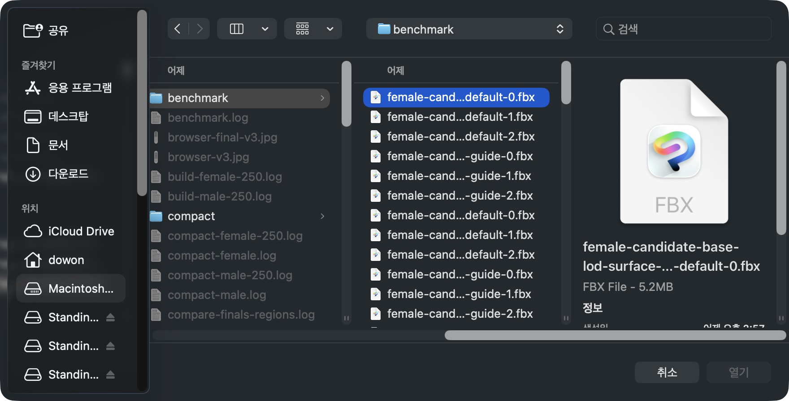
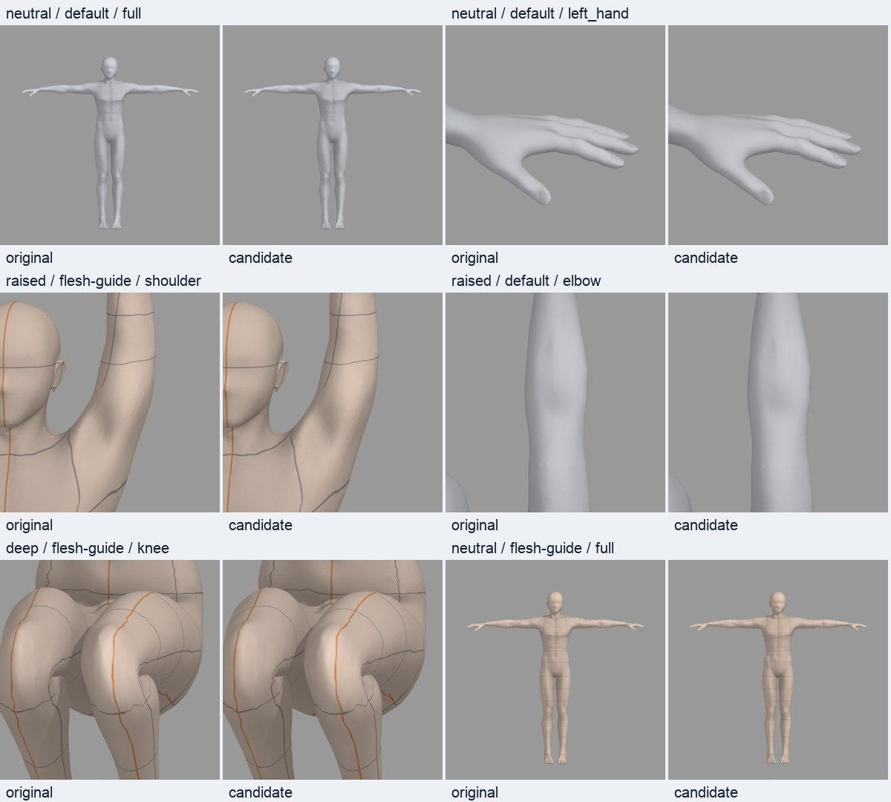
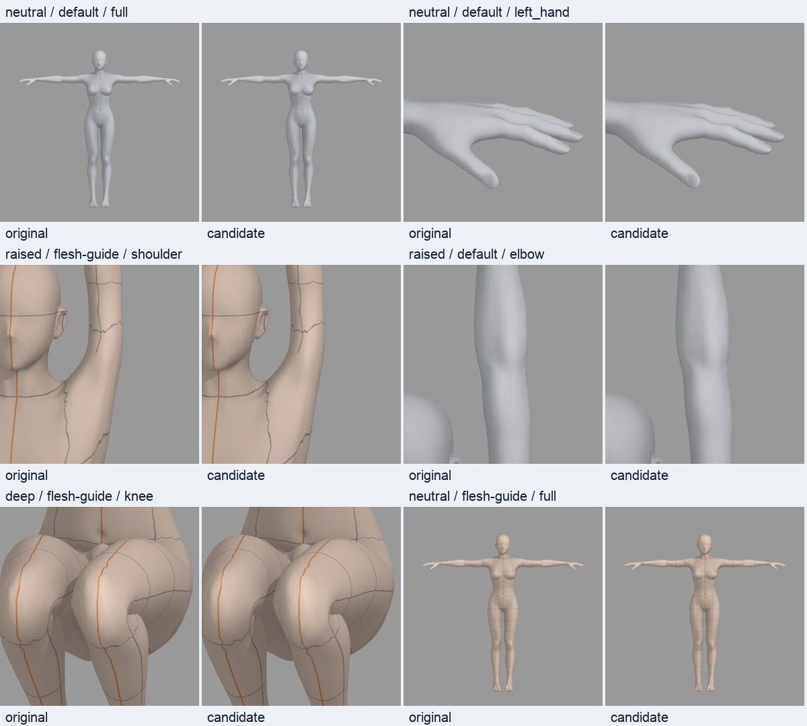
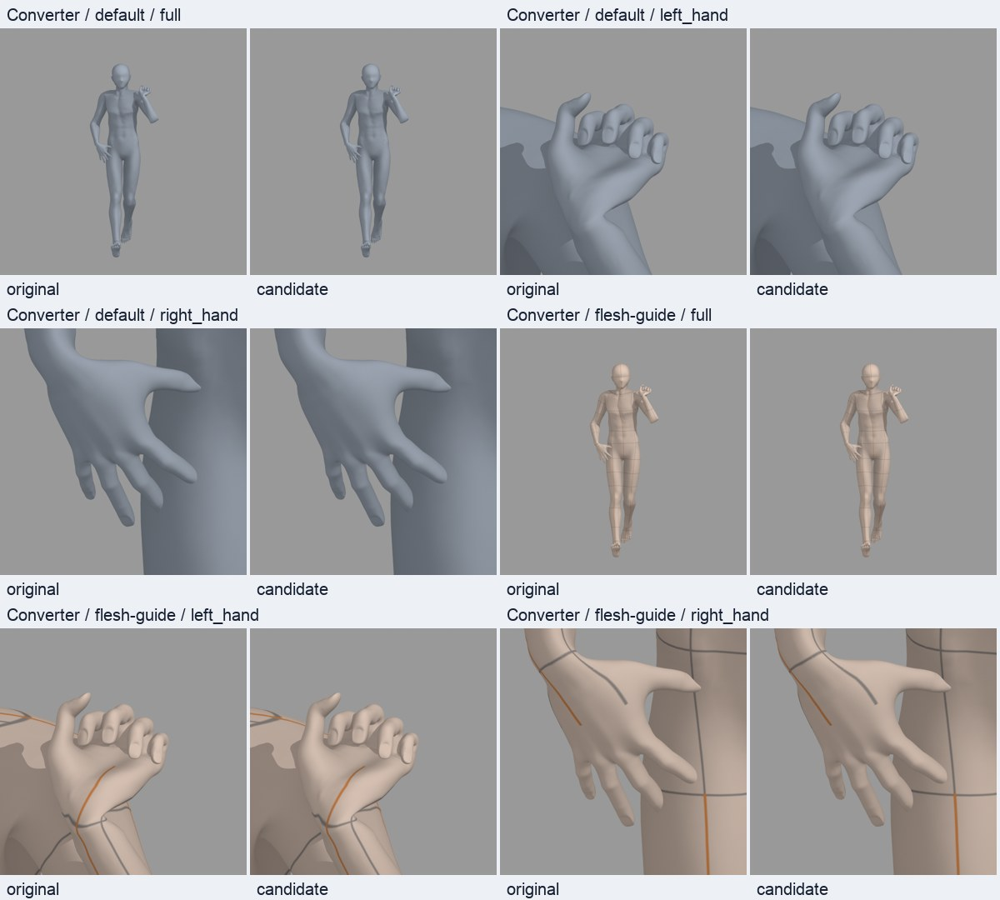
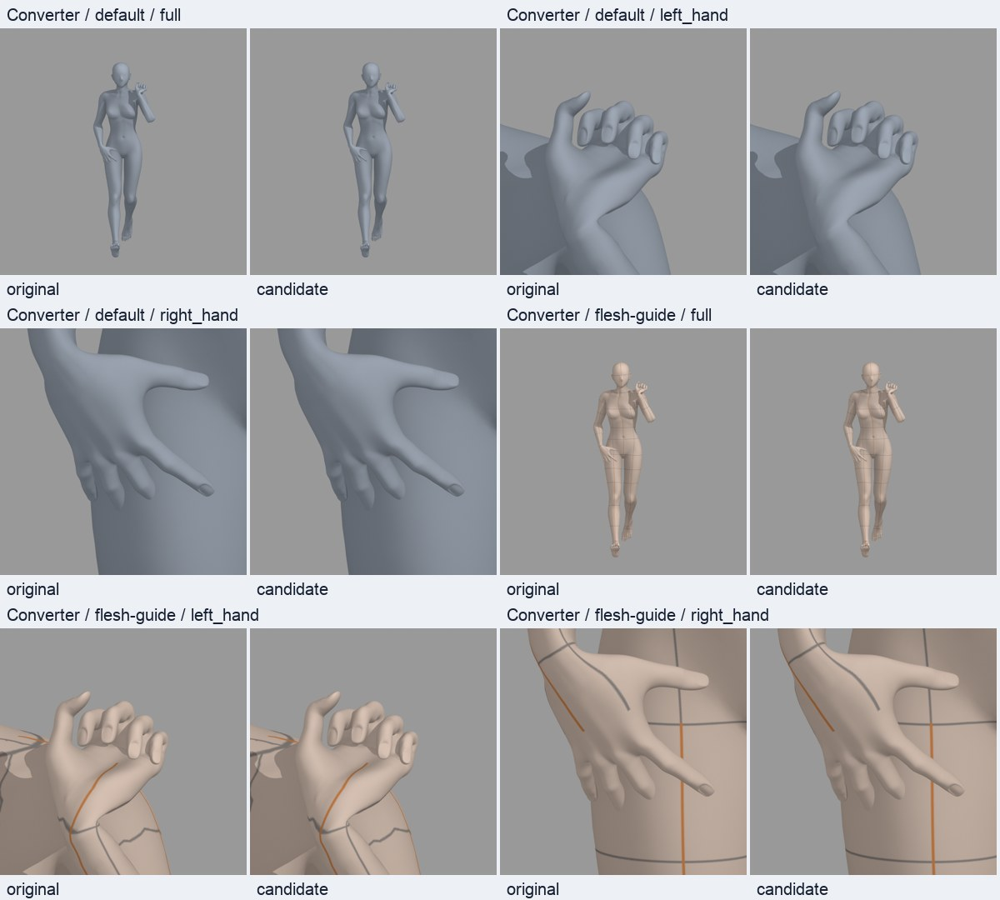

# Closed-fist graph preservation and further male body reduction

This review supersedes v3 for the current fist/body work. The earlier v3 assets,
measurements and CSP evidence remain historical; they are not modified or used
as certification of these new hashes. The production Converter is unchanged. **All twelve actual Converter final-fist
pairs now pass the original correspondence gates and the new hand/body regional
gates.**

## Selected meshes and the vertex-count tradeoff

The topology-dependent fist smoother needs the original adjacency around its
moving points. The selected models preserve every vertex with total Hand-bone
influence >0.01 and its protected incident faces. Both hands are protected, not
only the left fist used in the comparison. Source coordinates, weights, BODY/PSD
channels and the fixed source correspondence remain exact at retained points.

| Male region | Approved original | Previous v3 | Selected v4 | Change from v3 |
| --- | ---: | ---: | ---: | ---: |
| Torso | 22,129 | 10,929 | 10,017 | -912 |
| Arms | 23,471 | 11,461 | 11,134 | -327 |
| Legs | 6,677 | 6,093 | 5,876 | -217 |
| **Torso + arms + legs** | **52,277** | **28,483** | **27,027** | **-1,456 (-5.11%)** |
| Hands | 51,058 | 36,857 | 51,058 | +14,201 |
| Feet | 34,100 | 25,659 | 25,667 | +8 |
| Head + neck | 2,039 | 2,039 | 2,039 | 0 |
| **Entire mesh** | **139,474** | **93,038** | **105,791** | **+12,753** |

These regions partition vertices by their dominant skinning bone; they are
additive reporting categories, not anatomical segmentation. Male torso/arms/
legs are 48.30% below the approved original, and each is below v3. **Total male
vertices increase from v3**, because restoring the original hand graph adds more
vertices than the additional body reduction removes. Relative to the approved
original the entire male mesh is still 24.15% smaller.

The female graph repair yields 94,901 vertices (previous v3 79,731; approved
original 105,430). Its 51,058 hand vertices are restored too. Female body regions
were not targeted for further reduction in this request; their selected counts
are torso 4,768 / arms 5,813 / legs 6,494. This is not presented as a reduction
from the previous female candidate.

## Unchanged numeric gates and source math

All nine approved male and eleven approved female presets plus one large custom
per sex pass their authoring checks: **10/10 male, 12/12 female**. These include
neutral, raised, seated and the extended base/custom elbow, deep, crossing and
explicit-hand cases; geometry/height/floor, actual FBX round trips, weights and
rig checks run without relaxing the original gates.

The existing retained correspondence p99 <=0.5mm, protected maximum <=0.05mm
and sampled source-to-candidate surface p99 <=0.5mm remain required. A new
**body-only** source-to-candidate surface p99 <=0.5mm also applies, so the dense
unchanged hands cannot dilute the body error. Worst body p99 is 0.4646mm male /
0.4293mm female. Retained and protected authoring-coordinate differences are
zero. Percentiles are not maximum-distance guarantees: worst sampled body
surface distances reach 1.4060mm / 2.2807mm, respectively.

Actual Blender neutral regressions also pass: finger matrix-basis difference is
zero, evaluated neutral hand surface differs by only 0.000241mm male /
0.000267mm female floating-point error. The earlier accidental neutral-finger
curl remains fixed independently of the deliberate fist test.

The final male uses bounded isolated vertex-star deletion with a 0.5mm local
eligibility level, 0.25mm in other regions, 5,309 measured source support points
and three source vertices guarding an inverted extreme-custom triangle.
Eligibility is not an error guarantee; the full deformed geometry tests decide
acceptance. The female uses the 0.25mm local level with full hand protection.

The complete original control graph is still numeric reference data with the
pinned pure evaluator. Only the actual authoring/deformation/solver/export mesh
is reduced. Control-graph math stays at original resolution. No simplification
runs after final FBX export. The selected meshes use exact source-vertex subsets;
experimental QEM triangle embeddings were rejected and are not delivered.

More aggressive star-deletion trials exceeded regional surface limits or
inverted an extreme-custom face. QEM trials also failed body surface/floor/
orientation checks. Their lower vertex counts are not selected, and no gate was
changed to admit them. The final adaptive candidate passed every preset again.

## Actual Converter acceptance and repeated measurements

The local matrix uses the unchanged pinned Linux amd64 image / Blender5.2.0
fbe6228777e7 / CPU2 / 4GiB, ob_015, real left fist/right open, base/preset/custom,
default/flesh-guide and three fresh workers per pair. Male and female groups run concurrently on
disjoint Docker CPU sets (0–1 and 2–3), with CPU2/4GiB per container, then their
72 files are combined and rehashed. The 15-vCPU Docker VM (7.75GiB visible memory) has no native
render/build jobs running during these measurements. Original and candidate
neutrals were freshly prepared on that runtime. Completed-FBX, retarget and
appearance caches are disabled. The authoring custom is 190cm; delivered
custom defaults are snapped to the published grid (male189.684899cm /
female189.893087cm), identically on both variants. All 72/72 conversions succeeded and every saved final SHA256 was independently
reverified. Final-file geometry and repeated timing results are below; the
former actual-fist hold is cleared for these measured pairs.

The final screen additionally requires hand maximum <=0.05mm and body-only
surface p99 <=0.5mm, together with the prior correspondence/protected limits.
`compare_finals.py --require-pass` rejects an incomplete or failed 72-file matrix
and any of the twelve trial-zero geometry pairs that fails these limits.

The initial functional-only male base pair (excluded from the repeated timing
batch) passes the actual final screen: hand/protected/retained maxima are 0mm,
body-only surface p99 is 0.3737mm. See [smoke-functional.json](evidence/hands-v4/smoke-functional.json).

## CSP attempt and review scope

CSP EX5.1.1 macOS trial opened the 3D file picker, but **Open remained disabled**
for the new female neutral and for previously imported v3 files. A shorter
byte-identical filename and file-selection refresh did not resolve it. Native
coordinate input returned `noWindowsAvailable`, while accessibility menu/path
selection worked. The picker was cancelled and the empty test canvas closed;
existing documents were not saved. No new-candidate CSP import pass is claimed.
See [the recorded observation](evidence/hands-v4/csp-review.json) and screenshot.
The earlier five successful CSP imports belong to v3, not these candidates.



Neither finite geometry nor correspondence checks certify all penetrations,
aesthetic folds, nail thickness, every skin/preset, arbitrary CSP reposing or
save/reopen. Fresh local UV/weight/index/FBX identities are generated for every
candidate alias. Old skin/SSR2 certification pins are not reused. Approximate
SSR2 is not activated.

## Reproduction and artifacts

Selected source folders under `/private/tmp/standin-mesh-light-v4-20261115/`:

- `compact/male-hands-body-500um-ref-v4-targeted`
- `compact/female-hands-body-250um-ref-v4-final`

[Selection and source hashes](evidence/hands-v4/selection.json),
[male QA](evidence/hands-v4/quality-male.json),
[female QA](evidence/hands-v4/quality-female.json),
[male manifest](evidence/hands-v4/male-manifest.json),
[female manifest](evidence/hands-v4/female-manifest.json).

Follow [the original isolated reproduction workflow](REPRODUCE.md). Convert the
published `male-required-source.json` / `male-guard-source.json` index lists into
int32 NPY arrays and verify their recorded NPY SHA256, then pass them with:

```bash
--method surface --surface-profile hands-body-v4 \
--tolerance-mm .5 --other-tolerance-mm .25 \
--keep-indices <male-required-source.npy> \
--extra-protected <male-guard-source.npy> --variant-suffix targeted
```

Female options are `--method surface --surface-profile hands-body-v4
--tolerance-mm .25 --other-tolerance-mm .25 --variant-suffix final`. Both use the
same approved original hashes/recipe registry/UV files as v3. Compact each source
with the semantic-hash guard and run full `quality.py` checks. Rebuild the local
package with identity suffix `lod-hands-v4-20261115`, fresh candidate neutral
exports, local skin manifests and Linux prepared prototypes for all twelve
aliases. Merge the two verified six-entry prepared indexes only in this new
local registry. Use the same pinned container mounts with this new `/work` root.

After all 72 conversions, run `analyze.py`, then native Blender
`compare_finals.py --require-pass`. Regenerate the actual-FBX gallery and
`delivery_manifest.py --revision hands-v4`. No previous delivery manifest is
mutated. The repo only contains small evidence and review images; large blend,
FBX, source-graph and render files remain in the separate local asset root.

Work remains on Draft PR #243 against frozen develop
`ee965494435dbaf26b643c2e1f8da1fe404dc513`. Central checkout, solver/production
loaders/skin code and production skin manifest remain unchanged. There is no
main merge, deployment, S3/catalog/default activation or 2.10.6 release action.





## Completed actual-Converter checks and repeated timing

All twelve trial-zero pairs pass: hand maximum 0.000000mm, protected maximum
0.000000mm, retained p99 maximum 0.000000mm and rig-head maximum
0.000000mm. The body-only sampled surface p99 ranges are:

- male: 0.3535–0.4580mm.
- female: 0.3661–0.4560mm.

These are the actual post-fist FBX files, separate from authoring pose tests.
All 72 final files passed the production pipeline and SHA audit. Gallery images
comprise 320 base-pose/all-skin views, 88 all-shape views and 24 actual Converter
base-pair views. Selected neutral/body/joint and actual-hand pairs were visually
inspected; the numeric result is not a blanket aesthetic/penetration certificate.

| Model / case / skin | Original median (range), sec | Candidate median (range), sec | Median reduction |
| --- | ---: | ---: | ---: |
| male / base / default | 39.19 (39.15–39.92) | 31.00 (30.93–31.14) | 20.89% |
| male / base / flesh-guide | 50.83 (50.57–52.38) | 39.55 (39.19–40.53) | 22.19% |
| male / preset / default | 35.27 (34.95–36.18) | 28.03 (27.91–29.39) | 20.54% |
| male / preset / flesh-guide | 53.79 (53.53–57.44) | 43.52 (43.49–44.40) | 19.10% |
| male / custom / default | 38.28 (38.04–38.51) | 31.05 (30.01–31.80) | 18.90% |
| male / custom / flesh-guide | 51.91 (51.46–52.75) | 42.32 (42.27–42.50) | 18.46% |
| female / base / default | 28.67 (28.27–28.75) | 26.17 (25.83–26.18) | 8.74% |
| female / base / flesh-guide | 37.16 (36.90–44.96) | 35.16 (33.93–37.81) | 5.39% |
| female / preset / default | 25.57 (25.23–25.65) | 22.88 (22.78–23.31) | 10.49% |
| female / preset / flesh-guide | 42.24 (39.60–42.91) | 36.57 (36.39–38.04) | 13.41% |
| female / custom / default | 27.19 (26.61–27.42) | 24.32 (24.09–24.55) | 10.56% |
| female / custom / flesh-guide | 41.20 (40.95–41.38) | 37.81 (37.74–37.92) | 8.22% |

Each row has three fresh workers per variant, with alternating order. Positive
reduction means faster; negative means slower. These are fresh paired samples
from this batch, not comparisons against v3 timing on a different schedule.
This includes the preserved full control math and actual hand/skin/final-file
work, not a vertex-count-only causal effect. Ranges and all means/stages remain
in JSON. File-ready ends at local fsync; API/network/app/CSP latency is excluded.
Files were later moved unchanged from the two measured group directories into
the final benchmark directory; each original measured path is retained.

[Open the v4 comparison](http://127.0.0.1:8770/review/index.html).
The gallery starts on neutral; actual Converter fists have a separate selection.

Final local manifest: **946 files / 3,395,641,869 bytes**,
SHA256 `aaabb8e3d2275650824ab45589f18695ed8dcd7295fbf67acbf786ec56e48310`. This remains a review-only bundle;
CSP import and human/skin certification remain unresolved as described above.




