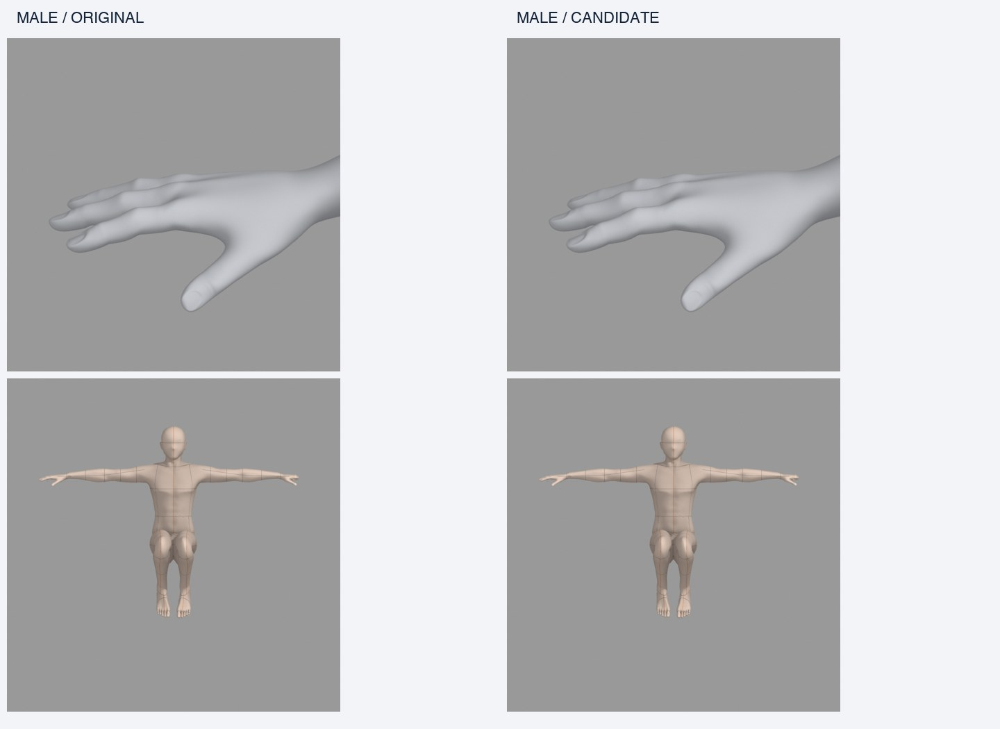
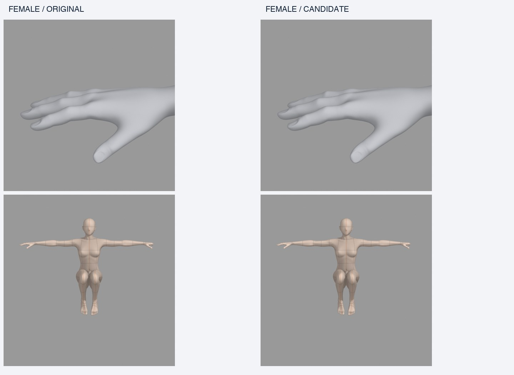
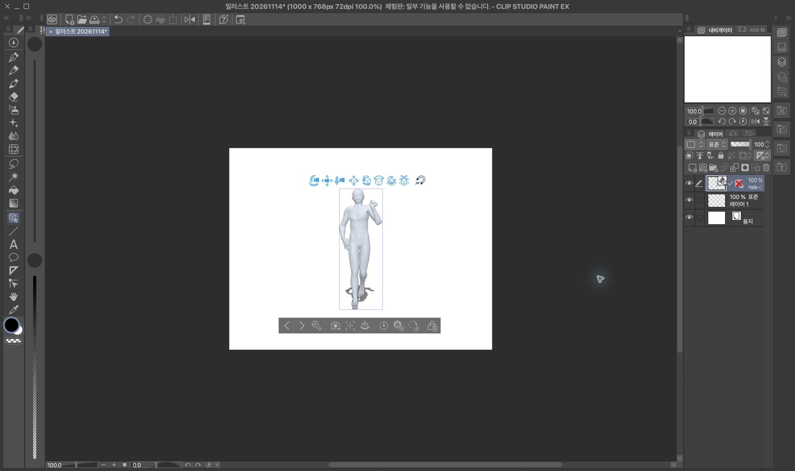
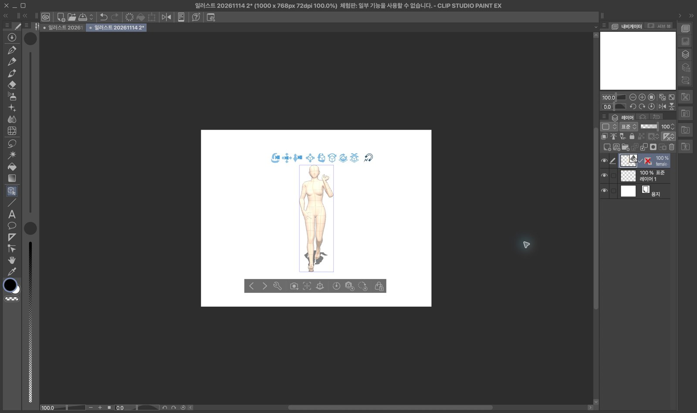

# Latest-body protected mesh reduction — local review, 2026-11-14

> Latest: [v4 closed-fist graph preservation and further male body reduction](HANDS_BODY_V4.md).

> Historical follow-up: [neutral-hand fix and stronger 33.3% / 24.4% candidates](FOLLOWUP.md). The sections below preserve the first experiment and its limitations.

The deliverables are offline candidate authoring assets, actual final FBXs,
quality evidence, a local browser comparison, and a repeated Converter benchmark.
The approved male/female defaults are unchanged. This is not a release or a
recommendation to switch the production catalog.

Baseline: remote `develop` fetched and frozen at
`ee965494435dbaf26b643c2e1f8da1fe404dc513`. Work is isolated in
`/private/tmp/standin-mesh-light-20261114` on
`codex/protected-body-lod-20261114`. The central checkout, other sessions,
existing evaluation folders, S3 assets/pins, main, staging and production were
not modified. No 2.10.6 release operation was resumed.

## Inputs and provenance

The latest authoring blends, controllers and neutral FBXs were recovered from
`/private/tmp/standin-final-preparation-qa-20261112`, checked against the supplied
release/shape registry and copied to the new artifact folder. All six exact
SHA256 values and paths are in [provenance.json](evidence/provenance.json).
Original files and the previous 11/13 experiment remain read-only.

The actual current sources contain a full authoring mesh and a UI-only Preview
LOD. They contain no lower-resolution production authoring mesh for this same
approved anatomy. Historical 24,988/24,999-vertex releases and their controllers
exist, but have version-specific geometry/correctives; they are not an equivalent
low-resolution source for the current model. They were not substituted.

## What was built and why

| Model | Approved vertices | Review candidate | Reduction | Rig / controls |
| --- | ---: | ---: | ---: | --- |
| male-base-v0-8-0 | 139,474 | 134,398 | 3.64% | 54 bones / 33 controls |
| female-base-v0-4-0 | 105,430 | 102,233 | 3.03% | 54 bones / 39 controls |

Multiple planar-dissolve and local-star candidates were generated separately for
each gender. Uniform whole-body Decimate was not used for a final body. The
original UI Preview LOD was not reused as a production mesh.

The first method protected hands/feet/head/major joints, then dissolved planar
interiors at 0.25/1/3/7/15 degrees. A second mask retained fingertips/nail support
and all finger-joint neighbourhoods while allowing palm simplification. Both
were also tried with actual reviewed UV seams protected. A 7-degree variant
reached roughly 31.5% male / 18.1% female reduction, but was **rejected**: male
strong body settings produced reversed triangles, and female extreme settings
had large surface/correspondence errors. The numeric failures are preserved in
[evidence](evidence/). A lower vertex count was not treated as success.

The selected review method removes only isolated local vertex stars (one or
three rounds), leaving separation between removals. Eligibility tests use a
0.08mm local plane-departure threshold in Basis and every BODY/PSD key, plus an
18mm maximum neighbourhood span. This threshold is a *selection heuristic*, not
a claimed Hausdorff bound. Actual deformed point-to-surface errors were measured
separately. The male mask additionally freezes a 4cm neighbourhood around failed
triangles discovered in the earlier strong-shape experiment.

A unique immutable integer map identifies each candidate vertex's original
vertex. Every BODY key, PSD, skin weight, landmark index and normal uses that
same correspondence. Protected face connectivity is checked. The original
bone hierarchy, rest axes, driver graphs, finger meaning and production solver
are retained. The existing authoring geometry and FBX round-trip checks run
unchanged. The male source-topology fat smoothing fields are resampled at the
same retained source IDs rather than silently recalculated on a different graph.
Other topology-sensitive behaviour is measured and disclosed.

Each candidate has a new asset identity, rules/controller hash, blend hash,
neutral FBX hash, full candidate UV/index/weight hashes, and a newly generated
50k UI preview with a new barycentric correspondence. Candidate skin manifests
include all supported skins, but carry **no inherited CSP certification**.
Prepared neutrals are regenerated with the exact final source hashes and pinned
Linux runtime. Temporary orphan source meshes are excluded from the delivered
blend; `compact.py` verifies semantic arrays and driver equivalence on reload.
This storage cleanup is disclosed separately from the vertex-count change. The approved originals are Zstandard-compressed blend containers, while the final candidates in this measurement use uncompressed blend serialization. Candidate blends are therefore larger on disk (about 113.3MiB male / 99.7MiB female) despite fewer mesh vertices. That loading/serialization difference and the resampled static fields mean this is a practical candidate-bundle comparison, not a vertex-count-only causal ablation.

## Quality and limits

All 9 male and 11 female default presets, plus a large custom for each gender,
pass the unchanged neutral geometry, height/floor, actual FBX round-trip,
54-bone and weight/rig reload checks. Base/custom additionally exercise raised
arms, elbows, deep knees/hips, sitting, crossing and finger poses; every preset
exercises raised arms and sitting. Independent surface checks use a fixed
sample of about 12,000 source points in each direction. Retained-point checks
cover every retained vertex. They are different metrics and are not conflated.

The extra conservative comparison screen requires retained p99 <=0.5mm,
protected maximum <=0.05mm, and source-to-candidate surface p99 <=0.5mm. It passes
4/10 male and 7/12 female shape cases; other cases are **held for human review**.
No threshold was lowered to call them passing. Those flags remain visible in
the browser and JSON evidence. They prevent automatic promotion.

Across the tested authoring poses and shapes, maximum retained-hand error is
about 0.0029mm male / 0.00031mm female; fingertip/nail-support proxy error is zero.
Face maxima are about 0.00047mm male / zero female. Exact region definitions,
retained/original counts, per-case and per-pose errors are in the region JSONs.
The nail proxy uses distal-finger weights and is not a nail segmentation or a
measurement of nail thickness. Source and candidate share original fine detail,
but visual nail thickness, finger collisions and aesthetics still need review.

Actual final FBXs are reloaded for comparison renders, with matching camera,
lighting and framing. Default, gray-guide, flesh, flesh-guide, muscle and
flesh-muscle skins go through the existing typed writer and independent
file/UV/material/embedded-image verifier. All presets/custom bodies also receive
full-body default/flesh-guide FBX renders. No image generation or mock body
illustration is used.

The finite/round-trip/skin checks do not prove absence of all penetration or
folding. The approved controller itself reports contact checking as unavailable;
no collision solver was invented or disabled. Check hands/nails, body outline,
shoulder/elbow/knee creases and crossing contacts in the browser. Two actual final Converter files were imported and displayed in macOS CSP trial drawing mode: male candidate/default and female candidate/flesh-guide. Screenshots, application version and exact FBX hashes are in `evidence/csp-import.json`. This is a representative import check, not full CSP certification. HTTP timing and interactive app button-to-disk timing remain unmeasured.

## Timing protocol

The benchmark uses one pinned local Linux amd64 image
`sha256:a4d731fe35682f3e97f2bbeb53e188c3f43fd2bdc3f6da6a89cedb41ab2c5fd6`,
Blender 5.2.0 / `fbe6228777e7`, CPU 2 and memory 4GiB. The image supplies the
runtime; `/code` mounts the latest frozen develop plus these isolated scripts.
Both sides use the same worker, solver and validators. Source BVH is the
original `ob_015`, SHA256
`a98738379acb614c5d070cec2f53e1f7df4fae0cef4c97dee1b08201caa8ef83`.
Hands use actual Converter left `fist` / right `open`. PNG/GLB outputs are off.

The matrix is 2 genders x 2 variants x base/preset/large-custom x
(default/flesh-guide) x 3 uncached runs = 72 conversions. Original/candidate order
alternates. Every side has a genuinely prebuilt neutral; the large custom is an
explicit offline local recipe solely for this experiment. Production custom
caching behaviour is not changed. No completed-FBX, retarget or appearance cache
is used. Each skin condition gets a fresh Converter call, not a reused FBX.

We record Converter return, nested worker stages, neutral restore, shape source
load/control validation, pose transfer/PSDs, authoring FBX export/round-trip,
hand processing, final independent reload, optional skin export/verification,
local save/fsync and file-ready. Nested spans must not be added as disjoint
stages. No 3D preview was requested, so interactive 3D readiness is unmeasured.
Docker Desktop terminated unexpectedly during the first attempt after nine successful runs. Those files are preserved in `benchmark-interrupted/` and are excluded from the final matrix. Docker Desktop was restarted, and the entire 72-run final matrix was started afresh in one runtime session. Local SSR2/render generation also ran on the host during some measurements;
paired order and ranges are reported, and small differences are not interpreted
as statistically established gains. This is a local controlled-resource result,
not a server capacity estimate.

The 11/11 staging 79.653s / 50.718s figures include a different actual Converter
validation/output context. The 11/13 old/new figures use one sample and
version-specific sources. Neither is combined with this experiment to advertise
a speedup. They are background evidence, not a vertex-count-only ablation or
button-to-disk timing.

Final means, medians, ranges and stage data are in `evidence/timing-summary.json`
and the full local `benchmark/results.json`. A vertex-count reduction and a
measurable first-FBX improvement are separate claims.

## Local delivery and review

Large immutable binaries live under:
`/private/tmp/standin-mesh-light-assets-20261114/`.

- `originals/`: preserved exact input copies.
- `compact/{male,female}-protected-3-articulated-local/`: final authoring blends,
  controllers, fixed correspondence, UV arrays and candidate manifests.
- `delivery-package/`: candidate/original FBXs, local registries and skin assets.
- `prepared-baseline-v2/`, `prepared-candidates-compact/`: Linux neutral bundles.
- `quality-*/`, `regions-*.json`: raw quality evidence and actual neutral FBXs.
- `review/`: actual posed/shape FBXs, comparison PNGs, receipts and browser page.
- `runtime-{male,female}/`: new sampled candidate previews and measured reports.
- `benchmark/`: every first-combination final FBX and raw timing/report JSON.

Open <http://127.0.0.1:8768/review/index.html>. To serve it again:

```bash
python3 -m http.server 8768 --bind 127.0.0.1 \
  --directory /private/tmp/standin-mesh-light-assets-20261114
```

The browser offers gender, every rendered shape, pose, skin, detail region,
side-by-side/overlay/toggle and original/candidate FBX links. The local server
binds only to loopback. A representative comparison is committed under `images/`.

See [REPRODUCE.md](REPRODUCE.md) for the build/QA/benchmark entry points. There
is no deployment, catalog installation, or promotion command in this workflow.





## Completed repeated benchmark

All 72/72 conversions and actual final-file hashes passed. The default/base median was 42.188 → 39.477s male and 26.503 → 26.023s female. Male condition medians vary from a 0.98% slowdown to 10.65% improvement and have overlapping ranges; there is no broad robust male speedup claim. Female medians improve about 1.38–2.70% across the six conditions. These modest local differences do not establish a large latency improvement or a vertex-count-only effect. See the full mean/median/range matrix below.

| Gender | Shape | Skin | Original median [range] s | Candidate median [range] s | Median decrease |
| --- | --- | --- | --- | --- | --- |
| male | base | default | 42.188 [38.308, 42.739] | 39.477 [37.639, 41.112] | 6.42% |
| male | base | flesh-guide | 57.246 [55.804, 58.533] | 57.806 [55.713, 62.273] | -0.98% |
| male | preset | default | 42.634 [41.412, 44.299] | 42.592 [37.597, 42.667] | 0.10% |
| male | preset | flesh-guide | 63.328 [57.179, 63.798] | 56.584 [56.081, 63.031] | 10.65% |
| male | custom | default | 42.567 [40.713, 43.169] | 41.108 [40.388, 42.209] | 3.43% |
| male | custom | flesh-guide | 60.717 [56.183, 61.543] | 60.129 [57.275, 60.237] | 0.97% |
| female | base | default | 26.503 [26.043, 26.766] | 26.023 [25.793, 26.181] | 1.81% |
| female | base | flesh-guide | 42.264 [42.119, 42.267] | 41.339 [41.313, 41.357] | 2.19% |
| female | preset | default | 28.020 [27.739, 28.100] | 27.467 [27.230, 27.764] | 1.97% |
| female | preset | flesh-guide | 42.877 [42.392, 43.158] | 41.719 [41.568, 42.030] | 2.70% |
| female | custom | default | 28.381 [28.205, 28.460] | 27.923 [27.645, 28.019] | 1.61% |
| female | custom | flesh-guide | 43.061 [43.031, 43.216] | 42.467 [42.439, 42.840] | 1.38% |





## Preview promotion is blocked

Both newly generated SSR2 files fit 32MiB (male 31,208,692 bytes / female 31,468,292 bytes), and bind to the exact final source/container/controller hashes. Independent seed-99 checks use the existing 0.5mm preset, 5mm few-control, 10mm basic, 20mm stress maxima, with 12/8/4 samples for every preset. Both fail: male maxima are 8.83 / 17.61 / 41.56mm; female 6.82 / 73.69 / 68.82mm for few/basic/stress. These are approximation errors in the generated interactive preview, not errors measured in the full-controller FBX. Reports remain in evidence, no bounds/thresholds were relaxed, and these SSR2 files are explicitly **not activated or certified**. The browser uses real final-FBX renders instead.
