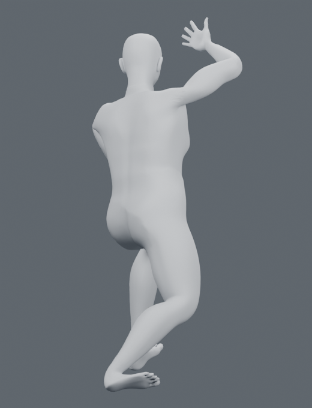
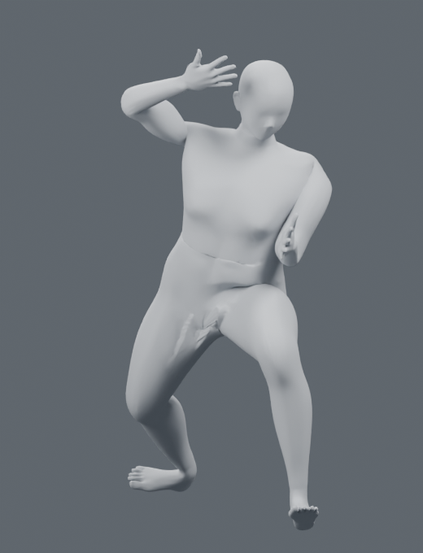

# 개인 FBX·CS3C 통합·안전 거절 검증 — 2026-11-21

**변형 해결은 미완료이며 출시할 수 없다.** 기존 PR142에 최신 develop을 정상 merge했고, PR159는 최신 develop 충돌을 해결하면서 main의 기존 최종 미리보기 방향 수정도 인수했다. 기본 비활성·Draft·`releaseReady:false`를 유지한다. main/develop 직접 push, PR 병합, 운영/스테이징 배포, 운영 피드·접근코드·운영자 설정 변경은 하지 않았다.

이번에 추가한 것은 심한 변형을 성공한 복구본으로 내보내지 않는 **저장 차단**이다. 원본 리그·웨이트·재질·노멀·손은 변경하지 않는다. 원래 표면 보정이나 부모 전달 실험을 새 해법으로 재명명하지 않았다. 안전 거절을 변형 해결로 세지 않는다.

## 통합과 소유 경계

- 시작 head: server `07606435932c94b22b6e7883931c5537bd8e833e`, client `c9ad7dfe7b27f2c66e87ee038ccd5a931679a878`.
- 통합 develop: server `2bb4ecbd448d9f91d5a0d2a0d09b959db6ba43b5`, client `8b1708d4c8aab54b213dd21e8370cf488d3e42cf`.
- client는 기존 main 수정 `c0aed5dc`만 cherry-pick했다. 개인 등록 모습의 큰 미리보기, 실제 적용 미리보기, 인물별 선택/저장 binding, 기본형의 공통 FBX·스킨·외곽선·복구 경로를 함께 보존한다. 개인 인물은 서버 interactive operation을 만들지 않는다.
- 공유 retarget·기본 체형 카탈로그·v5p2/v4 모델·generated assets는 직접 수정하지 않았다. `converter/local/*`의 새 차단은 개인 모델에만 적용된다. 공유 변경은 develop merge로 들어온 것이며 다른 채팅의 작업 폴더는 수정하지 않았다.
- dirty 원본 3개 저장소의 변경 patch·관련 원문·해시와 기존 저장본 사본을 이번 전용 `out/personal-body-closeout-20261121`에 보존했다. 새 작업은 `/private/tmp/personal-body-closeout-20261121/{server,client,bff}`의 격리 워크트리다. 오래된 `/tmp` 결과의 부재를 기존 로그만으로 재실행 성공 처리하지 않았다.

## baseline과 새 전달 실험

고정 v11 manifest `2540a161e19fa34ad1d9c38bcc79751d471b938f6de5b0757923e303def5789b`의 **6,606개 exact 파일·해시를 재검증**했다. 기존 남녀·아동 × 앉은/CMU의 source→등록→retarget/LBS→팔 전달→표면 보정→FBX 재로드를 재현했다. QA 비교기는 최종 `root_group_` 별칭을 명시적으로 대응한다. 제품의 별칭·원본 보관 계약은 바꾸지 않았다.

여성 CMU의 같은 엣지는 rest **0.476568mm**, retarget/LBS **104.797mm**, 보정 후 **94.660mm**, 최대 배율 **198.628788**이다. 짧은 분모를 삭제하거나 반올림해 통과시키지 않는다. 이 사례와 이전 HERO의 약21배 어깨 사례는 서로 다른 입력이다.

새 진단은 기존 웨이트를 유지하면서 근위 부모 프레임을 원래 관절 머리 주변으로 ±3° 옮기고, 자손 world matrix를 복원한 뒤 **같은 rigged-rest bake와 기존 표면 보정**을 적용했다. fresh import를 매번 사용했고 모델/성별 특례는 없다.

| 여성 CMU 후보 | 최대 엣지 배율 | 압축 | 접힘 | 판정 |
|---|---:|---:|---:|---|
| 기존 baseline | 198.628788 | 180 | 482 | 품질 미합격 |
| hips X +3° | 198.297826 | 178 | 494 | excessBend·sharp·folded 악화, 기각 |
| hips Y +3° | 198.620240 | 168 | 460 | >2배 엣지 증가, 기각 |
| 나머지 hips 후보 4개 | 전체 수치 JSON 참조 | — | — | 다른 지표 악화, 기각 |
| spine 및 hips/spine 결합 8개 | 관절 머리 오차 1.838–4.863mm | — | — | 0.02mm 관절 보존 기준 실패 |

14개 후보 모두 기각했다. 이미 앞 단계에서 실패했으므로 접촉·CSP·전체 지원 모델 수용에 도달한 후보는 없다. 새 접촉 안전성이나 해결 가능/불가능의 일반 증명을 주장하지 않는다. [전체 지표와 해시](closeout-20261121.json).

아래는 같은 카메라·조명·원래 solid 재질의 Blender Cycles CPU 렌더다. CSP 사진이 아니며 **오른쪽은 기각된 진단 후보**다. 생산 출력으로 채택하지 않았다.

| 기존 여성 CMU | 기각 후보 hips X +3° |
|---|---|
|  |  |
|  |  |

이전에 HERO에 사용한 임시 등록본/연구 배열은 현재 삭제돼 동일 baseline 계보를 재구성하지 못했다. 현재 남아 있는 배포 원본 `HERO-000-2.original.fbx`는 v11의 기존 입력 계약에서 `UNSUPPORTED_RIG`로 거절된다. 이것을 이전의 21배/9.71배/16.014배 사례와 동일한 입력으로 취급하지 않으며 임의 리그 지원으로 확장하지 않는다.

## 새 최종 패키지와 저장 차단

`personal-converter/12`, contract revision **7**이다. 새 manifest는 **`4929a7ab3200a96533a674361669ab278da108c46663d9b9b9f26d8257b1c852`**, darwin-arm64, **6,616개 exact 파일**이다. v11/v10 폴더를 덮어쓰지 않았다. 기존 오염된 v10을 정상으로 재표시하지 않았고 파일집합/해시/버전/hello/아키텍처·취소·크기·메모리 제한 검사를 유지했다.

`pose_quality.py`는 전체 world-space 표면에서 원래 삼각분할과 현재 표시 삼각분할을 모두 검사한다. 기존 진단의 2배 엣지/삼각형 최대 늘어남, 0.2배 압축, 0.01배 면적 붕괴 경계를 그대로 사용한다. 0 길이 엣지·0 면적 면이 새로 열리거나 유한하지 않은 좌표·검증 예산 초과도 거절한다. 이 값은 보수적인 debug 저장 차단 규칙이며 모든 모델의 조형·접촉·연속성 수용을 인증하는 보편 임계값은 아니다.

보정 직후와 실제 최종 FBX 재로드 후 검사한다. 실패하면 `POSE_QUALITY_REJECTED`로 끝나며 exportable snapshot을 만들지 않는다. 앱은 이유를 표시하고 다른 포즈 선택으로 안내한다. 기본형으로 바꾸거나 이미 뒤틀린 LBS를 ‘원본 복구’로 표시하지 않는다. 이전 검증 파일과 원본은 그대로 보존한다.

새 엄격한 삼각형 검사에서는 남성 앉은 포즈도 엣지 최대 1.906배와 별개로 삼각형 최대 늘어남 약5.916배가 있어 차단된다. 종전 importer/roundtrip 성공을 새 품질 수용으로 올려 쓰지 않는다. 남녀 중립 대조의 native 저장 성공 또한 심한 포즈 해결이 아니다. 아동은 중립 대조에서도 거절이 남는다. 형식/골격이 등록 가능하다는 사실과 특정 포즈가 저장 가능하다는 사실을 구분한다.

## BFF·실기·앱·CSP의 구분

기존 `GET /v1/pose-candidates/:id/export?format=bvh`를 재사용했다. BFF 소스 수정이나 새 endpoint/PR은 없다. 최신 BFF `4255e88`의 Hono 라우터, 실제 설치 토큰 해시 인증, 실제 PostgreSQL 스키마/SQL(PGlite의 pg rowCount adapter), 확정 선택, source SHA 검사를 실행했다. 저장된 refined artifact는 실제 BFF S3 SDK·SQL 대장을 통해 영속화하고 export가 그 바이트를 읽는지 대조했다.

**외부 추론과 AWS S3는 각각 허용된 기록 BVH와 loopback 파일 object-store 대조 서버**다. persisted refined 대조는 원본과 다른 공백 바이트로 저장 경로를 식별하는 시험이며 새 조형 보정이 아니다. 운영 인증·운영 SQL/S3·실제 fitted camera·새 분석까지 포함하는 운영 E2E 합격은 아니다. CORS도 현재 BFF 코드를 사용했다. 개인 원본·로컬 ID/경로·decoder를 HTTP로 보내지 않는다. 품질 검토에 동의하지 않아 export analytics 행은 0이며, 별도 운영자/접근코드를 만들지 않았다.

v12 debug QA 앱은 별도 identifier/deep-link·QA 전용 Keychain·앱데이터·loopback API, updater endpoints 없음으로 만들었다. 실제 약관/계약 동의는 하지 않고 로컬 BFF가 생성한 가상 설치만 사전 주입했다. 사용자가 QA 서비스의 macOS 접근 안내를 직접 승인한 뒤 **실제 파일 picker로 남성 CS3C·여성 FBX 등록 → 개인 모델 선택 → 최종 BVH → native apply → 최종 미리보기 → Downloads 저장 4건**을 완료했다.

카메라는 identity/35° yaw이며, 포즈는 SHA `24852fcb5222a9a8c4511db527b479bc85f1122238260e0b75adede225d42a8d`의 중립 대조다. 전 채널 0으로 만든 진단 입력이며 앉은/CMU 변형 해결 사례가 아니다. 오프라인 서버에 승인된 기본형 후보 poster가 없어 후보2의 클릭이 이미지 재시도로 끝나는 제한을 확인했다. 제품 코드를 우회하거나 가짜 기본형 이미지를 만들지 않고, 카메라별 **별도 소유 작업**을 실제 SQL에 넣어 첫 확정 후보를 선택했다. 실제 source SHA·설치 인증·확정 선택·내보내기 검사는 그대로 사용했다. 일반 온라인 후보 이미지/선택 흐름 수용은 별도다.

네 FBX는 서로 다른 artifact/snapshot SHA로 앱데이터의 source·pose·camera binding과 정확히 일치한다. 같은 이름 저장 시 앱은 `_v2` 파일을 만들어 앞 파일을 보존했다. 여성 앉은 포즈를 같은 UI로 시도하면 이유를 표시하고 다운로드가 비활성화되며 새 FBX가 만들어지지 않는다. 이 20:46 빌드에는 이후 `23af50fa`의 복구 버튼 분기가 아직 없어 ‘다시 준비’가 표시됐다. 최종 소스를 포함해 같은 runtime으로 재빌드했고 사용자가 같은 QA Keychain 서비스를 재승인한 뒤, 남녀 카드 보존·이름 변경 취소·삭제 취소·실제 picker 취소·앱↔바 전환·품질 거부 안내의 ‘다른 포즈 고르기’와 후보 복귀/개인 선택 유지까지 직접 확인했다. 최종 재빌드에서 여성 identity를 다시 다운로드한 결과는 앞선 CSP 입력과 SHA까지 일치한다. 네 저장본을 이 재빌드에서 나온 결과라고 소급하지 않는다.

**CSP에서 네 실제 앱 저장본을 각각 새 캔버스에 가져와 `.clip` 저장 → 닫기 → 재열기를 모두 완료했다.** 남성 identity 문서는 3D 오브젝트를 오른쪽으로 옮기고 Y축 회전한 뒤 저장했으며 재열기 후 유지됐다. 기본형 검수/기존 사용자 문서는 수정하지 않았고 우리 문서4개만 닫아 이전 활성 문서로 돌려놨다. 화면과 `.clip` SHA를 보존했다. source 한계를 통과한 중립 대조의 호환성 검증이며 심한 포즈의 조형 수용이 아니다. [실제 앱/CSP 화면과 결과](https://github.com/04JUNG/Standin-client/tree/codex/personal-body-local-client-20261028/docs/qa/personal-body-closeout-20261121).

과거 [v11 실제 앱4건/CSP 표시4건](CSP_APP_V11_ACCEPTANCE_20261106.md)의 원본 SHA도 보존했다. 당시의 Save As 라이선스 차단은 과거 관찰이며, 현재는 직접 새 `.clip` 저장/재열기를 확인했으므로 현재 차단으로 기재하지 않는다.

실제 OS는 macOS **26.6.2 arm64**다. Windows/Intel Mac 실제 converter runtime은 실행할 환경이 확인되지 않았다. OS CI·합성 Mach-O/PE 거절·universal 앱 검사는 실제 target 실행을 대신하지 않는다. architecture-specific runtime을 universal로 포장하지 않는다.

내장 Blender와 Python 모두 `codesign --verify --strict`에서 **invalid signature**를 반환했다. 기능 실행/manifest exact 통과와 정식 내장 서명 수용은 별개다. decoder 공개 재배포 검토, Blender corresponding source·완전한 notices 전달과 signed/notarized OS 패키지·일반 온라인 후보 이미지 흐름·live BFF·변형 품질은 출시 전 남은 항목이다. 승인되지 않은 바이너리/decoder를 Git이나 공개 PR에 올리지 않았다.

## 검증과 산출물

검사별 실제 결과·패키지/입출력 SHA·native 구간 시간은 [증거 JSON](closeout-20261121.json)에 있다. source→registered→posed→corrected→exported→reloaded의 수치·실패를 분리했다. 원문/등록 보관본·단계 배열·진단 FBX·원래 앱4파일·새 native 저장본·runtime·QA 앱·로그는 전용 영구 `out/personal-body-closeout-20261121/`에 보관하며 공개 문서에는 수치와 해시만 싣는다.

native 등록/apply(file-ready)/export와 picker UI 시간은 별개다. UI 이벤트 간격에는 CUA 관찰·CSP 전환·대기 시간이 섞이므로 converter 지연으로 인용하지 않는다. 남성 file-ready 관찰 31.894초, 여성 등록 관찰 33.461초는 상한 관찰값이다. 별도 native 실측은 남성 등록19.162/apply9.026/export0.125초, 여성16.928/26.429/0.286초다. 단일/혼합 인물·앱/바 상태·프리셋·스킨/외곽선·stale/cancel 경계의 자동 회귀는 actual native/app/CSP 수용과 따로 기록한다.

최종 구현 head의 GitHub CI도 확인했다. client `07e4b480`은 **1,746 pass / 7 skip**, frontend·macOS/Windows Rust·PR check 통과(Dev/Staging build는 기존 정책상 skip), server `4ced33ef4`는 **5개 check 통과**다. 후속 증거 문서 head의 CI는 PR 상태에서 별도로 확인한다. 두 PR 모두 conflict 없이 mergeable이지만 Draft·REVIEW_REQUIRED/BLOCKED를 유지하며 새 head의 재리뷰가 필요하다.
