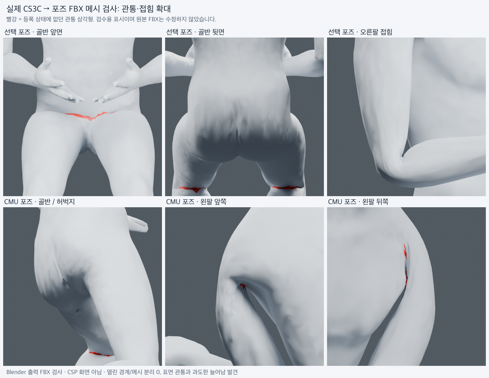

# 실제 CS3C 기반 포즈 FBX 메시 검사 — 2026-11-04

**메시 연결과 스킨 데이터는 보존됐지만, 표면 관통·과도한 늘어남이 있어 변형 품질은 개선이 필요하다.** 이전 [반사광/FBX 보존 검사](SPECULAR_20261104.md)의 성공은 표면 변형 품질 합격을 뜻하지 않는다.

검사 대상은 같은 Standin 남성 0.7.6의 실제 CS3C 네 변형본이다. 각각 등록 FBX와 선택 포즈(앉은 자세), CMU 포즈 출력을 대조했다. 출력 8개 모두 검사했으며, 네 변형본의 같은 포즈 결과는 좌표·삼각형·기준 좌표가 동일하므로 수치 분석은 두 개의 geometry digest로 공유했다. 독립적인 네 인체 모델 테스트로 세지 않는다. 원본 FBX 대조군이나 GLB로 대체하지 않았다.



빨강은 등록 상태에 없던 엄밀한 교차 삼각형 쌍에 속한 면이다. 확대 렌더에만 진단 재질을 추가했으며 출력 FBX를 수정하지 않았다. 화면의 빨간 부분 개수와 아래 삼각형 쌍 개수는 다르다. 이는 Blender 렌더이며 CSP 수용 검사가 아니다.

## 결과

| 항목 | 선택 포즈 | CMU 포즈 |
| --- | ---: | ---: |
| 정점 / 삼각형 | 24,988 / 50,000 | 24,988 / 50,000 |
| 열린 경계 / 비다양체 엣지 / 고립 정점 | 0 / 0 / 0 | 0 / 0 / 0 |
| 연결 성분 | 1 | 1 |
| 면 인덱스·폴리곤·전체 스킨 웨이트 | 등록과 동일 | 등록과 동일 |
| 면적 0에 가까운 삼각형 (≤1e-14m²) | 0 | 0 |
| 기준 면적의 1% 미만으로 압축된 면 | 0 | 1 (약 0.553%) |
| 엣지 길이 최대 배율 | 2.446배 | 8.321배 |
| 길이 2배 초과 엣지 | 76 | 177 |
| 길이 1/5 미만 엣지 | 33 | 35 |
| 등록 상태 엄밀 교차 삼각형 쌍 | 13 | 13 |
| 포즈 출력 엄밀 교차 삼각형 쌍 | 364 | 291 |
| 등록 대비 새 교차 쌍 | 352 | 278 |
| 전체 정점 독립 LBS 재구성 최대 오차 | 2.14e-6m | 7.47e-7m |

삼각형 쌍 수는 결함 부위 수가 아니다. 한 번의 접힘에서 여러 쌍이 나온다. 등록 상태에 있던 교차와 새 교차를 분리했다(선택 포즈는 기존 한 쌍이 해소돼 `364-13`과 새 교차 수가 다르다).

열린 경계나 메시 분리는 없고, 기준 상태에서 1e-7m 안에 겹친 별도 정점 쌍도 없었다. 따라서 중복 정점 seam이 벌어진 사례는 없지만, 이 seam 지표만으로 모든 시각적 찢어짐을 인증하지 않는다. 연결된 면이 안쪽으로 파고들어 틈처럼 보이는 변형은 실제로 있다.

선택 포즈는 골반 앞쪽, 엉덩이와 허벅지 접힘, 팔꿈치 안쪽의 교차가 확인됐다. CMU 포즈는 골반/허벅지와 왼팔·겨드랑이 주변 교차 및 심한 늘어남이 확인됐다. 가장 늘어난 CMU 엣지는 약 **4.75mm → 39.56mm**다. 단순히 매우 작은 분모에서 나온 수치로 취급할 수 없다. 선택 포즈의 최댓값은 **7.27mm → 17.78mm**다. 부위명은 주된 bone weight를 이용한 진단 분류이며 고정된 해부학 라벨은 아니다.

독립 LBS는 등록 정점·모든 원래 influence·등록/출력 뼈의 world rigid frame으로 결과를 재구성한다. 등록 FBX의 0.01 object unit scale과 출력 FBX의 적용된 단위는 별도로 제거하고, 비균일/반사 frame은 이 QA adapter에서 거절한다. 최대 약 **0.0021mm** 오차로 출력과 일치했다. 이는 추가 FBX 저장 손상보다는 **현재 웨이트와 리타게팅된 뼈 포즈가 만드는 스킨 변형**에서 문제를 찾아야 한다는 근거다. 원본 웨이트만의 잘못인지, 포즈 각도/축/관절 제한 문제인지는 이 검사만으로 단독 판정하지 않는다.

## 검사 범위와 재현

`scripts/local_converter/audit_actual_mesh.py`는 실제 FBX를 읽어 폴리곤/웨이트 동일성, 연결 성분·경계·비다양체·고립 정점, 유한 좌표, 면적·엣지 비율, 중복 정점 seam 간격, BVH 후보의 strict transverse triangle crossing을 검사한다. 기준/출력의 동일 face-pair 집합을 비교해 기존 문제를 분리한다. 검출기 self-check는 교차/분리/공유 경계/정점 접촉/반대 winding, 회전·이동과 0.001/1/1000배 스케일, 실제 BVH 쌍을 확인했다. 전체 실행과 self-check 모두 완료했다.

교차 검사는 edge가 상대 삼각형 내부를 엄밀히 통과하는 경우를 센다. 단순 접촉은 관통으로 세지 않는다. **동일 평면 겹침, 완전 포함, 모든 뒤집힌 면의 부재까지 인증하지 않는다.** 독립적으로 인증된 normal transport 기준이 없으므로 world normal의 전후 내적만으로 뒤집힘 판정을 하지 않았다. 2배/1% 등 수치는 진단용 검토 기준이며 승인된 release gate가 아니다. 현재 제품의 보존 gate가 이 표면 품질까지 차단한다고 주장하지 않는다.

재현 명령의 `<Blender>`는 기존 pinned 5.2 패키지 executable이다. `<run>`은 `verify_actual_models.py`가 생성한 실제 4-source/2-pose 실행 폴더다.

```sh
env PYTHONDONTWRITEBYTECODE=1 PYTHONNOUSERSITE=1 PYTHONSAFEPATH=1 \
  <Blender> --background --factory-startup --disable-autoexec \
  --python-use-system-env --threads 2 --python-exit-code 1 \
  --python scripts/local_converter/audit_actual_mesh.py -- \
  --run-dir <run> --output <run>/mesh-audit.json
```

같은 Blender 옵션으로 `render_mesh_audit.py -- --run-dir <run>`을 실행하면 여섯 확대 렌더가 나온다. 원본/출력 hash와 정점·삼각형 witness는 [수치 증거](verification-mesh-20261104.json)에 보관했다. runtime manifest `4a0f060f…dff814`, 파일 6,580개의 hash를 검사 후 확인했고 변경/추가 0개다. 이 작업은 QA 스크립트·기록만 추가했으며 모델 웨이트/제품 리타게팅 solver/운영 환경은 변경하지 않았다.

수정 우선 부위는 골반·허벅지, 팔꿈치·겨드랑이다. 같은 뼈 포즈에서 웨이트 대안과 관절 회전/축 대안을 분리 비교한 뒤, 관통 감소와 중립/기존 포즈 회귀를 확인해야 한다. 현재 결과를 메시 품질 합격으로 분류하지 않는다.
