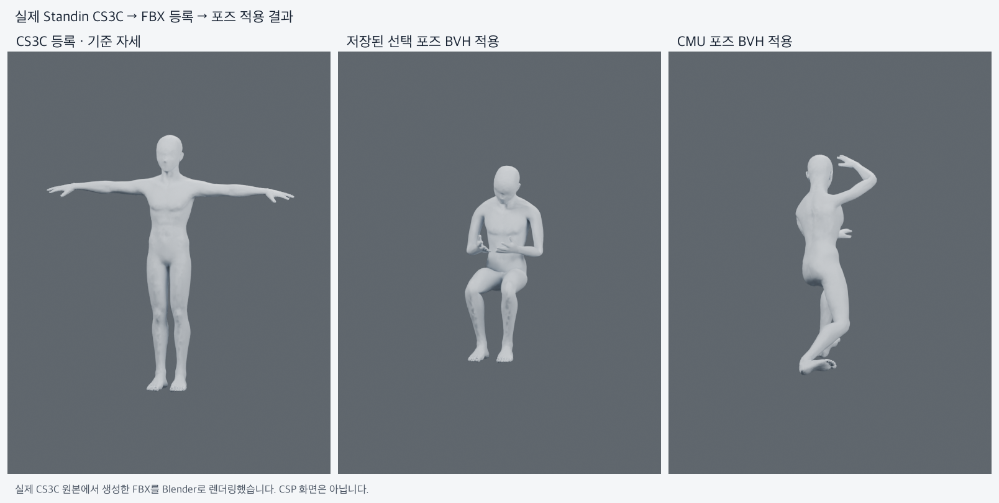

# 실제 Standin CS3C 반사광 보존 및 포즈 적용 — 2026-11-04

이 기록은 [수정 전 실제 CS3C 실패 기록](ACTUAL_STANDIN_CS3C_20261104.md)을 대체한다. 실제 Standin 남성 0.7.6 CS3C 네 파일을 원본으로 등록하고, 각각 두 BVH를 적용해 **8개의 CS3C 기반 포즈 FBX**를 출력했다. 원래 FBX 대조군으로 대체하지 않았다. 네 파일은 같은 인체의 매핑/포즈 저장 변형본이며 서로 독립적인 네 모델의 호환성 검증은 아니다.

이미지는 출력 FBX의 Blender 렌더다. 모델/재질을 검수용 색으로 교체하지 않았다. CSP 화면 또는 CSP 가져오기 성공 증거로 사용하지 않는다.

## 수정

원본 diffuse RGB는 약 `(0.48, 0.53, 0.59)`, specular RGB는 `(0.12, 0.1325, 0.1475)`다. Blender 5.2의 pinned FBX exporter는 `SpecularColor=BaseColor`, `SpecularFactor=SpecularIORLevel/2`로 기록한다. 이 모델은 `SpecularRGB=DiffuseRGB×0.25`이므로 IOR Level **0.5**로 정확히 표현할 수 있다. 기존의 무광 전용 거절과 IOR 0 고정을 제거하고, 표현 가능한 반사광을 해당 파라미터로 보존한다. shininess는 pinned exporter와 상호 대응하는 roughness로 변환한다.

지원 범위는 **불투명·비발광·무텍스처 solid 재질 중 `SpecularRGB=DiffuseRGB×k`, `0≤k≤0.5`인 경우**다. 표현할 수 없는 반사 색상/강도는 평균·clamp로 조용히 바꾸지 않고 명시적으로 거절한다. 임의 metallic/layered/transparent/emissive/texture 재질이나 CSP 조명 픽셀 일치를 인증하지 않는다.

등록 FBX뿐 아니라 매 포즈 출력의 raw FBX `DiffuseColor/Factor`, `SpecularColor/Factor`, `Shininess`, `Opacity`를 원본 기대값과 대조한다. 원본 기대값은 등록 manifest에 남겨 다음 pose job에도 전달하므로 재임포트 뒤 값이 달라져도 검증을 통과하지 못한다. 이 검사는 기존의 메시/뼈/재질 영역 및 skin-probe roundtrip gate에 추가된다.

재질 검사를 통과한 뒤 발견된 hardcoded skin probe 이름도 수정했다. 이전 샘플의 `LeftLowerArm` 등에 고정하지 않고 기존 canonical role → 알려진 rig profile 매핑을 사용한다. 실제 Mixamo의 `mixamorig:LeftForeArm` 등과 기존 CS3C humanoid 모두 같은 다섯 관절을 검사한다. 원본 행렬·inverse bind·원래 weight를 사용하는 독립 FK 검증을 유지했고 solver/기본 서버 bone map은 수정하지 않았다.

## 실제 파일 결과

| 원본 CS3C | 등록 | 선택 포즈 / CMU 포즈 |
| --- | --- | --- |
| standin-male-0.7.6-mapped-review.cs3c | 성공 | 2개 성공 |
| standin-male-0.7.6-arm-raised-review.cs3c | 성공 | 2개 성공 |
| standin-male-0.7.6-recorded-and-applied-review.cs3c | 성공 | 2개 성공 |
| standin-male-0.7.6-recorded-pose-review.cs3c | 성공 | 2개 성공 |

- 원본 각각 **53 hierarchy nodes, 24,988 vertices, 1 mesh, 1 material**. 원본 파일 SHA 불변. source FK vs Blender 최대 vertex 오차 `5.67e-7`.
- 등록 FBX4 + 포즈 FBX8 = **12개 실제 파일**의 raw material을 별도 QA 코드로 대조했다. 이 코드는 제품 material mapping/comparison helper를 호출하지 않는다.
- 출력 specular effective RGB는 원본 `(0.1199999973, 0.1324999928, 0.1474999934)`와 일치하며 **반사광 오차 0**이다. raw `SpecularColor`는 diffuse와 같고 `SpecularFactor=0.25`다. diffuse/opacity 오차도 0, shininess 최대 오차 `2.29e-7` (gate `1e-5`).
- 8개 pose FBX를 재임포트해 등록 FBX의 skin weight가 정확히 같고 등록 뼈가 남아 있음을 확인했다. 메시 최대 변화 약 `0.99m/1.07m`, 관절 최대 변화 약 `1.03m/1.09m`로 두 포즈가 실제 반영됐음을 검사했다.
- 첫 번째 실제 파일 실행의 같은-host 등록은 약 `5.54–6.16초`, pose apply+검증은 `2.52–2.93초`였다. 별도 native adapter 실측은 최초 시작 `6.18초`, 등록 `5.58초`, pose `2.52초`, cache 재사용 `34ms`다. 최종 패키지를 앱/Rust 동시 빌드 중 확인한 실행에서는 최초 시작 `34.53초`, 등록 `8.06–10.84초`, pose `3.68–5.08초`였다. 부하와 파일 cache 상태에 따라 지연이 커지므로 6초/2.5초를 SLA로 주장하지 않는다. host 재사용은 반복 시작 비용을 제거하지만 최초 시작 지연 자체를 해결하지는 않는다. 최종 pinned package의 native 집중 재검증은 시작 `9.94초`, 등록 `8.44초`, pose `3.69초`, cache `51.54ms`로 통과했다. network/UI/final user-folder write는 제외한다.

## 계약·회귀·패키지

Envelope는 `standin.local-converter/1`, storage/camera는 기존 `/1`이며 계약 revision은 **5**다. `hello.materialContractVersion=personal-solid-specular/1`. importer `/3`, normalization/converter `/5`, rig `/2`다. `validation.materialPreservation`에 raw-parameter 보존 검증을 기록한다. client native handshake와 일반 package gate가 이전 material contract를 거절한다. 기존 캐시는 버전/fingerprint guard에 따라 재등록해야 한다.

- local unit **17**, decoder **6**, 실제 Blender **5** 통과. 반사광을 0으로 만든 export를 거절하는 negative regression 포함.
- 실제 native personal-body 검사 **10** 통과. 실제 인체 CS3C/FBX, decoder 포함/미포함, 취소/재시작/host reuse 검사 포함. stale material-contract host 거절 집중 검사도 통과.
- frontend **1,302 통과/1 skip**, typecheck/lint(기존 warning1/error0), clippy, 일반 runtime packaging gate 통과. 기존 무광 CS3C 샘플의 등록/apply/export/cache/cancel/EOF/restart 회귀도 통과.
- 일반 build entry로 별도 macOS arm64 debug `.app` 빌드 및 포함 runtime hash 검증. [정확한 pin·독립 검사](verification-specular-20261104.json), [원본별 실행 기록](verification-specular-actual-models-20261104.json).
- 등록 GLB exporter에는 일부 정점의 4개 초과 influence 생략 경고가 있다. GLB는 등록 preview만이며 source/posed FBX 보존 증거로 사용하지 않았다. 위 skin/geometry 검사는 실제 FBX와 Blender에 근거한다.

재현: `scripts/local_converter/verify_actual_models.py`에 pinned `--launcher`, 반복 `--source`/`--pose`, 새 `--output`을 전달한다. Blender의 `verify_actual_specular.py -- --runtime <package> --run-dir <output> --source <original> ... --render`로 독립 raw 재질/geometry 검사 및 렌더를 실행한다. `--python-use-system-env`와 `PYTHONDONTWRITEBYTECODE=1 PYTHONNOUSERSITE=1 PYTHONSAFEPATH=1`을 유지하고 완료 후 package manifest를 다시 검증한다. raw originals/decoder/runtime/FBX/local transcript는 Git에 넣지 않는다.

이 작업은 `.clip` writer나 CSP import acceptance를 구현하지 않는다. live BFF 연속 E2E, CSP 수용(기존 종료 원인 포함), 다른 OS 및 서명/재배포 release gate는 여전히 별도다. UI/기록 동의 기본값, frozen solver, 운영 환경은 변경하지 않았다. merge·배포·유료 추론은 수행하지 않았다.
