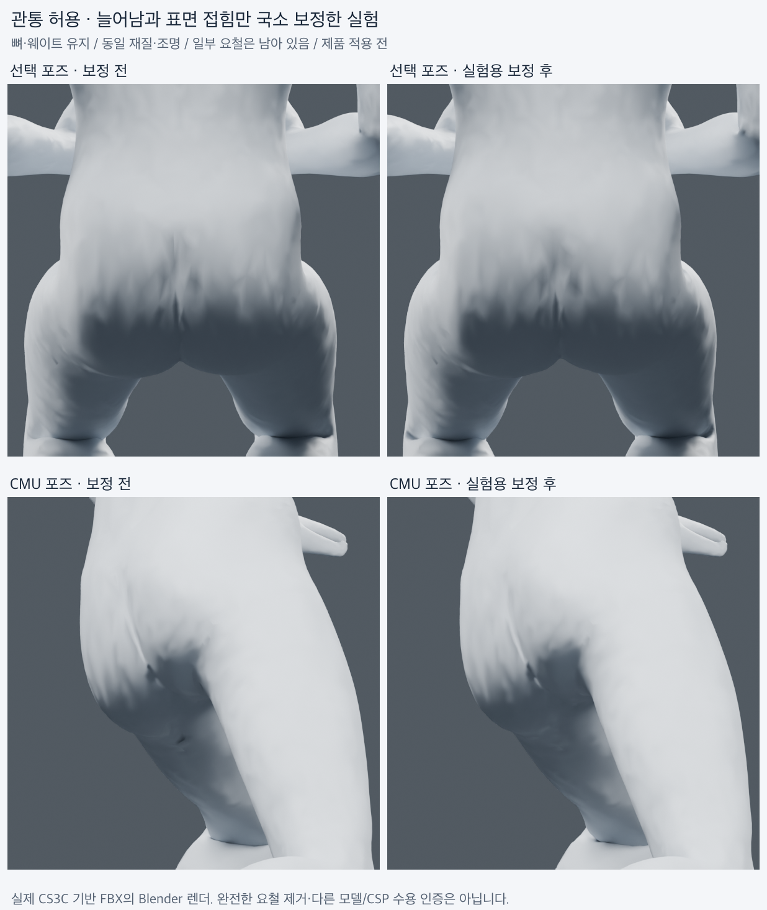

# 관통을 우선 교정 대상에서 제외한 국소 표면 보정 실험 — 2026-11-04

사용자는 일정 수준의 관통을 허용하고, 포즈 적용 때 생기는 찢어진 듯한 늘어남·접힘·울퉁불퉁한 표면에 보정 목표를 좁혔다. 이 실험은 **관통 수를 최적화/차단 조건에 넣지 않고**, 뼈·웨이트를 유지하며 정점 표면만 국소 조정한다. 극단적 관통까지 무조건 허용하는 제품 정책이나 허용 임계값을 정한 것은 아니다.

**두 실제 포즈에서 과도한 엣지 늘어남/압축을 줄였고, 날카로운 접힘 지표도 개선했다. 다만 둔부의 완만한 요철은 육안으로 충분히 개선되지 않았다. 완성된 표면 보정이나 제품 적용 완료로 분류하지 않는다.**

왼쪽은 원래 포즈 출력, 오른쪽은 실험용 표면 보정 출력이다. 검수 색이나 다른 모델로 바꾸지 않았다. Blender 렌더이며 CSP 화면이 아니다.

## 방법과 대상

같은 Standin 남성 0.7.6의 CS3C 기반 출력 중 두 고유 포즈(선택 포즈/CMU)를 사용했다. 이전 네 CS3C 변형본의 결과는 같은 geometry digest를 공유하지만 이번에는 대표 출력 **2개만** 보정했다. 다른 인체 모델 일반화 또는 새 native-picker E2E 검증이 아니다.

[ARAP 원 논문/저자 프로젝트](https://igl.ethz.ch/projects/ARAP/)의 국소 회전/형태 보존 아이디어를 참고한 균일 엣지 제약, differential-detail 후보, 양/음 Laplacian 평활화, 엣지 길이 제한을 비교했다. 후보가 원 논문의 완전한 solver 구현이라고 주장하지 않는다. 포즈마다 **12개, 총 24개** 후보를 비교했고, 최종 선택은 다음 조합이다.

1. 등록 모델의 중립 표면을 기준으로 심한 늘어남·압축·새로 생긴 날카로운 접힘 주변을 찾는다.
2. 국소 형태 보존 후보(ARAP-inspired, tether 0.04)를 초기값으로 사용한다.
3. 같은 국소 영역에 양/음 평활화 5회를 적용하고, 기준 엣지 길이의 0.25–1.9배를 목표로 반복 투영한다. 유한 반복/고정 경계 때문에 목표 밴드의 정확한 만족을 보장하지 않고 실제 결과를 다시 측정한다.
4. 정점 이동을 원래 포즈 표면에서 최대 20mm로 제한한다. 지원 영역 밖과 머리/목/손/발 계열 정점은 고정한다. 이 분류와 20mm는 현재 fixture용이며 임의 크기/리그의 제품 기본값이 아니다.
5. 최대/99분위 엣지 배율, 2배 초과/1/5 미만 엣지 수, 면적 1% 미만 면, 60/90/120도 새 접힘 지표와 퇴화 면이 악화되지 않는 후보만 남긴다. 관통 수는 이 선택에 사용하지 않는다.

단독 평활화는 접힘 지표를 줄이면서 새로운 늘어남을 만들었고, 단독 형태 보존은 늘어남을 줄이면서 접힘을 늘렸다. 이들 후보는 기록에 남기고 선택에서 제외했다. 더 강한 조합(10회)은 99분위 늘어남을 악화시켜 제외했다. 기준을 낮춰 통과시킨 것이 아니다.

## 실제 내보낸 FBX 결과

| 항목 | 선택 포즈: 전 → 후 | CMU: 전 → 후 |
| --- | ---: | ---: |
| 최대 엣지 배율 | 2.446 → **1.914** | 8.321 → **1.998** |
| 99분위 엣지 배율 | 1.477 → 1.446 | 1.575 → 1.564 |
| 2배 초과 엣지 | 76 → **0** | 177 → **0** |
| 1/5 미만으로 압축된 엣지 | 33 → **0** | 35 → **0** |
| 기준 면적 1% 미만 면 | 0 → 0 | 1 → **0** |
| 새 60도 초과 접힘 지표 | 176 → **129** | 199 → **128** |
| 새 90도 초과 접힘 지표 | 82 → 33 | 101 → 46 |
| 새 120도 초과 접힘 지표 | 47 → 14 | 48 → 23 |
| 최대 정점 보정량 | 16.66mm | 20.00mm |
| 전체 정점 보정량 95분위 | 2.54mm | 3.58mm |

접힘 지표는 중립에서 인접 삼각형 각도가 30도 미만이던 엣지가 해당 각도를 넘은 수다. 시각적 결함 부위 개수나 사용자 체감 품질 점수가 아니다. 남은 접힘/요철을 0이라고 해석하지 않는다. 정점 24,988개/삼각형 50,000개와 인덱스, 전체 원래 스킨 웨이트를 유지했고 뼈 포즈를 바꾸지 않았다. 메시 정점 자체는 위 범위만큼 이동하므로 표면 윤곽까지 완전히 같다고 주장하지 않는다.

수치는 실제로 내보낸 FBX를 재임포트한 결과다. corrected surface와 재임포트 표면의 최대 차이는 선택 3.39e-7m / CMU 3.02e-7m, 뼈 머리 차이는 4.77e-7m / 6.26e-7m다. 기존 raw 재질 보존, 본 계층/위치, 표면 roundtrip, 다섯 관절 skin-probe 검사를 두 실험 출력 모두 통과했다. 선택 후보의 계산은 ARAP 초기값 약 3.7–3.9초와 후속 약 0.4초를 함께 필요로 한다. 후속 0.4초만 전체 지연으로 광고하면 안 된다. Blender 시작/입출력/검증은 별도다.

## 법선만 바꾼 대조군

원래 포즈의 정점·웨이트·뼈는 그대로 두고 문제 영역 주변 corner normal만 기하에서 재계산한 FBX도 두 개 만들었다. 좌표 roundtrip/스킨/재질 보존 검사를 통과했다. 기존 법선과 기하 법선 편차는 최대 약 0.05도 수준이고 20도 초과 corner는 0개다(부동소수점/normal encoding 오차 포함). 법선만 바꾸는 대조군은 큰 개선 근거가 없었다. 따라서 남은 눈에 띄는 울퉁불퉁함을 법선 오류로 돌리지 않는다. 선택 표면 보정 출력도 적용 영역의 법선을 갱신했지만 이것이 개선의 주원인이라고 주장하지 않는다.

## 검증·한계·재현

- 실제 두 포즈 × 12후보, 최종 표면 FBX2, 법선 대조군 FBX2를 확인했다. 원래 입력/포즈 FBX8은 hash 불변이다.
- rigid 변형된 reference가 변하지 않는 기준 사례, 고정 경계/단일 요철/이동 상한, 길이 3인 엣지의 상한 투영 기준 사례를 검사했다. 같은 뼈/웨이트·고정 정점과 실제 export 결과도 확인했다.
- pinned runtime manifest `4a0f060f…dff814`, 6,580파일의 hash를 확인했고 변경/추가 0이다. frozen solver, 원본 모델/웨이트, 제품 runtime/계약/UI는 수정하지 않았다. 앱에는 아직 연결되지 않았다.
- 이 모델은 원래 열린 경계/메시 분리가 없었다. 이 실험은 새로운 면을 생성하거나 구멍을 메우지 않는다. 원본부터 면이 유실된 모델, 열린/비다양체/매우 얇은 메시, 다른 크기/리그, 의도한 세부 조형 보존은 별도 검증이 필요하다.
- 60도 접힘 감소가 모든 요철 개선을 보장하지 않는다. 확대 화면에 남은 완만한 요철을 다루려면 추가 검출/보정과 윤곽·디테일 보존 검수가 필요하다. 결과는 출력 포즈에 구운 표면 보정이며 CSP에서 다른 포즈로 재편집한 품질을 인증하지 않는다. coplanar/containment/모든 뒤집힌 면의 완전 검사나 CSP import acceptance도 아니다.

[실험 코드](../../scripts/local_converter/experiment_surface_only.py), [동일 조건 렌더](../../scripts/local_converter/render_surface_only.py), [전체 수치·hash·실패 후보](verification-surface-only-20261104.json).

기존 pinned Blender의 `PYTHONDONTWRITEBYTECODE=1 PYTHONNOUSERSITE=1 PYTHONSAFEPATH=1`, `--background --factory-startup --disable-autoexec --python-use-system-env --threads 2 --python-exit-code 1` 옵션을 유지한다. `--python scripts/local_converter/experiment_surface_only.py -- --runtime <package> --run-dir <actual-final>`로 실험을 재현한다. 이후 같은 옵션의 `render_surface_only.py -- --run-dir <actual-final>`이 before/normal-only/after 이미지를 만든다. 원본/decoder/runtime/FBX/local log는 Git에 올리지 않는다. 이 단계에서 merge·배포·운영 접근·유료 추론을 수행하지 않았다.
