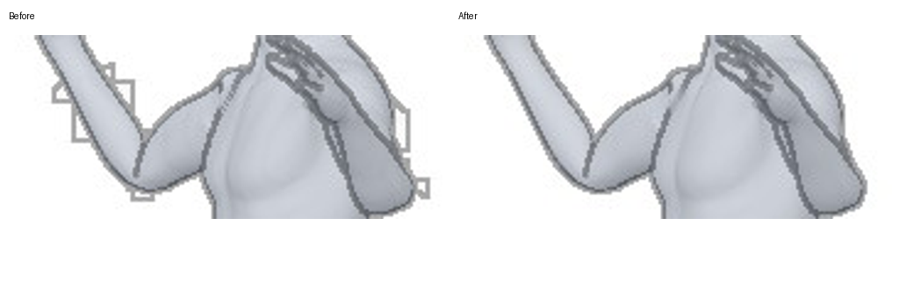

# Staging poster correction: sd_athletics_08

The exact served `full / native yaw_045` frozen raster contains rectangular
lines outside both arms. The original front-only response does not show the
same view, so it is insufficient for this investigation. The client card adds
`scope=full&variant=rough-yaw8-v1`; the server selects native `yaw_045`.



The correction uses the exact source BVH SHA
`1e7e12cb28f10f0505365afb371fecfd15718ef20b8fc287b8d040d127180dd1`,
approved `standin-master-v2` character SHA
`7c648b97a24a3bb4914b6e5d515708c33727979881d92ef916d5726e22301f3d`,
all 30 source finger channels through the production offline adapter, and the
same native 45-degree orthographic full-body view. The regenerated image has
no external rectangular lines. Neither BVH nor character nor live search data
is changed. The historical source GLB/GPU that introduced the rectangles is
still unidentified; this correction does not claim to establish that cause.

## Small immutable patch

`src/thumbnail_patch.py` validates an additional patch after the complete
reviewed overlay is installed. It binds the exact base library URI, library
version, base asset version, pose, source BVH, character, old renderer revision,
source finger-channel application, recipe digest, explicit image key, and old
and new JPEG digests. A mismatch fails startup/read rather than mixing assets.
Only the declared image key is replaced. All other keys retain the complete
original overlay validation. The original library/overlay files stay intact.

The installer accepts only the pinned staging library URI ending in
`lib-20261105-c7817702-32e4eb027242.tar.gz` and patch URIs under the staging
bucket's `pose-library/thumbnail-patches/` prefix. Production library/bucket
configuration is rejected before downloading. Both settings below must be
present; with neither set the feature does nothing:

```
POSE_THUMBNAIL_PATCH_URI=s3://<pinned-staging-bucket>/pose-library/thumbnail-patches/<immutable-pack>.tar.gz
POSE_THUMBNAIL_PATCH_SHA256=<complete archive SHA256>
```

Use a fresh staging task after the code is reviewed and merged. There is no
runtime installation endpoint. Rollback is a fresh task without those settings.
Do not deploy this correction to production or replace the multi-GB library.

## Offline reproduction

Install NumPy/Pillow/ModernGL in an isolated environment and provide Blender.
No external model calls, uploads or server changes occur during this command:

```sh
python scripts/build_staging_poster_patch.py \
  --bvh <verified-source.bvh> --character <approved-standin-master-v2.fbx> \
  --headers <exact-card-response-headers.json> --pose sd_athletics_08 \
  --output <new-output-directory>
```

The builder checks source/character hashes and camera identity, applies the
source finger channels, writes an inspected PNG and a one-image archive with
recipe hashes. The observed old JPEG digest is
`f89c4b40ef79d94f4fac966c35b5ccae634dd00e02221e697b2b2e71eed6945a`.
The prepared correction JPEG digest is
`b488ffcb652713ad032ac32cfe029dfe43cf98722bdd65667ec3df4516b7b3c8`.
The prepared archive is 15,164 bytes, SHA256
`353721eaf0a3d6bb6a7509b79f1f47001fbd9596ec34d3cefca49ac3c02f0c0e`.
Blender 5.2 and Apple M5 Pro OpenGL generated this reviewed sample. Archive byte
hashes can differ on reruns because tar/gzip metadata contains timestamps;
use the emitted digest, never reuse an earlier archive digest.

## Validation

Targeted posterior/overlay/patch suite: 143 passed. Tests cover old/new digest
checks, source/character/library/renderer/finger mismatches, unlisted-key
preservation, unchanged complete base manifest, path traversal, immutable
installation, and production/wrong-prefix rejection before download.

An independent earlier commit fixes an 8-bit normal/depth attachment creating
subtle false internal contours. Its smooth-plane GPU regression passes. That
precision issue does not explain the larger rectangles shown above; the visible
correction is the explicitly bound regenerated raster.
