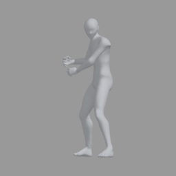

# Local verified-final-FBX pilot (2026-11-11)

Server base: `5868bee279c89bd47ffbe2e79cfe23b8287760e7`.
BFF base: `541ed219e5b3df7e059aa8c4b9847b2923842a28`.
This is the historical manual pilot for the original recorded policy. The PR
now includes develop 5999fe397 and automatic default-model preparation; see
[the newer automatic report](../automatic-default-fbx-20261111/README.md).
Those changes correctly invalidate the old policy keys.

Both were fetched again before that pilot PR preparation. No deployment or shared-S3 write
was performed. The old dirty server checkout was not changed or copied.

## Actual catalog and population

The read-only active staging library was `lib-20261110-da2ead1e`: **3,503 pose IDs,
3,501 distinct BVH hashes**. The current approved anatomy release manifest is
`f590cdb9f4ed0a78fb331bdde90c715c526c1314ce03d046432ac8eeaf3bf973`.

| Default | Final neutral asset SHA-256 | Height cm | Heads | Rules |
|---|---|---:|---:|---|
| male-base-v0-8-0 | 705035f1bd247b3bf63a6d293065a5a39390b2d228df559474f9dc6682bf8c43 | 168.684899 | 7.943109 | standin-body-0.8.0 |
| female-base-v0-4-0 | ffd7b57d6ebba06299be252976b511afe5684a237e6f7d440bb90b2ba20f0c33 | 169.893087 | 8.000001 | standin-female-body-0.4.0 |

head_scale=1; all actual defaults and source hashes are retained in summary.json.
No body preset or client selection UI was changed.

The primary semantic text-search batch uses its actual fixed front-reference
identity camera baked into the final FBX, shape=null, original source hands and
full scope: **7,006 pose/model combinations, 7,002 distinct artifact keys**.
The primary pilot prepared **6**, failed **0**, and left **7,000 ungenerated**.
The sample poses are `2hand Idle_01`, `Asking Question_01`, and
`MH__anrico_sitting02`, each with both defaults. This is not full-library readiness.

There are **27 valid local FBXs for that recorded policy (207,264,260 bytes)** total: the
six primary samples, the same six without a baked camera, six explicit-default
numeric shapes in each camera form, and three extra edits (height +1cm, left-hand
relaxed, head scope). Earlier development-policy artifacts are excluded. Every
registered file has a final-byte checksum and validation metadata. The complete
7,006-row primary ready/unmade list is local at
`out/verified-fbx/full-coverage-inventory.json`; the full source/hash/default plan
and immutable plan copies are under `out/verified-fbx/cache/plan*.json`.

## Measured preparation, preview and download

The committed BFF probe ran against the committed localhost Converter probe with
`--forbid-conversion`: any runtime `_convert_one` call would append the counter
and fail the HTTP request. **12 real HTTP prepares** (six primary assets × two
independent job IDs/BFF route instances) all succeeded with **0 Converter Blender
conversions**. Repeat prepares and downloads caused no additional Converter
HTTP conversion request. Each new job received a different review key and the
same FBX SHA; another job's key, another owner and a quarantined source were
rejected. Job/ownership/confirmation persistence is fixture-backed; the semantic
presentation, body selection, BFF routes/client, HTTP protocol, hashes, actual
FBX/PNG and final artifact checks are real. Production database/auth deployment
is not claimed by this local probe.

| Stage | Local elapsed time |
|---|---:|
| Offline cold sample generation, across exact combinations | 11.013–21.449 seconds |
| First preparation of an already generated semantic FBX, new job | **177–239 ms** |
| Repeated prepare in that job, process memory warm | 0.22–0.57 ms |
| Exact final FBX download, in-process BFF response consumption | 60–83 ms |
| Separate actual PNG render from persisted final FBX | 1.437 seconds |

These are local macOS/Blender 5.2.0 measurements, not Internet download latency.
The 61.890-second staging example (58.010-second Converter computation) is the
same artifact-preparation contract but a different pose/environment. Do not
claim a measured staging speedup or mix an offline cache hit with runtime first
generation. Foot-plant's 25.02 seconds is nested in 29.112 seconds, not additive.

The initial upper planning estimate is 120.5 serial worker hours and 68.4 GiB at
61.9 seconds/10 MiB per pose/model pair. The local pilot mean extrapolates to
30.3 hours/~51.3 GiB for 7,002 distinct semantic keys; this is **not** a production
capacity promise. Explicit controls, other cameras and scopes have separate plans.

## Integrity and negative cases

The real FBXs retain 54 bones and skin binding. Full male/female samples have
139,474/105,430 vertices. Authoring PSD, vertex/joint/weight roundtrip and posed
joint transport evidence is in summary.json. Source-finger poses were transferred
on 30 joints for each of the two finger-equipped poses; the largest endpoint
roundtrip error across tested outputs was 0.000757 mm. The sitting BVH lacks finger
chains and explicitly reports source_unavailable; no arbitrary hand-library pose
was substituted.

Real HTTP variants demonstrate first-generation miss, exact repeat hit and return
to the original default bytes for numeric shape, hand, camera and scope changes.
The wrong expected source hash returns 409. A separately copied local cache was
corrupted: the corrupt bytes were never returned, one safe Blender rebuild took
19.27 seconds, and its retry was a hit with no additional Blender conversion.
Unit/contract tests cover policy changes, malformed/unpinned source registries,
private/refined BVH bypass, revoked cache entries, cancellation, interrupted
publication, process-crash lock release and interprocess coalescing. Existing BFF
regressions exercise body/hand/source/owner/revision changes and late responses.

**Validation limit:** structural reimport and approved anatomical PSD checks are
not a complete body collision/folding certificate. Approved contact QA says
checked=false and the strict topology/expected-normal registry is uncertified.
Every stored manifest explicitly records complete_collision_certificate=false.
No new refinement safety claim, Top5 behavior change or research-file change is
part of this PR.

## Checks and remaining operator work

- Converter non-Blender pytest suite: **764 passed, 1 skipped**. Three Blender-only
  modules are excluded from ordinary Python collection; actual Blender exports,
  reloads, fingers, edits and PNGs are covered by this pilot, not falsely counted
  as those native unit suites.
- Server smoke: **54/54**; compileall and git diff --check passed.
- BFF: typecheck/build passed; **1,082 passed, 2 skipped**, no failures (1,084 total).
  The focused framing/body/receipt tests also passed (93 tests).
- The persistent-cache test file has 21 passing cases, including real processes.

Before any separately authorized deployment: review the validation scope, prepare
all required pose/model/camera/control combinations, choose a private persistent
POSIX volume and quota/lifecycle, use the exact target image/environment, install
and pin library.json, and run the same hit-only contract probe in that environment.
Validate Linux/amd64 behavior before promotion. Library quarantine/owner checks
and job receipt retention must remain enabled. This task did not perform those
operations, production deployment, staging deployment, S3 publication or auto-merge.

Evidence: [summary](summary.json), [semantic contract](semantic-e2e.json),
[nonbaked contract](nonbaked-e2e.json), [variants](variants.json),
[corruption recovery](corruption.json).

