# 리파인 v4 파츠 수정 · 2026-10-29

사용자 피드백으로 작성·복원한 다리 7건과 develop 기반 코드의 실제 저장 검증을
분리해 기록한다. 자연어 입력·파츠 선택은 수동으로 지정했다. 초기 VLM의 상세
설명은 동일 이미지의 보관 응답이며 신규 VLM 자동 진단 성공률을 측정하지 않았다.

## 점수 변화 · 같은 목표로 비교 가능한 다리 6건

기존 v3.2 배점(좌우 팔다리 각10, 몸통20, 머리5, 전체 동작35)을 그대로 사용했다.
바뀐 다리 항목만 AI가 다시 판정하고 비대상 항목은 원판정을 유지했다.
사람의 형상 확인과 사람의 점수 검수는 다르며, **점수는 AI 보조 부분 평가**다.
수동 작성이 포함돼 동결 자동 평가 프로토콜에 부합하는 벤치마크로 주장하지 않는다.

| 사례 | 변경 | 원평가 /100 | 이번 부분 재평가 /100 | 순증 범위 |
|---|---|---:|---:|---:|
| T024 · CB034 | 양다리 뻗기·오른발목 위 | 65 | 85 | +20 |
| T041 · CB026 | 뒤로 깊게 접은 오른다리 확정본 복원 | 75–80 | 85–90 | +10 |
| T042 · CB027 | 왼다리를 옆으로 길게 뻗기 | 55–65 | 65–75 | 0–20 |
| T043 · CB028 | T042와 같은 하체, 지지발 판정 보류 | 55–80 | 55–90 | 0–10 |
| T049 · CB067 | 낮은 골반·바깥으로 넓게 벌린 쪼그림 | 75–80 | 95–100 | +20 |
| T050 · CB074 | 왼다리 앞 교차·왼발 5cm 전진 | 65–70 | 75–80 | +10 |
| **6건 평균** | | **65.00–73.33** | **76.67–86.67** | **+10–15** |

평균 양 끝점 변화는 +11.67/+13.33점이다. 순증 범위는 같은 비대상 부위의
불확실성을 전후 함께 두고, 바뀐 T042·T043 지지발의 불확실성은 독립적으로
계산했다. 중간값으로 점수를 확정하지 않는다. T043은 하체를 통째로 바꾸어
오른다리도 바뀌었으므로 원래 `match`를 자동 계승하지 않고 접지를 보류했다.
95–100의 상한100은 확정 만점이 아니다.

**T022 · CB029는 점수 비교 제외**: 사진 참고와 후속 사용자 지시로 목표를
무릎 위 다리 꼬기로 바꿨다. 원래 러프 기준35–60점에 임의 상승을 붙이지 않는다.
최신 형상 후보는 오른다리 위 관계를 유지하고 왼무릎75.38°→60.00°,
오른발끝 화면 왼쪽 +2.85cm다. 이 추가 후보는 아직 최종 형상 승인을 의미하지 않는다.

[점수·판정 JSON](scores.json), [원판정](baseline-reviews.jsonl),
[부분 재평가](after-reviews.jsonl), [고정 채점 코드](scoring-contract/score_reviews.py).
상반신 /45와 전신 /100은 합산하지 않는다. 다른 팔 배치의 중복 컷도 합산하지 않았다.

## 실제 코드 실행과 저장·불러오기

[native 실행 기록](native-runtime.json)은 이 브랜치의 runner로 새로 실행했다.

* T043: canonical 하체 피부와 다리 rest frame을 함께 교체하고 상체를 보존했다.
* T050: 인물의 실제 앞방향으로 왼발 5cm 전진, 발목 높이 보존.
* T002/T018: 팔 담당 커밋 `d09da4a`의 우산·휴대폰/무릎 위 손 조합을 재실행했다.
* 위 4건 모두 저장 FBX를 다시 열어 관절·피부 정점 오차 0.02mm 이내와 최종
  피부 비회귀/필수 손 접촉 검사를 통과했다.
* T041 거부 시험: 실패 시 과거 초기 자세가 아닌 현재 확정 파일의 SHA를 유지했다.

[native 형상 실패 시험](geometry-negative-tests.json)은 해시·토폴로지·가중치,
잘못된 위아래 관계, 피부 자료 누락·새 관통 거부와 실제 정상 전이를 확인한다.
[트랜잭션 6개 시험](transaction-tests.json)은 보호 부위·손가락 복구, 다리 다음
현재 무릎을 읽는 팔 적용, 필수 최종 검사와 native 조합을 확인한다.
인위적인 5° perturbation은 회귀 시험이며 점수 근거가 아니다.

이 4건의 자동 저장 검증과 아래 7건의 작성 형상 검토는 다른 집계다.
기존 자동 11건 시험은 [이전 결과](previous-automatic-score-summary.json)에 보존했다.
그때의 다리9건 평균62.78–73.89→65.00–76.11/100을 현재 작성본 점수와 섞지 않는다.

## 전후 이미지

왼쪽은 비교 전, 오른쪽은 작성·수정 후다. 각 쌍은 같은 카메라와 배율이다.
T022만 직전 승인본과 추가 후보를 비교한다. 다른 컷은 초기 자세와 작성본을 비교한다.
전체 정면·사선·측면은 [이미지 폴더](images)에 있다.

| 사례 | 전 | 후 |
|---|---|---|
| T022 · 위에서 내려다보기 | 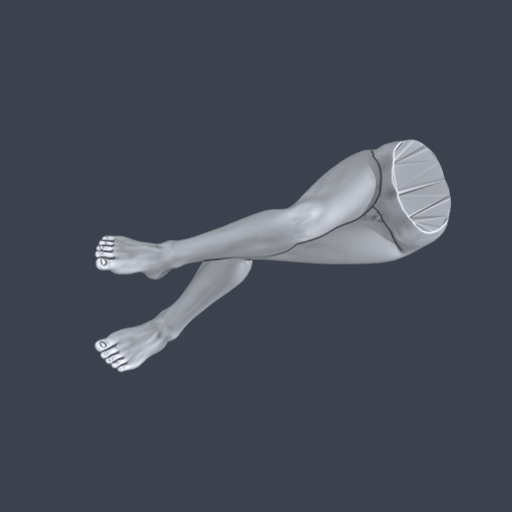 | 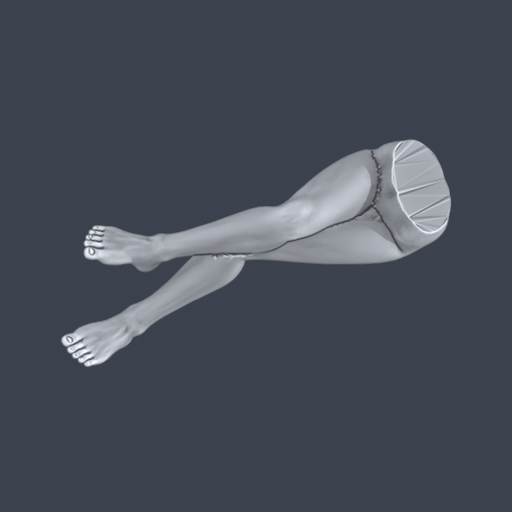 |
| T024 · 오른발목 위 | 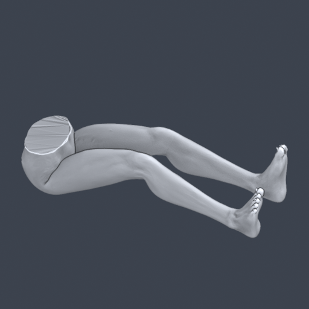 | 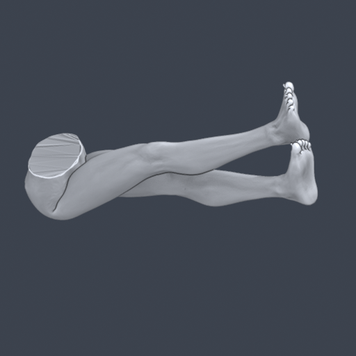 |
| T041 · 오른무릎 깊게 접기 | 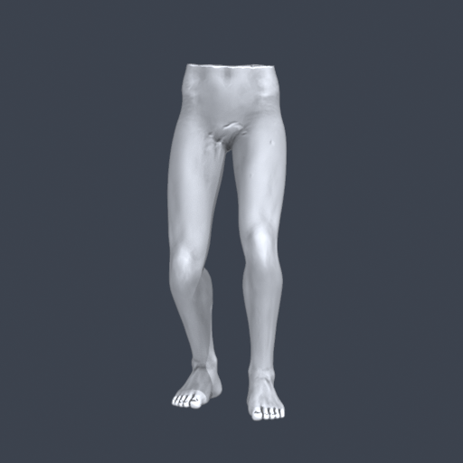 | 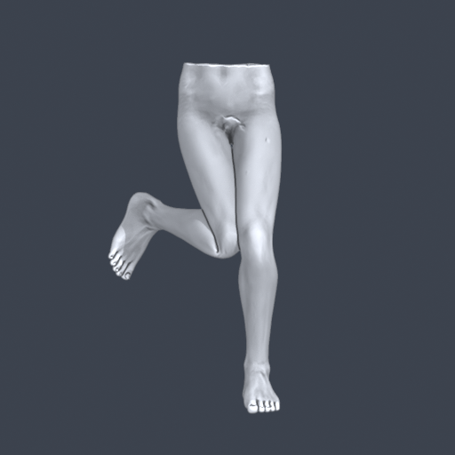 |
| T042 · 옆으로 뻗기 A | 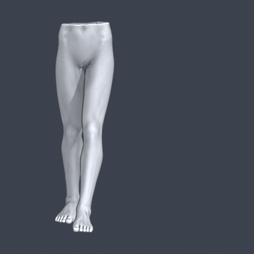 | 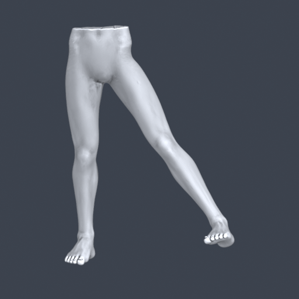 |
| T043 · A와 같은 하체 B | 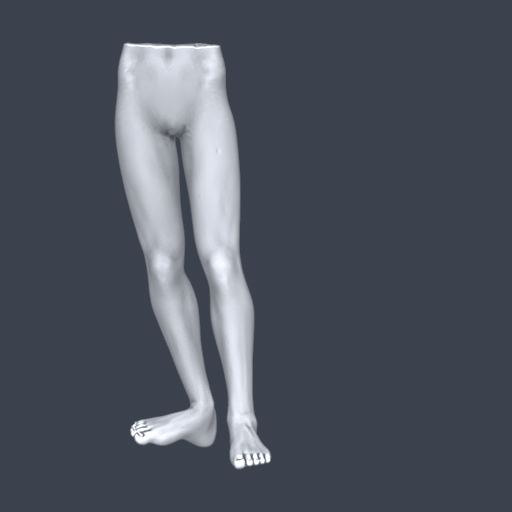 | 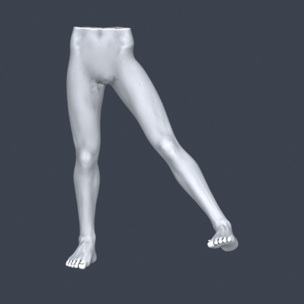 |
| T049 · 넓은 쪼그림 | 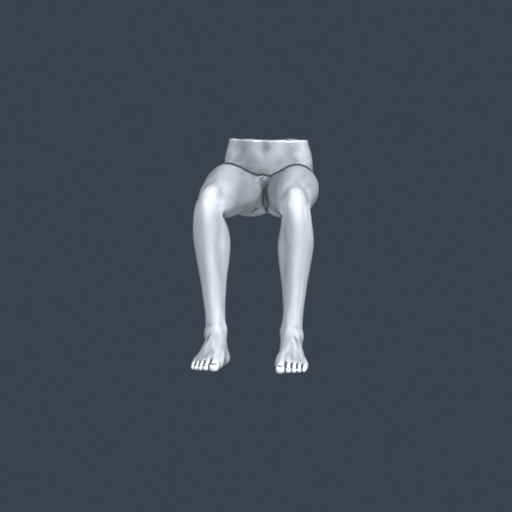 | 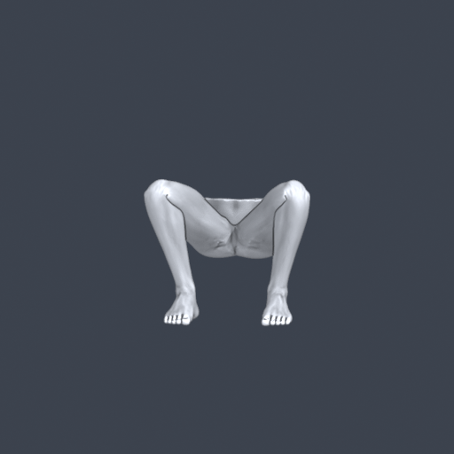 |
| T050 · 왼발 앞으로 | 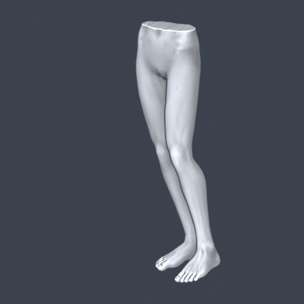 | 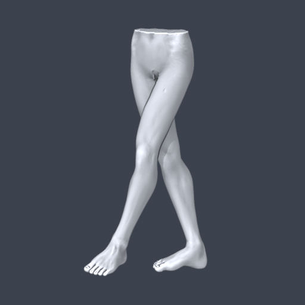 |

## 근거와 남은 한계

* [파츠 카탈로그](part-catalog.json): 초기 VLM 긴 설명·이후 사용자 지시·입력과
  FBX 해시·생성 이미지 해시·피부 triage를 구분했다.
* [저장 형상 독립 측정](saved-geometry-verification.json): T042/T043 하체 정점
  9,669개 일치, T050 5cm 전진 등을 기록했다. T022의 후속 값은 카탈로그에 별도다.
* [팔 소스 경계](arm-source-provenance.json): 팔 담당의 검증된 커밋을 가져왔다.
  그 이후 사용자가 요청한 손목·손가락·허리 밀착 개선은 별도 진행 중이다.
* 전체 피부 검사를 통과했다고 주장하지 않는다. T050 등 기존 작성본의 피부
  경고가 있으며 T022는 welded skin 절단면의 닫힘 실패도 있다. 형상 후보와 자동
  적용을 구분했고, 새 코드의 자동 변경은 검사 자료가 불완전하면 거부한다.
* 실제 체중 지지·지면 반력, 가린 부위의 정답은 측정하지 않았다.
* 러프·참고 사진 원본과 로컬 FBX 모델·가중치는 저장소 정책에 따라 제외했다.
  이 폴더에는 실제 native 출력의 생성 렌더와 수치 근거만 포함한다.
* 동결 baseline369개 파일을 수정하지 않았으며 50장 새 실행 성능으로 해석하지 않는다.

재현 API와 입력 형식: [REFINE_V4_PARTS.md](../../../docs/REFINE_V4_PARTS.md).
